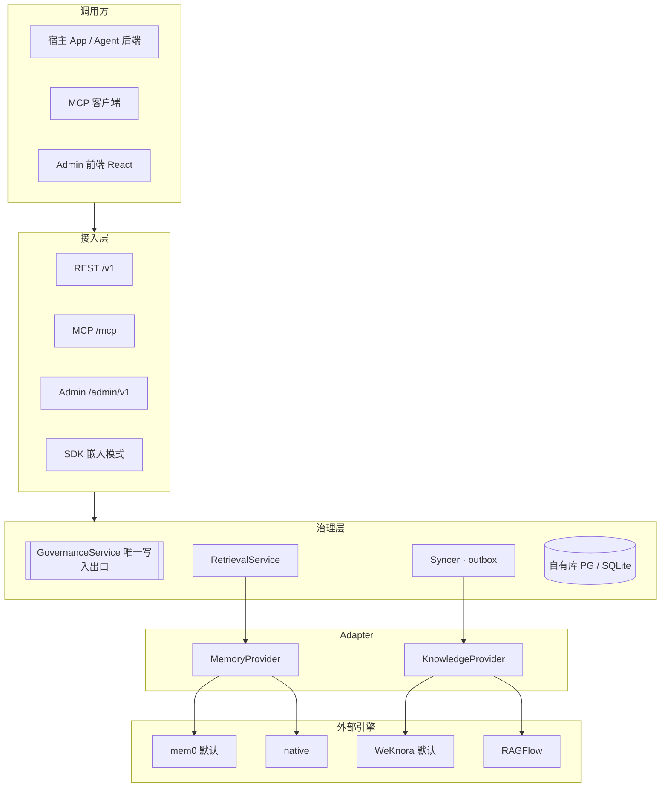
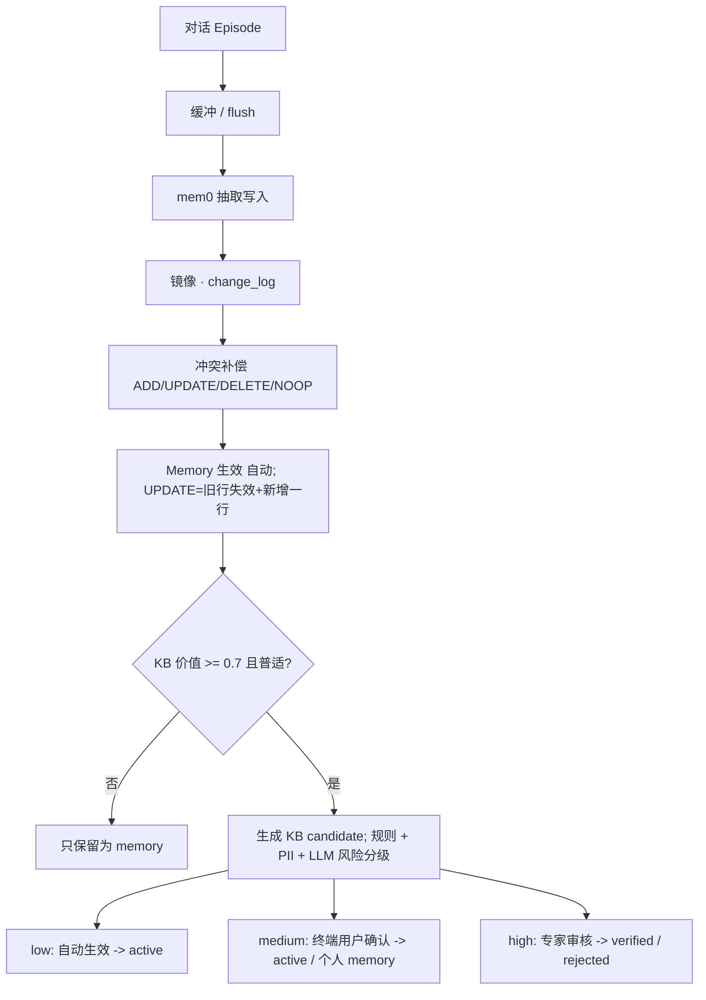

# llm-steward 设计文档：AI 记忆与知识的治理层

Nov 7, 2026 · @Arthur Gao

## 1. 概述

**llm-steward** 是 AI 记忆与知识的治理层：它让 agent 产生的记忆经过筛选、确认和审核，变成可信、可追溯的团队知识。它本身不重新实现 memory 或 RAG 引擎，而是通过 adapter 接入成熟的开源项目——默认 memory 用 **mem0**，默认 KB 用 **WeKnora**，文档复杂时可以换 **RAGFlow**，测试和单机场景用内置的 **native** 实现（SQLite + sqlite-vec）。任何 app 或 agent 都可以通过 REST、Python SDK 或 MCP 接入。仓库包含 `backend/`（FastAPI）和 `frontend/`（Admin）两个目录。

> 命名：steward 取自数据治理里的 data steward（数据管家），也就是负责数据质量、口径和合规的角色。仓库名 `llm-steward`，Python 包 `llm_steward`，CLI `steward`，环境变量前缀 `STEWARD_`。

### 目标

- **治理是核心**：状态机（candidate → active → verified → deprecated）、按风险分级审核、终端用户确认卡片、完整变更历史与出处、Memory → KB 的升级（promote）通道。这些全部由 llm-steward 自己实现，与后端无关。
- **后端可插拔**：通过 `MemoryProvider` 和 `KnowledgeProvider` 两个接口适配不同引擎。治理元数据只存在 llm-steward 自己的库里，外部引擎只负责存储、抽取和检索。更换后端时把生效数据重新同步一遍即可。
- **统一检索**：一次调用同时查 memory 和 KB，在治理层合并、按可信度加权、组装成可以直接放进 prompt 的上下文。返回格式不随后端变化。
- **轻量部署**：llm-steward 与 mem0 共用**一个 PostgreSQL（pgvector）**；WeKnora 需要 ParadeDB（`pg_search`），自带一个 PG 实例和 Redis；native 模式只需要一个 SQLite 文件。
- **多种接入**：REST（OpenAPI）、Python SDK、MCP server、可嵌入的确认卡片组件。

### 非目标（v1 不做）

- 不自研抽取算法、向量检索引擎、文档解析或知识图谱。这些交给 adapter 背后的项目；native 实现只求够用，用于测试和单机场景。
- 不做聊天应用或 agent 框架。llm-steward 只管"记什么、信什么、取什么"。
- 不做 GraphRAG。需要时由 WeKnora 自带的 GraphRAG 或 LightRAG adapter 提供（v2 再考虑）。
- 不做多区域、分布式部署。

### 核心术语

| 术语 | 含义 |
| --- | --- |
| Namespace | 隔离和配置的单位，一般对应一个接入项目。每个 namespace 有独立的 API key、配置，以及选用的 provider |
| Scope | namespace 内部的归属维度：`user_id`、`agent_id`、`session_id`。为空表示该 namespace 下共享 |
| Provider | 后端引擎的 adapter：`MemoryProvider`（mem0 / native）、`KnowledgeProvider`（WeKnora / RAGFlow / native） |
| Memory | 一条原子记忆。内容存在 memory provider 中，llm-steward 保存一份镜像和治理元数据 |
| KB Entry | 一条受治理的原子知识。**llm-steward 是它的真相源**，只有生效的条目才会同步到 KB provider |
| KB Document | 上传的文档。由 KB provider 负责解析和切块，llm-steward 记录其状态和出处 |
| Candidate | 待确认或待审核的写入提议，来自 AI 抽取、promote 或用户的保存建议 |
| External Ref | llm-steward 对象与 provider 内部 id 之间的映射，同时记录同步状态 |
| Retrieval | 一次联合检索，跨 provider 合并后返回排序结果和组装好的上下文 |

## 2. 开源调研与借鉴

没有哪个项目同时做到"Memory + 可治理的 KB + 审核 + SQLite/pgvector 双后端 + Admin"。所以 llm-steward 只做治理层：借鉴各家已经验证过的做法，并直接把其中成熟的项目当作后端使用。

| 项目 | 定位 | 借鉴 | 不采用 |
| --- | --- | --- | --- |
| [mem0](https://github.com/mem0ai/mem0)（Apache-2.0） | 通用 memory 层 | `user_id`/`agent_id`/`run_id` 三维 scope；只存原子事实；语义 + BM25 + 实体并行检索后融合；经典的 ADD/UPDATE/DELETE/NOOP 决策（早期版本）；每条 memory 都有 history | 新版改成"只 ADD"以降低成本。我们保留冲突处理，因为 KB 不能堆积矛盾条目 |
| [Graphiti / Zep](https://github.com/getzep/graphiti)（Apache-2.0） | 时态知识图谱 | **双时间模型**：事实有生效区间，被新事实取代时标记失效而不是删除；**episode 溯源**：每条事实都能追溯到产生它的原始输入 | 需要 Neo4j 等图数据库。v1 用关系表模拟实体关系 |
| Letta（原 MemGPT） | 有状态 agent | **分层 memory**：常驻上下文的 core blocks（如 `human`、`persona`）与按需检索的 archival 存储分开；空闲时后台整理记忆（sleep-time / dreaming） | 是整个 agent 运行时，不是可插拔的服务 |
| [LangMem](https://langchain-ai.github.io/langmem/concepts/conceptual_guide/) | memory SDK | 语义/情景/程序三类记忆；**collection vs profile** 两种形态；**hot path vs background** 两种写入时机；层级 namespace | 与 LangGraph 绑定 |
| [Memobase](https://github.com/memodb-io/memobase)（Apache-2.0） | 用户画像 memory | **可配置的 profile schema**（topic/sub\_topic）；按用户的 **buffer + 批量 flush**（约 1024 token 或空闲 1 小时）；`context` 接口直接返回可以拼进 prompt 的字符串；技术栈是 FastAPI + Postgres | 只管用户画像，没有 KB |
| [Cognee](https://github.com/topoteretes/cognee)（Apache-2.0） | memory + 知识图谱 | remember / recall / improve / forget 四个动词的简洁 API；**improve：把会话知识升级进共享存储**；单个 Postgres 承载全部数据 | 图谱抽取的成本高，v1 不做 |
| [R2R](https://github.com/SciPhi-AI/R2R)（MIT） | RAG 服务 | 多格式文档导入；语义 + 关键词检索后用 **RRF（Reciprocal Rank Fusion）融合**；用 collection 做权限隔离；REST + Python/JS SDK | 没有 memory 写入和治理 |

### 归纳出的 10 条设计原则

1. **只存原子事实，不存整段对话**（mem0）。整段对话另存为 episode，作为出处。
2. **写入时做冲突决策**：ADD / UPDATE / DELETE / NOOP（mem0 早期版本）。这是 KB 不烂掉的关键。
3. **失效而不删除**：用 `valid_from` / `valid_to` 记录生效区间，可以查历史状态（Graphiti）。
4. **每条数据都可溯源**：能对应到 episode、文档或人工操作（Graphiti）。
5. **分两种形态**：profile（每个 key 只有一个当前值，如「城市」）和 collection（可以堆积、按需检索）（LangMem、Memobase）。
6. **两种写入时机**：同步写入（hot path）和后台批量整理（buffer + flush）（LangMem、Memobase）。
7. **常驻与检索分层**：pinned 的少量核心信息每次都带上，其余的按相关性检索（Letta）。
8. **混合检索 + RRF + 可选 rerank**（R2R、mem0、Graphiti）。
9. **提供「直接返回 prompt 上下文」的接口**，调用方一行代码就能用（Memobase）。
10. **动词少而清晰**：remember / recall / promote / forget（Cognee）。MCP server **默认必须带鉴权**——Graphiti 的参考 MCP server 没有鉴权，官方自己也警告不要暴露到不可信网络。

**llm-steward 的差异点**：Memory 与 KB 之间有一个显式的 **promote（升级）** 流程，并内置风险分级审核、用户确认卡片和 Admin——这正是前面讨论的知识治理问题。Letta 的描述基于其公开文档和 MemGPT 论文的通行概念，其新版 Agent SDK 已经改用 git 追踪的 MemFS。

### 大厂的开源和托管方案

| 厂商 | 方案 | 类型 | 现状 | 与 llm-steward 的关系 |
| --- | --- | --- | --- | --- |
| Redis | [agent-memory-server](https://github.com/redis/agent-memory-server)（Apache-2.0） | 开源 memory 服务：会话级 working memory + 长期 memory，提供 REST 和 MCP | 原始版本已移到 `V0/` 作为研究性代码，官方说明不是受支持的生产版本，重心转向 Redis Cloud 托管服务 | **定位最接近**，但绑定 Redis，没有 KB 治理，也不再作为开源产品维护 |
| Microsoft | [Kernel Memory](https://github.com/microsoft/kernel-memory) | .NET 的 RAG/memory 服务 | 已归档，README 说明是研究项目、不提供支持 | 当年最像"通用 KB 服务"，现在已经没人维护 |
| 腾讯 | [WeKnora](https://github.com/Tencent/WeKnora) | 企业级 RAG 知识库：文档解析、混合检索、GraphRAG、Wiki 模式、ReAct agent | 活跃开发中 | 强在文档型 KB；不管 agent memory，也没有 memory→KB 的升级和审核流程；依赖较重（Qdrant/Milvus/ES、Neo4j） |
| 阿里（ModelScope / AgentScope） | [ReMe](https://modelscope.github.io/ReMe)（Apache-2.0，前身是 MemoryScope） | agent memory 框架：个人记忆、任务记忆、工具记忆 | 活跃 | "任务记忆"与我们的 procedural memory 类似；没有 KB 治理和 Admin |
| AWS | Bedrock AgentCore Memory | 托管服务（非开源） | GA | 功能完整但绑定 AWS；Strands Agents SDK 默认用 mem0 作为 memory 提供方 |
| Google | Vertex AI Agent Engine Memory Bank；[ADK MemoryService](https://google.github.io/adk-docs/sessions/memory) | 托管服务 + 开源 SDK 接口 | GA | ADK 只定义了接口，内置实现仅用于原型（关键词匹配）；可以为 ADK 写一个 llm-steward adapter |
| MemTensor（创业公司，非大厂） | [MemOS](https://github.com/MemTensor/MemOS) | "记忆操作系统"，还覆盖 KV cache 和参数记忆 | 活跃 | 偏研究，依赖 Neo4j + Qdrant，部署重 |

### 结论：有没有必要自己做

**单纯的"memory 层"和单纯的"RAG 知识库"都不值得重做**。前者有 mem0（GitHub 约 6.8 万 star）、Letta、Zep/Graphiti、ReMe，后者有 WeKnora、RAGFlow、R2R。如果你只是一个 app 需要记住用户，直接用 mem0 OSS + pgvector，几天就能上线。

**空白在二者之间的那一层**。上面没有一个项目同时具备：

1. Memory 和 KB 在同一个服务里，并有**显式的 promote（memory → KB）流程**；
2. **按风险分级的审核**、终端用户确认卡片、状态机和变更历史；
3. **轻量部署**：从一个 SQLite 文件平滑升级到 pgvector，不需要 Neo4j、Qdrant、Redis；
4. 开箱即用的 Admin。

Redis agent-memory-server 和 Microsoft Kernel Memory 曾经最接近这个定位，但都已经退居研究性代码。这说明大厂更愿意把它做成托管产品，也说明开源的自托管位置确实空着。

**建议：做，但把范围收紧在"治理层"**

- 如果你有 2 个及以上自己的项目要复用，或者审核和溯源是刚需（企业、客服、医疗、金融场景），值得做。
- 不要在抽取算法、知识图谱、文档解析上和大项目拼质量。把它们做成插件接口（第 8 节），默认用简单实现，需要时可以接 mem0 / ReMe 做抽取、接 Docling 做解析。
- 用公开基准（LoCoMo、LongMemEval）跑一次默认抽取和检索，与 mem0 做对照。如果差距很大，就把默认抽取器换成 mem0，只保留治理层。
- 如果只是单个 app、不需要审核：不建议做，直接用 mem0。

### 后端选型结论

**默认组合是 mem0 + WeKnora。** mem0 与 llm-steward 共用一个 PostgreSQL；WeKnora 使用自带的 ParadeDB 实例（见第 3 节）。 RAGFlow 作为第二个 KB adapter，留给文档复杂的场景。数据为 2026 年 11 月的仓库页面。

| 角色 | 项目 | 协议 | 社区与维护 | 选它的理由 | 注意 |
| --- | --- | --- | --- | --- | --- |
| Memory（默认） | [mem0](https://github.com/mem0ai/mem0) OSS | Apache-2.0 | 约 6.8 万 star；AWS Strands Agents 默认的 memory 提供方 | 使用最广；支持 [pgvector](https://docs.mem0.ai/components/vectordbs/dbs/pgvector)；按 user/agent/run 分 scope | 2026 年 4 月起抽取算法改为"只 ADD"，冲突和取代需要治理层自己补 |
| KB（默认） | [WeKnora](https://github.com/Tencent/WeKnora)（腾讯） | MIT | 约 3.7 万 star；v0.9.0 于 2026-10-29 发布，发版频繁 | 支持 PostgreSQL + pgvector；有 SQLite 单文件的 Lite 版；内置 MCP；约 360 个 REST 端点；中文友好 | 仍是 0.x，API 变化快，需要锁定版本并写合约测试 |
| KB（备选） | [RAGFlow](https://github.com/infiniflow/ragflow) | Apache-2.0 | 约 9.4 万 star；1.0.0-rc1 于 2026-09-29 发布 | 文档解析最强（版面、表格、扫描件）；有 HTTP API 和 Python SDK | 依赖重：Elasticsearch / Infinity、MySQL、MinIO 等；建议 4 核 16 GB 起步 |
| 图谱（v2） | [LightRAG](https://github.com/HKUDS/LightRAG) 或 WeKnora 自带 GraphRAG | MIT | 约 4 万 star | 有 REST server，可以只用 PostgreSQL 存储；自称 LLM 调用比 Microsoft GraphRAG 少得多 | 默认没有鉴权，必须放在内网 |
| 测试 / 单机 | native（内置） | — | — | SQLite + sqlite-vec + FTS5，零依赖；合约测试的参照实现 | 只求够用，不追求效果 |
| KB（自有，S9） | [lite-rag](https://github.com/ArthurGao/lite-rag)（owner 自己的 RAG 引擎） | Apache-2.0 | — | 混合检索（BM25 + 向量 + RRF）、可选 rerank；PostgreSQL + pgvector 或 Chroma；每个 kb 的配置有身份校验；有 HTTP 服务和 Docker 镜像 | 个人项目；`STEWARD_KB_PROVIDER=literag`，详见第 8 节 |

**不选 Microsoft GraphRAG**：它是索引库而不是服务，建索引时 LLM 调用量大、成本高，不适合作为通用 KB 的默认后端。**不选 Letta / Zep 作 memory 后端**：它们更像完整的 agent 运行时或图数据库方案，不适合作为可插拔组件。

## 3. 总体架构：治理层 + adapter

llm-steward 是一个 FastAPI 服务，分四层：接入层（REST / MCP / SDK）→ 治理层（服务与自有数据库）→ provider adapter → 外部引擎（mem0、WeKnora、RAGFlow 或 native）。**治理信息只存在 llm-steward 自己的库里**，外部引擎只负责内容的存储、抽取和检索。


mem0 与自有库共用一个 PostgreSQL（独立 schema）；WeKnora 使用自带的 ParadeDB 实例；native 同时实现两个接口。

GovernanceService 是唯一的写入出口；同步器（Syncer）通过任务队列，把生效的数据异步推送给 provider。

### 三条架构规则

1. **只把生效的知识同步出去**：KB 条目在 llm-steward 中变成 `active` 或 `verified` 后，才作为文档推送到 KB provider；被废弃时从 provider 删除。草稿和待审核的内容永远不进外部 KB，所以外部系统不需要理解状态。
2. **联合检索在治理层做**：并行调用 memory 和 KB provider 的检索，用 RRF 合并，再用自己库里的元数据（是否已验证、风险、好评率）加权。不在库里的结果和已失效的结果一律过滤掉。
3. **用 `external_refs` 表关联**：记录 llm-steward 对象与 provider 内部 id 的映射和同步状态。更换 provider 时，把生效数据重新同步一遍即可。

写入顺序始终是：先在自有库的事务里写入对象、`change_log` 和一条 `sync` 任务（outbox 模式），再由 worker 推送到 provider。失败则指数退避重试，Admin 中显示同步状态。

### 部署组合

| profile | 自有库 | Memory provider | KB provider | 适用 |
| --- | --- | --- | --- | --- |
| `native` | SQLite | native | native | 开发、测试、单机、嵌入式 |
| `standard`（默认） | PostgreSQL + pgvector | mem0（进程内 Python 库，使用同一个 PG） | WeKnora（独立容器，自带 ParadeDB 与 Redis） | 大多数生产场景 |
| `docparse` | PostgreSQL + pgvector | mem0 | RAGFlow（独立部署） | 大量复杂 PDF、表格、扫描件 |

自有库与 mem0 在同一个数据库中使用独立 schema（`steward`、`mem0`），互不干扰。WeKnora v0.9.0 的迁移依赖 ParadeDB 的 `pg_search` 扩展（BM25 索引），普通 PostgreSQL + pgvector 无法承载，因此它使用自带的 `paradedb/paradedb` 实例（见 `deploy/weknora/README.md`，2026-11-08 核实）。provider 也可以按 namespace 单独配置。

### 技术选型

| 层 | 选择 | 理由 |
| --- | --- | --- |
| 语言 / 包管理 | Python 3.12、uv | mem0 是 Python 库，可以直接进程内调用 |
| Web | FastAPI + Pydantic v2 | 自动生成 OpenAPI，前端和 SDK 都从它生成 |
| ORM / 迁移 | SQLAlchemy 2.0（async）+ Alembic | 同一套模型支持 PostgreSQL 和 SQLite |
| 自有库 | PostgreSQL 18 + pgvector（本地共用的 PG 容器，CI 用 `pgvector/pgvector:pg18`）；native 模式用 SQLite | 与 mem0 共用一个 PG 实例；WeKnora 自带 ParadeDB |
| Memory | `mem0ai`（锁定版本） | 见第 2 节 |
| KB 客户端 | httpx2（httpx 的后继，Starlette 1.x TestClient 也用它）调用 WeKnora / RAGFlow 的 REST API | 锁定版本，由合约测试保护 |
| LLM / Embedding | OpenAI SDK，走任意 OpenAI 兼容端点（本地开发用 llm-gateway，生产用厂商端点）；按「角色」配置模型（`memory.extract`、`memory.resolve` …），调用点不写模型名 | 治理层自己的 LLM 调用（风险分级、KB 价值评分、起草、冲突判断）与 provider 的配置分开。原定 LiteLLM，P2 改为 OpenAI SDK：mem0 已自带该依赖，依赖树更小（2026-11-08） |
| native 实现 | sqlite-vec（`vec0`）+ FTS5 + jieba + fastembed | 零依赖、离线可跑 |
| 后台任务 | 数据库任务表（outbox）+ asyncio worker | llm-steward 本身不依赖 Redis（WeKnora 自带的 Redis 只供 WeKnora 使用），两种数据库都能用 |
| MCP | 官方 `mcp` Python SDK（streamable HTTP），挂载在 `/mcp` | 与 REST 共用 service 和鉴权 |
| 鉴权 | Namespace API key（哈希存储）+ Admin JWT | 机器调用和人工登录分开 |
| 前端 | React + Vite + TypeScript + TanStack Router/Query + shadcn/ui + Tailwind | 用 `@hey-api/openapi-ts` 生成客户端 |
| 可观测 | structlog、Prometheus `/metrics`、可选 OpenTelemetry | 重点监控检索延迟、同步失败率、provider 错误率 |
| 部署 | Docker Compose，三个 profile | 一条命令启动 |

### 配置示例

```bash
STEWARD_DATABASE_URL=postgresql+asyncpg://steward:***@pg:5432/steward   # 或 sqlite+aiosqlite:///./data/steward.db
STEWARD_MEMORY_PROVIDER=mem0          # mem0 | native
STEWARD_KB_PROVIDER=weknora           # weknora | ragflow | native
STEWARD_WEKNORA_URL=http://weknora:8080
STEWARD_WEKNORA_API_KEY=***
STEWARD_LLM_MODEL=anthropic/claude-haiku-5-5
```

## 4. 数据模型

自有库只存治理所需的数据：对象的状态、版本、出处、审核记录、同步状态，以及用于 Admin 展示和检索过滤的内容镜像。向量、切块和全文索引归 provider 管。所有业务表都带 `namespace_id`；主键使用 UUIDv7；JSON 字段在 PG 中用 `JSONB`，在 SQLite 中用 `JSON`。

### 表一览

| 表 | 用途 | 关键字段 |
| --- | --- | --- |
| `namespaces` | 接入项目 | `slug`、`name`、`config`（JSON，含选用的 provider，第 8 节） |
| `api_keys` | 机器调用的凭证 | `namespace_id`、`prefix`、`key_hash`、`scopes`（read / write / review / admin）、`last_used_at`、`revoked_at` |
| `admin_users` | Admin 登录用户 | `email`、`password_hash`、`role`（owner / reviewer / viewer）、可访问的 namespace |
| `episodes` | 原始输入（对话、导入、手工操作），溯源的依据 | `kind`、`user_id`/`agent_id`/`session_id`、`content`（JSON messages）、`processed_at` |
| `memories` | memory 的镜像 + 治理元数据（内容由 memory provider 产生和检索） | 见下方 DDL |
| `kb_collections` | KB 分组，对应 provider 里的一个知识库 | `name`、`review_policy`、`default_risk` |
| `kb_entries` | 受治理的原子知识，**真相源** | 见下方 DDL |
| `kb_documents` | 上传文档的记录 | `collection_id`、`title`、`source_uri`、`mime`、`content_hash`、`status`（pending / processing / ready / failed，从 provider 同步）、`risk_level` |
| `candidates` | 待确认或待审核的写入提议 | 见下方 DDL |
| `external_refs` | 与 provider 的 id 映射及同步状态 | 见下方 DDL |
| `change_log` | 所有对象的变更历史 | `object_type`、`object_id`、`op`、`before`、`after`、`actor_type`（ai / end\_user / admin / system / provider）、`actor_id`、`reason` |
| `retrieval_logs` | 每次检索的记录 | `query`、`filters`、`results`（含各 provider 的原始分与最终分）、`latency_ms`（分 provider）、`feedback` |
| `jobs` | 后台任务与 outbox | `type`（sync / ingest / extract / maintenance）、`payload`、`status`、`attempts`、`run_after`、`locked_until`、`error` |
| `native_*` | 仅 native provider 使用：`native_chunks`、`native_vectors`（sqlite-vec / pgvector）、`native_fts`（FTS5 / tsvector） | 与治理表分开，可以整体替换或删除 |

### 核心表 DDL（逻辑结构）

```sql
CREATE TABLE memories (
  id               UUID PRIMARY KEY,
  namespace_id     UUID NOT NULL,
  user_id TEXT, agent_id TEXT, session_id TEXT,  -- NULL = 该维度共享
  memory_type      TEXT NOT NULL,      -- semantic|episodic|procedural|profile|<自定义>
  key              TEXT,               -- 仅 profile，如 'user.city'，与 scope 一起唯一
  content          TEXT NOT NULL,      -- 镜像：provider 里的文本
  data             JSON,               -- 按 namespace schema 校验的结构化字段
  status           TEXT NOT NULL,      -- active|superseded|deleted
  origin           TEXT NOT NULL,      -- extraction|direct|import
  pinned           BOOLEAN DEFAULT FALSE,
  importance       REAL DEFAULT 0.5,
  confidence       REAL DEFAULT 0.8,
  valid_from       TIMESTAMPTZ NOT NULL,
  valid_to         TIMESTAMPTZ,        -- 被取代时写入
  superseded_by    UUID,
  source_episode_id UUID,
  expires_at       TIMESTAMPTZ,
  access_count INT DEFAULT 0, last_accessed_at TIMESTAMPTZ,
  content_hash     TEXT NOT NULL,
  tags JSON, metadata JSON, created_at, updated_at
);

CREATE TABLE kb_entries (
  id               UUID PRIMARY KEY,
  namespace_id     UUID NOT NULL,
  collection_id    UUID NOT NULL,
  title            TEXT NOT NULL,
  content          TEXT NOT NULL,
  status           TEXT NOT NULL,      -- draft|active|verified|deprecated|rejected
  risk_level       TEXT NOT NULL,      -- low|medium|high
  origin           TEXT NOT NULL,      -- manual|import|promoted_memory|user_suggestion|extraction
  author_type      TEXT NOT NULL,      -- ai|human
  source_refs      JSON,               -- [{type:'episode'|'memory'|'url'|'document', id|url}]
  created_by TEXT, verified_by TEXT, verified_at TIMESTAMPTZ,
  review_due_at    TIMESTAMPTZ,
  valid_from, valid_to, superseded_by,
  confidence REAL, hit_count INT, helpful_count INT, unhelpful_count INT,
  version          INT NOT NULL DEFAULT 1,  -- 每次内容变更 +1，同步时比对
  tags JSON, metadata JSON, content_hash TEXT, created_at, updated_at
);

CREATE TABLE candidates (
  id               UUID PRIMARY KEY,
  namespace_id     UUID NOT NULL,
  target_type      TEXT NOT NULL,      -- memory|kb_entry
  op               TEXT NOT NULL,      -- ADD|UPDATE|DELETE
  target_id        UUID,
  draft            JSON NOT NULL,      -- 拟写入内容，用户或审核者可修改
  reason           TEXT,
  risk_level       TEXT NOT NULL,
  origin           TEXT NOT NULL,      -- extraction|promote|user_suggestion|api
  stage            TEXT NOT NULL,      -- awaiting_user|awaiting_review
  status           TEXT NOT NULL,      -- pending|accepted|rejected|expired
  requested_for_user TEXT,
  decided_by TEXT, decided_at TIMESTAMPTZ, decision_note TEXT,
  source_episode_id UUID, expires_at TIMESTAMPTZ, created_at
);

CREATE TABLE external_refs (
  id               UUID PRIMARY KEY,
  namespace_id     UUID NOT NULL,
  object_type      TEXT NOT NULL,      -- memory|kb_entry|kb_document|kb_collection
  object_id        UUID NOT NULL,
  provider         TEXT NOT NULL,      -- mem0|weknora|ragflow|native|<自定义>
  external_id      TEXT,               -- provider 内部 id（待同步时为空）
  sync_status      TEXT NOT NULL,      -- pending|synced|failed|deleting|deleted
  synced_version   INT,                -- 已同步到 provider 的 version
  last_synced_at   TIMESTAMPTZ, last_error TEXT, attempts INT DEFAULT 0,
  UNIQUE (object_type, object_id, provider),
  UNIQUE (provider, namespace_id, external_id)
);
```

### 一致性规则

- **KB 条目**：自有库是真相源。`status` 变为 active / verified 或 `version` 增加时，入队 `sync.upsert`；变为 deprecated / rejected 时，入队 `sync.remove`。检索结果按 `external_id` 反查，`synced_version` 与当前 version 不一致时，以自有库内容为准。
- **Memory**：provider 是内容的生产者。每次 `add` 后把 provider 返回的变更（新增、更新、删除）写回镜像和 `change_log`。每天运行一次对账任务，对比 provider 与镜像，修复漂移。
- **检索安全网**：provider 返回的结果如果在自有库中找不到，或已经失效，一律丢弃并记录告警。这保证了即使同步延迟，已废弃的知识也不会被使用。
- **文档**：整篇文档由 KB provider 解析和切块。llm-steward 只记录文档级的状态和风险，文档的生效与下线也经过治理层。

## 5. 写入流水线与治理

Memory 默认自动写入；KB 的写入一律先生成 candidate，再由风险等级决定是自动生效、等终端用户确认，还是等专家审核。


终端用户确认永远不会产生 verified；MCP 只能提议，不能直接写入 KB。

上半部分是 memory 的自动通道；只有通过 KB 价值判断的事实才会生成 candidate，再按风险进入三条路径之一。

### 写入入口

| 入口 | 用途 | 是否调用 LLM |
| --- | --- | --- |
| `POST /v1/episodes` | 提交对话消息，由系统抽取记忆（主入口） | 是 |
| `POST /v1/memories` | 调用方直接写入一条记忆；`infer=false` 时跳过抽取和冲突判断 | 可选 |
| `POST /v1/kb/documents` | 上传文档，切块后 embedding | 否 |
| `POST /v1/kb/entries` | 直接创建知识条目，按审核策略处理 | 可选（风险分级） |
| `POST /v1/memories/{id}/promote` | 把一条记忆升级为 KB candidate | 是（改写为通用表述） |
| `POST /v1/suggestions` | 宿主 app 主动提议"把这段内容存入 KB" | 是（起草） |

### Episode 处理的 7 个步骤

1. **缓冲**：按 `(namespace, user, session)` 累积。触发 flush 的条件：超过 `buffer_tokens`（默认 1024）、空闲超过 `buffer_idle`（默认 30 分钟）、显式 `flush`，或请求带 `mode=sync`。
2. **Provider 抽取并写入**：调用 `MemoryProvider.add(messages, scope)`。mem0 负责抽取事实并存储，返回变更列表；native provider 用内置的 `extract_facts` prompt 完成同样的工作。
3. **镜像与记录**：把变更写入 `memories` 镜像、`external_refs` 和 `change_log`（`actor_type=provider`），并关联 `source_episode_id`。
4. **冲突补偿**：如果 provider 能抽取（`extract`）但不声明 `resolves_conflicts` 能力（mem0 2.2.1 只会 ADD，就是这样；P2 起以能力判定，2026-11-08），就对每条新记忆在同一 scope 内取相似度 ≥ 0.75 的 top-5（profile 类型按 `key` 查找），由 `ConflictResolver` 判断 UPDATE / DELETE / NOOP。UPDATE 时旧记忆在镜像中标记 `superseded`、写入 `valid_to` 和 `superseded_by`，**保留在 provider 中**（遵循「失效而不删除」，`as_of` 才能查到旧值；常规检索由安全网按状态过滤）；DELETE 同样只标记失效；NOOP 时删除新写入的重复项。（原文为 `provider.delete(old)`，P2 实现时按第 2 节原则 3 修正，2026-11-08）
5. **KB 价值评分与风险分级**：治理层自己的 LLM 调用（每次 flush 批量一次），对新记忆给出五项评分（复用性、增量、时效、普适、可信，各 0–1）和 `risk_level`。
6. **KB 建议**：五项均值 ≥ `kb_suggest_threshold`（默认 0.7）且"普适" ≥ 0.6 时，用 `draft_kb_entry` prompt 改写为通用表述，生成一条 `target_type=kb_entry` 的 candidate。
7. **同步**：candidate 生效为 KB 条目后，入队 `sync.upsert`，由 worker 推送到 KB provider（第 3 节的 outbox）。

`POST /v1/memories` 带 `infer=false` 时跳过第 2 步的抽取，直接把内容原样写入 provider（mem0 支持 `infer=False`）。

### 风险分级

先跑规则，再由 LLM 标注，取两者中较高的等级：

- **规则**（namespace 配置）：按关键词或类别划为 high（价格、政策、法务、医疗、安全）；内置 PII 检测（手机号、身份证、银行卡、邮箱、密钥格式），命中后按配置拦截、脱敏或升为 high。
- **LLM**：在抽取或起草时一并输出 `risk_level` 和理由。

### KB 审核策略（按 collection 配置）

| 风险 | 默认处理 | 生效状态 | 检索权重 |
| --- | --- | --- | --- |
| low | 自动生效 | `active` | 0.9 |
| medium | 先问终端用户（如果有），确认后生效 | `active` | 0.9 |
| high | 进入审核队列，由 reviewer 批准 | `verified` | 1.0 |
| 由 Admin 或 reviewer 创建 | 直接生效 | `verified` | 1.0 |

状态变化：`draft → active → verified`；任何生效状态都可以因被取代、过期或人工操作变为 `deprecated`；candidate 被拒绝后写入 `rejected` 并保留。`review_due_at` 到期时不改变状态，只在 Admin 中标记"待复审"。**终端用户确认永远不会产生 `verified`**：用户确认只说明有用，不说明正确。

### 用户确认卡片（前面讨论的弹窗）

- `POST /v1/episodes` 和 `POST /v1/retrieve` 的响应里带可选字段 `suggestions[]`，内容是 `stage=awaiting_user` 的 candidate（含起草好的标题和内容）。
- 宿主 app 展示卡片。用户确认时调用 `POST /v1/candidates/{id}/accept`，请求体可带修改后的 `draft` 和保存范围 `scope: personal | team`。personal 转为用户的 memory；team 继续走审核策略（medium 直接生效，high 进入审核队列）。
- 用户拒绝时调用 `/reject`。如果带上 `suppress_category=true`，就写入一条 procedural memory："该用户不希望被问 X 类问题"。
- 防打扰：每个会话最多 `max_suggestions_per_session`（默认 2）条；未处理的卡片 7 天后过期。
- 前端提供可嵌入的 React 组件 `<SuggestionCard />`（放在 `frontend/packages/widget`）。

### 后台维护任务（默认每天运行）

- **过期**：`expires_at` 或 `valid_to` 到期的对象标记失效。
- **整合**（借鉴 Letta 的 sleep-time）：合并相似度 ≥ 0.92 的重复记忆；把旧的 episodic memory 归纳为 semantic。
- **反馈驱动**：命中 ≥ 5 次且差评率 ≥ 30% 的 KB 条目标记为待复审；命中多且好评多的 `active` 条目推荐 reviewer 升级为 `verified`。
- **缺口报告**：统计检索最高分低于阈值的高频问题，在 Admin 中展示"KB 缺什么"。

## 6. 检索（RAG）

一次 `POST /v1/retrieve` 并行查询 memory provider 和 KB provider，在治理层反查自有库、过滤失效内容，用 RRF 合并后按可信度和时效加权，最后在 token 预算内组装成上下文。各 provider 内部如何做混合检索由它们自己决定。

### 请求参数

```json
{
  "query": "我上次那个退款怎么样了",
  "scope": {"user_id": "u_123", "agent_id": "support-bot", "session_id": null},
  "sources": ["memory", "kb"],
  "memory_types": null,
  "collections": ["refund-policy"],
  "filters": {"tags": ["refund"], "metadata": {"region": "cn"}},
  "top_k": 8,
  "include_pinned": true,
  "rerank": false,
  "as_of": null,
  "format": "context",
  "token_budget": 2000
}
```

### 执行步骤

1. **预处理**：可选的 query 改写（默认关闭，有 LLM 延迟）。
2. **并行分发**：同时调用 `MemoryProvider.search(query, scope, top_k=30)` 和 `KnowledgeProvider.search(query, collections, top_k=30)`。每个 provider 有独立超时（默认 800 ms）；超时或报错时返回其余结果，并在响应中标记 `degraded: ["kb"]`。
3. **反查与过滤**：通过 `external_refs` 把结果映射回自有对象。丢弃找不到的、非 active / verified 的、不在 `as_of` 生效区间内的结果。provider 不支持的过滤条件（tag、metadata、scope）在这里做后过滤。scope 规则：memory 取 `user_id = :uid OR user_id IS NULL`，即用户私有记忆加上 namespace 共享记忆。
4. **RRF 融合**（k = 60）：按各 provider 内部的名次合并，避免不同引擎的分数尺度不可比。
5. **可选 rerank**：取 top-30 给 cross-encoder（默认 fastembed 本地模型，可换成 Cohere / Jina / Voyage），用其分数替代 RRF 分数。跨 provider 合并时开启 rerank 效果提升最明显。
6. **业务加权**：按下方公式计算最终分。
7. **去冗余**：MMR（λ = 0.7）。
8. **常驻记忆**：`pinned=true` 的 memory 和 profile 直接从自有库镜像读取，不调用 provider，始终放在最前面。
9. **组装与记录**：生成结果列表和上下文；写入 `retrieval_logs`（含各 provider 的耗时和原始名次）；异步更新 `access_count` 和 `hit_count`。响应返回 `retrieval_id`，用于提交反馈。

### 打分公式

第 4 步的 RRF 融合（P 是参与本次检索的 provider 集合，r 是该条结果在 provider p 返回列表中的名次）：

```latex
\mathrm{rel}(d) = \sum_{p \in P} \frac{1}{60 + r_p(d)}
```

第 6 步的最终分：

```latex
\mathrm{score}(d) = \mathrm{rel}(d) \times w_{\mathrm{trust}}(d) \times \bigl(1 + 0.3 \cdot \mathrm{importance}(d)\bigr) \times 0.5^{\,\mathrm{age}(d) / h_{\mathrm{type}}}
```

- `w_trust`：`verified` = 1.0，`active` = 0.9，`confidence < 0.5` 的 memory 再乘 0.8。
- `h_type`：按 memory 类型配置的半衰期。episodic 默认 30 天；semantic、procedural、profile 和 KB 默认不衰减（无穷大）。
- 权重、系数和半衰期都可以在 namespace 配置中覆盖。

### 上下文格式（`format=context`）

默认使用 Jinja2 模板，可以按 namespace 自定义：

```markdown
## 关于用户
- 偏好简短的中文回答
- 订单 #123 于 2026-10-29 申请退款

## 知识库
- [kb:01J...] 退款审核 3–5 个工作日，原路返回。（已验证）
- [kb:01K...] 跨境订单退款另加手续费。（未验证）
```

每条内容都带引用 id，方便 LLM 引用来源、用户反馈时定位；未验证的内容会显式标注。`format=items` 则只返回结构化的结果列表。

**性能目标**（设计指标，待压测验证）：治理层自身的开销（反查、过滤、融合、组装）p95 < 30 ms；端到端延迟主要取决于最慢的 provider，由超时设置兆底。

## 7. API 设计

对外提供三种接入方式，共用同一套 service 层和鉴权：REST（`/v1`）、Python SDK（`llm-steward-client`）和 MCP（`/mcp`）。Admin 前端使用单独的 `/admin/v1` 路由，由 JWT 鉴权。

### 鉴权

- **业务调用**：`Authorization: Bearer stw_<prefix>_<secret>`。key 绑定 namespace，数据库只存 `sha256(secret)`。scopes 分 `read`、`write`、`review`、`admin`。
- **终端用户身份**由宿主 app 在请求中传 `scope.user_id`，llm-steward 信任持 key 的服务端。如果要在浏览器里直接调用（例如确认卡片），宿主后端用 `POST /v1/tokens/user` 签发短期的 user token，该 token 只能操作这个 user 自己的 memory 和 candidate。
- **Admin**：邮箱 + 密码登录获取 JWT；v2 再加 OIDC。
- 限流：按 key 做令牌桶。

### REST 端点（`/v1`）

| 分组 | 端点 | 说明 |
| --- | --- | --- |
| Episodes | `POST /episodes` | 提交消息；\`mode=async |
|  | `POST /episodes/flush` | 强制处理某个 scope 的缓冲区 |
| Memories | `POST /memories` · `GET /memories` · `GET/PATCH/DELETE /memories/{id}` | CRUD；列表支持 scope、type、status、tag 过滤和分页 |
|  | `GET /memories/{id}/history` | 变更历史和取代链 |
|  | `POST /memories/{id}/promote` | 升级为 KB candidate |
|  | `GET /profile?user_id=` | 该用户的所有 profile 与 pinned memory，以 key-value 形式返回 |
|  | `DELETE /memories?user_id=` | 删除某用户的全部记忆（满足 GDPR 等合规要求，物理删除） |
| KB | `POST/GET /kb/collections` · `PATCH /kb/collections/{id}` | collection 管理与审核策略 |
|  | `POST /kb/documents`（multipart 或 URL）· `GET /kb/documents/{id}` · `DELETE` | 文档导入与处理状态 |
|  | `POST/GET /kb/entries` · `GET/PATCH/DELETE /kb/entries/{id}` | 知识条目；PATCH 会生成新版本 |
|  | `POST /kb/entries/{id}/deprecate` · `/verify` | 状态流转（需要 review scope） |
| Retrieval | `POST /retrieve` | 统一检索（第 6 节） |
|  | `POST /retrieve/{id}/feedback` | `{item_id, helpful: bool, note?}` |
| Governance | `POST /suggestions` | 宿主提议保存内容，由 LLM 起草 candidate |
|  | `GET /candidates` | 过滤条件：`stage`、`status`、`user_id` |
|  | `POST /candidates/{id}/accept` · `/reject` | 用户确认或审核，可以带修改后的 `draft` |
| 系统 | `GET /health` · `GET /metrics` · `GET /jobs/{id}` | 健康检查、指标、异步任务状态 |
|  | `POST /tokens/user` | 签发短期 user token |

**Admin 路由（`/admin/v1`）**：namespace 与 API key 管理、配置编辑、统计汇总、审核队列、变更日志、检索日志、检索沙盒、任务重试、provider 健康检查与同步状态、全量重新同步（更换 provider 时使用）。

### 通用约定

- 错误统一为 RFC 9457 Problem Details：`{type, title, status, detail, code}`。
- 列表使用 cursor 分页：`?cursor=&limit=`。
- 写接口支持 `Idempotency-Key` 请求头，避免重试时重复写入。
- 所有对象都返回 `source_refs`，可以追溯出处。
- **Webhooks**（可选）：`candidate.created`、`kb_entry.verified`、`kb_entry.deprecated`、`document.ready`。使用 HMAC 签名，让宿主 app 实时知道审核结果。

### Python SDK

```python
from llm_steward import Steward

st = Steward(base_url="http://localhost:8000", api_key="stw_...")

# 写入对话，由 memory provider 抽取记忆
res = st.episodes.add(messages=msgs, user_id="u_123", session_id="s_9")

# 联合检索并拼进 prompt
ctx = st.retrieve("我上次的退款", user_id="u_123", format="context")
system_prompt = BASE_PROMPT + ctx.context

# 展示确认卡片
for s in res.suggestions:
    ...
st.candidates.accept(s.id, scope="team", draft=edited)
```

提供同步和异步两套客户端，由 OpenAPI 生成基础代码后再手工封装。另外提供 **嵌入模式**：`Steward.embedded("sqlite:///./steward.db")`，不启动 HTTP 服务，直接在调用方进程内使用 service 层。这是选择 SQLite 的主要收益之一。

### MCP server

通过 `/mcp`（streamable HTTP，使用同一个 API key）或 `steward mcp --stdio` 接入。工具列表：

| 工具 | 作用 |
| --- | --- |
| `remember` | 写入一条记忆或一段对话 |
| `recall` | 检索，返回上下文文本 |
| `forget` | 软删除一条记忆 |
| `suggest_kb` | 提议存入 KB（只生成 candidate，不会直接写入） |
| `search_kb` | 只检索 KB，可按 collection 过滤 |
| `get_profile` | 获取用户画像 |

MCP 的 agent **不能直接写入或审批 KB**，只能提议。这是防止 prompt injection 污染共享知识库的底线。

## 8. 扩展与自定义

"通用"靠好的默认值，"可定制"分四层：大多数场景改**配置**就够了；换后端用 **provider adapter**；改治理行为用 **prompt 模板**；水平扩展用 **hook 和插件**。

### 第一层：Namespace 配置（YAML / JSON）

可以在 Admin 中编辑，也可以用 `steward ns apply -f ns.yaml` 导入（配置即代码）。

```yaml
slug: support-bot

providers:
  memory:
    type: mem0                 # mem0 | native | <module:Class>
    config:                    # 原样传给 mem0 的 Memory.from_config
      vector_store: {provider: pgvector, config: {collection_name: support_bot}}
      llm: {provider: anthropic, config: {model: claude-haiku-5-5}}
  kb:
    type: weknora              # weknora | ragflow | native | <module:Class>
    config: {base_url: http://weknora:8080, api_key_env: STEWARD_WEKNORA_API_KEY}
    timeout_ms: 800

llm: {model: anthropic/claude-haiku-5-5, temperature: 0}   # 治理层自己的 LLM 调用

memory:
  types:                       # 内置 semantic/episodic/procedural/profile，可新增
    - name: order_event
      description: 用户的订单相关事件
      half_life_days: 60
      schema:
        type: object
        properties: {order_id: {type: string}, event: {enum: [refund, cancel, complain]}}
  profile_keys: [name, city, language, plan]
  buffer: {tokens: 1024, idle_minutes: 30}
  conflict_compensation: auto  # auto（provider 能 extract 但无 resolves_conflicts 时启用）| always | off
  pii: {action: redact}        # block | redact | allow

kb:
  suggest_threshold: 0.7
  max_suggestions_per_session: 2
  high_risk_keywords: [价格, 退款政策, 法律, 医疗]
  review_due_days: 180

retrieval:
  top_k: 8
  rerank: false
  trust_weights: {verified: 1.0, active: 0.9}
  importance_boost: 0.3
  token_budget: 2000
```

### 第二层：Prompt 模板

所有 LLM 调用都使用命名的 Jinja2 模板，可以按 namespace 覆盖：`extract_facts`、`resolve_conflict`、`classify_risk`、`draft_kb_entry`、`promote_memory`、`consolidate`、`context_render`。所有模板都配套 Pydantic 输出模型，通过结构化输出保证解析稳定。Admin 中提供模板编辑器，并支持用样例输入试运行。

### Provider adapter（核心扩展点）

每个 adapter 实现一个 Python `Protocol`，并通过 `capabilities` 声明自己支持什么。治理层据此自动降级：缺 `update` 就启用冲突补偿，缺 `metadata_filter` 就多取结果后在治理层过滤。

```python
class MemoryProvider(Protocol):
    name: str
    capabilities: frozenset[str]   # {"extract", "update", "delete", "history", "metadata_filter", "graph"}
    async def add(self, messages: list[Message], scope: Scope, *, infer: bool = True,
                  metadata: dict | None = None) -> list[MemoryEvent]: ...   # 返回 ADD/UPDATE/DELETE 事件
    async def search(self, query: str, scope: Scope, *, top_k: int,
                     filters: dict | None = None) -> list[ProviderHit]: ...
    async def get(self, external_id: str) -> MemoryRecord | None: ...
    async def update(self, external_id: str, content: str) -> None: ...
    async def delete(self, external_id: str) -> None: ...
    async def list(self, scope: Scope, *, cursor: str | None = None) -> Page[MemoryRecord]: ...  # 对账用
    async def health(self) -> ProviderHealth: ...

class KnowledgeProvider(Protocol):
    name: str
    capabilities: frozenset[str]   # {"doc_parsing", "entry_upsert", "metadata_filter", "graph", "chunk_view"}
    async def ensure_collection(self, collection: KBCollection) -> str: ...      # 返回 external_id
    async def upsert_entry(self, entry: KBEntry, collection_ext_id: str) -> str: ...  # 一条知识写成一篇小文档
    async def ingest_document(self, doc: KBDocument, file: BinaryIO, collection_ext_id: str) -> str: ...
    async def document_status(self, external_id: str) -> DocStatus: ...
    async def remove(self, external_id: str) -> None: ...
    async def search(self, query: str, collection_ext_ids: list[str], *, top_k: int,
                     filters: dict | None = None) -> list[ProviderHit]: ...
    async def health(self) -> ProviderHealth: ...
```

| adapter | 实现要点 |
| --- | --- |
| `Mem0Provider` | 进程内使用 `mem0.AsyncMemory`；scope 映射为 `user_id`/`agent_id`/`run_id`；把 llm-steward 的 memory id 写进 mem0 metadata，便于反查；按 mem0 返回的事件确定 capabilities |
| `WeKnoraProvider` | REST（httpx2）：collection ↔ 知识库；一条 KB entry 写成一篇文本知识（标题 + 正文 + `steward_id` 元数据）；上传文档走其文档接口；定时轮询解析状态 |
| `LiteRagProvider` | 默认走 lite-rag 的 HTTP API（`literag serve` 或其 Docker 镜像，API key 的 namespaces 覆盖 `steward/*`），也可进程内（extra `literag`，锁定 git commit）。namespace ↔ `steward/<namespace_id>`，collection ↔ kb `c-<collection_id>`，entry ↔ 文档 `doc_id = entry_id`（metadata 带 `steward_id`、`version`、`tags`）；entry 的 external id 为 `<namespace_id>/<collection_id>#<entry_id>`（`remove` 不带 collection）。检索逐个 collection 并发查询，每个 entry 取最高分的 chunk，再按分数合并；还没同步过的 collection 返回空 |
| `RAGFlowProvider` | REST + Python SDK：collection ↔ dataset；entry ↔ 一篇文档；检索用其 retrieval 接口 |
| `NativeMemoryProvider` / `NativeKnowledgeProvider` | SQLite（或 PG）+ sqlite-vec / pgvector + FTS5 / tsvector + jieba；实现全部 capabilities，作为合约测试的参照 |

**合约测试**：同一套 `tests/contract/` 对每个 adapter 运行（写入 → 检索命中 → 更新 → 删除后不再命中 → 健康检查）。外部引擎在 CI 中用 docker compose 拉起已锁定的版本；升级 mem0 / WeKnora / RAGFlow 前必须先让合约测试通过。

### 其他可替换组件

| 接口 | 默认实现 | 可替换为 |
| --- | --- | --- |
| `ConflictResolver` | LLM 判断 UPDATE / DELETE / NOOP | 纯规则、关闭 |
| `RiskClassifier` | 关键词 + PII + LLM | 企业合规服务 |
| `KBWorthinessScorer` | LLM 五项评分 | 规则、分类模型 |
| `Reranker` | fastembed cross-encoder | Cohere、Jina、Voyage |
| `Hook` | 无 | `before_write`、`after_write`、`before_retrieve`、`after_retrieve`，用于审计、改写、拦截 |

adapter 和组件都通过 entry points（`llm_steward.providers`、`llm_steward.plugins`）或配置中的 `module:Class` 注册。

**边界**：adapter 和插件都不能绕过状态机和 `change_log`。所有写入都经过 `GovernanceService.apply()`；adapter 只由 Syncer 和 RetrievalService 调用，API 层不能直接访问。

## 9. 前端 Admin

Admin 是一个单页应用（SPA），顶部是 namespace 切换器，左侧是导航。所有列表都支持筛选、搜索、分页，点击任一对象打开右侧详情抽屉，里面包含内容、元数据、溯源链接和变更历史。v1 的页面如下：

| 页面 | 内容 | 主要操作 |
| --- | --- | --- |
| **Dashboard** | memory / KB 条目 / 文档数量；按状态分布；待审核数量；近 7 天写入量和检索量；检索 p95 延迟；失败的任务；"KB 缺口"列表 | 点击跳转到对应列表 |
| **Memories** | 表格：content、type、user / agent / session、status、pinned、importance、confidence、来源、更新时间。可按 scope、类型、状态筛选，默认隐藏 superseded | 编辑、删除、置顶、promote 到 KB、查看取代链（时间线） |
| **Users** | 按 `user_id` 聚合：画像（profile key-value）、pinned memory、记忆数量、最近活跃时间 | 查看该用户全部记忆、一键删除（合规） |
| **Knowledge Base** | 左侧是 collection 列表；右侧分"条目"和"文档"两个 tab。条目展示状态徽章（draft / active / verified / deprecated）、风险、来源、命中数、好评率、复审日期 | 新建、编辑（生成新版本）、验证、废弃、上传文档、查看文档切块、重新处理 |
| **Review Queue** | `awaiting_review` 的 candidate：左侧列表，右侧是草稿与已有相似条目的 **diff 对照**、LLM 理由、风险、来源对话 | 通过、编辑后通过、驳回（必须填理由）、批量操作、快捷键（a / e / r） |
| **Retrieval Playground** | 输入 query 和 scope，展示每一阶段的结果（向量、关键词、RRF、rerank、最终分）和组装好的上下文 | 调参数对比；一键"把缺失的答案加入 KB" |
| **Activity Log** | `change_log` 和 `retrieval_logs`，可按对象、操作者类型（ai / end\_user / admin）、时间筛选 | 查看 before / after diff |
| **Jobs** | 后台任务队列，按状态筛选 | 重试、取消 |
| **Settings** | namespace 配置（YAML 编辑器 + 校验）、prompt 模板（可试运行）、API key 管理（创建时只展示一次）、embedding space 切换与重建进度、成员与角色 | — |
| **Providers** | 每个 namespace 当前使用的 memory / KB provider、版本、capabilities、健康状态、延迟与错误率；同步队列（pending / failed 数量）和对账结果 | 重试失败的同步、触发对账、更换 provider 并全量重新同步（带进度） |

**权限**：`viewer` 只读；`reviewer` 可以审核和编辑 KB；`owner` 管理配置、key 和成员。

**可嵌入组件**：`frontend/packages/widget` 发布为 npm 包 `@llm-steward/widget`，包含 `<SuggestionCard />`（第 5 节的确认卡片）和 `<MemoryPanel />`（让终端用户查看和删除自己的记忆），使用 user token 调用 API。

## 10. 项目结构

仓库名 `llm-steward`，Python 包 `llm_steward`，采用 monorepo。后端分层依赖：`api/`、`mcp/` → `services/` → `providers/`、`pipeline/`、`storage/`。`services/` 不能导入 FastAPI；`providers/` 不能导入 `services/`，且只由 Syncer 和 RetrievalService 调用。

```text
llm-steward/
├── README.md
├── CLAUDE.md                     # 给 Claude Code 的开发约定（分层规则、命令、测试要求）
├── docs/llm-steward-design.md    # 本文档
├── docker-compose.yml            # profiles: native / standard（PG + WeKnora）/ docparse（PG + RAGFlow）
├── deploy/
│   ├── weknora/                  # 锁定版本的 WeKnora compose 片段与初始化脚本
│   └── ragflow/                  # 锁定版本的 RAGFlow compose 片段
├── .env.example
├── backend/
│   ├── pyproject.toml            # uv；可选依赖组 [mem0] [native] [rerank]
│   ├── alembic.ini               # 迁移脚本在包内 src/llm_steward/migrations/，随包发布
│   ├── src/llm_steward/
│   │   ├── main.py               # create_app()：挂载 /v1、/admin/v1、/mcp、前端静态文件
│   │   ├── config.py             # pydantic-settings，环境变量前缀 STEWARD_
│   │   ├── cli.py                # steward serve | worker | migrate | ns apply | resync | mcp --stdio
│   │   ├── api/
│   │   │   ├── deps.py           # 鉴权、namespace 解析、db session
│   │   │   ├── v1/               # episodes, memories, kb, retrieve, candidates, tokens, system
│   │   │   └── admin/            # auth, namespaces, keys, stats, review, logs, jobs, providers, settings
│   │   ├── mcp/server.py
│   │   ├── schemas/              # Pydantic 请求与响应模型
│   │   ├── models/               # SQLAlchemy ORM（第 4 节的治理表）
│   │   ├── services/
│   │   │   ├── governance_service.py   # 状态机、candidate、apply()、change_log、outbox
│   │   │   ├── memory_service.py
│   │   │   ├── kb_service.py
│   │   │   ├── retrieval_service.py    # 并行分发、反查、RRF、加权、组装
│   │   │   ├── sync_service.py         # Syncer：outbox 消费、重试、对账、全量重同步
│   │   │   └── namespace_service.py
│   │   ├── providers/
│   │   │   ├── base.py           # MemoryProvider / KnowledgeProvider Protocol、数据类、capabilities
│   │   │   ├── registry.py       # entry points + module:Class 加载，按 namespace 缓存实例
│   │   │   ├── mem0_provider.py
│   │   │   ├── weknora_provider.py
│   │   │   ├── ragflow_provider.py
│   │   │   └── native/           # memory.py, knowledge.py, vector_sqlite.py, vector_pg.py, fts.py, chunker.py
│   │   ├── pipeline/
│   │   │   ├── buffer.py
│   │   │   ├── conflict.py        # 冲突补偿
│   │   │   ├── worthiness.py      # KB 价值五项评分
│   │   │   ├── risk.py            # 规则 + PII + LLM
│   │   │   └── maintenance.py     # 过期、整合、反馈、缺口报告
│   │   ├── llm/                   # 角色层（roles.py）、OpenAI 兼容客户端（client.py）
│   │   ├── storage/db.py          # engine / session，按 URL 选择方言
│   │   ├── plugins/               # Hook 等其他可替换组件
│   │   ├── prompts/               # *.j2 默认模板
│   │   ├── jobs/                  # 数据库队列 + worker + 定时任务
│   │   └── embedded.py            # Steward.embedded() 进程内模式
│   └── tests/
│       ├── conftest.py            # 参数化：sqlite / pg
│       ├── fakes/                 # FakeLLM、FakeMemoryProvider、FakeKnowledgeProvider（可注入故障和延迟）
│       ├── contract/              # 每个 adapter 都要跑的合约测试
│       ├── unit/  integration/  e2e/
│       └── eval/                  # LoCoMo / LongMemEval（可选）
├── frontend/
│   ├── package.json               # pnpm workspace
│   ├── apps/admin/
│   │   ├── src/client/            # @hey-api/openapi-ts 生成
│   │   ├── src/routes/            # dashboard, memories, users, kb, review, playground, activity, jobs, providers, settings
│   │   ├── src/components/        # shadcn/ui + DetailDrawer, DiffView, StatusBadge, SyncBadge
│   │   └── tests/                 # Playwright
│   └── packages/widget/           # @llm-steward/widget：SuggestionCard, MemoryPanel
└── sdk/python/                    # llm-steward-client（同步 + 异步）
```

生产部署时前端构建产物由 FastAPI 直接提供；WeKnora 或 RAGFlow 作为独立容器部署，只在内网暴露给 llm-steward。

## 11. 实施计划（给 Claude Code）

分 8 个阶段实施，每个阶段一个 PR，都有可以自动验证的验收标准。顺序是**先在 native provider 上把治理核心跑通，再接 mem0、WeKnora，最后做前端和 RAGFlow**。单元测试使用 FakeLLM 和 Fake provider，不联网、结果确定；合约测试对真实引擎运行。

### 开发约定（写进 CLAUDE.md）

- 分层：`api` / `mcp` → `services` → `providers` / `pipeline` / `storage`，禁止反向导入（用 import-linter 在 CI 中检查）。
- 所有写操作都经过 `GovernanceService.apply()`，并在同一个事务内写 `change_log` 和 outbox 任务；禁止在请求处理中直接同步调用 KB provider 写接口。
- 外部引擎版本全部锁定（`mem0ai==x.y.z`、WeKnora 与 RAGFlow 的镜像 tag），升级必须先让合约测试通过。
- 测试参数化为 sqlite 和 pg 两种自有库；合约测试用 `pytest -m contract`，在 CI 中拉起真实引擎。
- 命令：`uv run pytest`、`uv run pytest -m contract`、`uv run ruff check`、`uv run mypy src`、`pnpm -C frontend test`、`pnpm -C frontend generate-client`。

### 阶段与验收

1. **P0 项目骨架**
   - [x] monorepo、uv、ruff、mypy、import-linter、pre-commit（pnpm workspace 推迟到 P6，与 Admin 一起建）
   - [x] `config.py`、`storage/db.py`（SQLite / PG）、Alembic
   - [x] docker-compose 的 `native`、`standard`（共用 PG + 锁定版本的 WeKnora）两个 profile；CI（一次运行覆盖 SQLite 与 PG）
   - `docparse`（RAGFlow）profile 推迟到 P7：本机无法启动验证（4C/16GB），不写未验证的配置
   - [x] CLAUDE.md
   - 验收：`native` 和 `standard` 都能启动，`GET /health` 返回各组件状态，CI 通过
2. **P1 治理核心（基于 native provider）**
   - [x] 第 4 节的全部治理表和迁移；`providers/base.py` 与 registry；native memory / knowledge provider；Fake provider
   - [x] `GovernanceService`（状态机、`apply()`、`change_log`、outbox）、jobs worker、Syncer 骨架
   - [x] `POST/GET /v1/memories`（`infer=false`）、基础 `POST /v1/retrieve`
   - [x] `tests/contract/` 初版，先对 native 跑通
   - 实现说明（2026-11-08）：
     - API key 鉴权（`stw_<prefix>_<secret>`、scope、吊销）提前到 P1，namespace 与 key 只能用 CLI 创建；user token、Admin JWT、限流仍在 P5。
     - native 的 `native_*` 表归 provider 所有，首次使用时建表，不进治理迁移，Alembic 的自动生成也会忽略它们；在 PG 上，若治理 schema 不存在就拒绝建表，以免落进 `public`。
     - native embedding 默认用本地 fastembed `paraphrase-multilingual-MiniLM-L12-v2`（384 维），一个库只允许一种 embedding 模型。
     - native 的混合检索中，一条全文命中至少要覆盖查询一半的词才参与 RRF 融合，否则一个通用词（"user"/"用户"）就会压过向量检索的正确结果（真实模型测试发现）。
   - 验收：两种自有库上测试全部通过；native 通过合约测试；namespace 之间完全隔离
3. **P2 Memory：接入 mem0**
   - [x] `Mem0Provider`（`AsyncMemory` + pgvector）、缓冲与 flush、镜像同步、冲突补偿、对账任务
   - [x] `/memories/{id}/history`、profile key、pinned
   - 实现说明（2026-11-08）：
     - mem0 2.2.1 锁定版本，进程内运行，表放在 provider 自己创建的 `mem0` schema；遥测强制关闭，`MEM0_DIR` 移到数据目录（不写 `~/.mem0`）；embedding 用本地 MiniLM。
     - mem0 检索必须带主体 id：共享记忆以 `__shared__` 用户存储，检索分别查本人与共享两次；namespace 写入元数据并在每次检索中过滤。
     - 冲突补偿：provider 能 `extract` 却没有 `resolves_conflicts` 能力时，由 `memory.resolve` 角色判断；模型指向候选之外的记忆时由代码兜底为 ADD。抽取出的记忆在 `change_log` 中记录 `memory.extract:<model>` 作为来源。
     - profile key 是用户级（加 agent）的：一个用户每个 key 只有一个当前值，带 `session_id` 的 profile 写入返回 422。`GET /v1/profile` 与检索前置的 pinned/profile 用同一个查询。
     - 抽取任务重试时从已写入的镜像继续，不会再次调用 `provider.add`；`add` 成功、镜像提交之前进程崩溃时仍可能重复（mem0 没有幂等 key），由对账报告孤儿记录。
     - 阶段收尾 review 中推迟的项（2026-11-08）：抽取任务最终失败（`failed`）后，其 episode 已标记处理，需要人工重放——放到 P5 的 admin「重试失败任务」；冲突补偿逐条串行、mem0 每次检索查两次（本人 + 共享）、episode token 数每次重算——在有真实负载数据后（P4）再优化。
     - 新操作者类型 `host_app`（API key 写入），与 llm-steward 自己的 `system` 写入区分。
     - 合约测试 `pytest -m contract` 默认不跑，CI 不跑；真实 LLM 只在手动验证时经 llm-gateway 调用。
   - 验收：Mem0Provider 通过合约测试；金标测试——先写入"我住北京"，再写入"我搬到上海了"，得到旧记录 superseded、新记录 active，检索只返回上海，`as_of` 能查到北京
4. **P3 KB 治理：接入 WeKnora**
   - 先做的 lite-rag S9（2026-11-09）：
     - `LiteRagProvider` 已接入，`STEWARD_KB_PROVIDER=literag`，默认 HTTP（`STEWARD_LITERAG_URL`、`STEWARD_LITERAG_API_KEY`），`STEWARD_LITERAG_MODE=inprocess` 则在进程内运行（extra `literag`，lite-rag 用自己的 `LITERAG_*` 配置或 `STEWARD_LITERAG_CONFIG` 指向的 YAML）。
     - KB 合约测试抽成 `tests/contract/test_kb_contract.py` 的一条生命周期：native 在默认测试里跑两种数据库；lite-rag 在 `-m contract` 下以进程内、真实 HTTP app（ASGI，开启 API key）两种方式跑，另有一条经治理层的端到端测试（active 条目能检索到；废弃并同步后，lite-rag 里也删掉了）。
     - 手动端到端（真实 `literag serve` + Ollama `bge-m3` + `steward serve` 带 worker）：active 条目被检索到；废弃后立即检索不到（安全网），worker 约 2 秒内从 lite-rag 删除；停掉 lite-rag 后 `/health` 为 degraded，kb_provider 为 error。
     - 收尾 /simplify 改了：进程内模式每个 namespace 复用一个 lite-rag 引擎，并发上限 4（lite-rag 连接池同为 4，默认线程池与 native embedder、mem0 共用）；`Providers.aclose()` 在容器关闭时释放 provider 持有的资源（进程内 lite-rag 的连接）；格式不对的 collection id 是我们自己的不变量被破坏，报 `ValueError` 而不是 503；dev 依赖改为 `llm-steward[literag]`，只有一处锁定。
     - Codex review（2026-11-09）：
       - 一条成立并已修复：进程内模式把 lite-rag 的原始异常写进日志，而存储错误可能带数据库 URL 和密码。现在写日志前用 `lite_rag.errors.redact` 去掉凭据（lite-rag 把 `redact` 从服务端模块移到了 `errors`），有先红后绿的测试。
       - 不成立的一条：Codex 认为"按 namespace 缓存引擎"是先查后建、没加锁，会有竞态。实际上 `_engine` 在事件循环线程里同步执行，查和建之间没有 `await`，不会被别的协程打断；而且引擎本身不持锁，写入由 store 串行化。
     - 留到 P4（联合检索）：lite-rag 一次只查一个 kb，多个 collection 会各自嵌入一次查询、各自 rerank，按分数合并实际上是按名次交错（hybrid 的分数是 RRF）。正确的做法是 lite-rag 提供多 kb 检索（只嵌入一次、只融合一次）。
   - [ ] collections、entries、candidates、风险分级（含 PII）、KB 价值评分、promote、suggestions、accept / reject
   - P3a 治理核心（2026-11-09，不含 LLM）：
     - 只有 reviewer 能产生 `verified`（新建或流转）：`admin`，或带 `review` scope 的 API key（用户 2026-11-09 选定，P5 有 Admin 登录前的做法）。review 是 `Actor` 的能力（`can_review`），不是身份：这种 key 在 change_log 里仍记为 `host_app`，审计能分清是人还是 key；终端用户、AI、system 都不能 verify。
     - 外部写入走 `SubmitKbEntry`：风险取调用方估计、规则结果和 collection 的 `default_risk`（下限）三者最高；low → `active`，medium → 有终端用户就生成 `awaiting_user` 卡片、否则 `active`，high → `awaiting_review`，reviewer 提交直接 `verified`。collection 的 `review_policy` 只能改 low / medium 的路由，high 永远进审核。
     - 修改走 `ReviseKbEntry`：非 reviewer 改 verified 条目、或新内容是 high，生成 UPDATE candidate 进审核，条目不变。
     - candidate 被接受时在同一事务里落地：ADD 建条目（并把 `target_id` 指向它）、UPDATE 改内容出新版本、DELETE 废弃；终端用户接受卡片：`personal` 存成自己的 memory，`team` 时 medium 生效为 `active`，high 转进审核队列；只有被问的那个用户（或 reviewer）能回答卡片，审核队列只有 reviewer 能处理；candidate 7 天后过期，过期后不能接受。
     - 筛查在 governance 里做：`SubmitKbEntry`、`ReviseKbEntry` 和带编辑的 `DecideCandidate` 都在写事务里读 namespace 策略并跑 `pipeline/risk.py`，所以无论从 API、流水线还是 MCP 进来都经过同样的规则。接受卡片时改过的草稿会重新筛查：新加了个人信息或高风险内容，终端用户接受时就转进审核队列，不会直接生效（安全审查发现，2026-11-09）；决定只能改 `title` 和 `content`。
     - 规则风险（`pipeline/risk.py`）：namespace 配置的 `kb.high_risk_keywords`（不分大小写）和内置 PII 检测（手机号、身份证含校验位、银行卡含 Luhn、邮箱、密钥格式）；`memory.pii.action` 为 `redact`（默认，替换为 `[REDACTED:<类型>]`）、`block`（422）或 `allow`；命中都升为 high，理由写进 candidate 的 `reason`，不重复敏感值本身。
     - REST：`/v1/kb/collections`（建和改需要 review scope）、`/v1/kb/entries`（写入 201 = 已生效，202 = 生成了 candidate）、`/v1/kb/entries/{id}/verify|deprecate`（review scope）、`/v1/candidates` 及 `accept|reject`（带 `user_id` 即以该终端用户身份回答）。
   - P3b LLM 步骤（2026-11-09，测试全用 FakeLLM）：
     - 开关 `STEWARD_KB_LLM`（默认关）。开启时启动就解析 `kb.risk`、`kb.worthiness`、`kb.draft` 三个角色，缺模型或端点直接启动失败；关闭时风险只看规则，不生成建议，promote 和 suggestions 返回 422。LLM 调用都在数据库事务之外。
     - 风险标注：每次改动文字（提交、修改、接受时编辑草稿）都先让 `kb.risk` 标注，只能把风险调高（调用方估计、模型、规则、collection 下限取最高），模型和理由写进 `reason`；风险已是 high 时不再调用。`kb.draft` 起草时一并标注自己写的内容，不再多调一次 `kb.risk`。
     - KB 价值评分（§5 第 5、6 步）：抽取完成后入队 `kb.suggest` 任务（outbox，模型出错单独重试，不拖住记忆抽取）。一次调用给整批新记忆打五项分，阈值在代码里（均值 ≥ `kb.suggest_threshold`，默认 0.7，且普适 ≥ 0.6；分数夹到 0–1，模型给的陌生 id 不采信）；值得的用 `kb.draft` 并发改写成通用表述（最多 4 个同时），以 `ai:kb.draft:<模型>` 身份提交到 namespace 的 `kb.suggest_collection`（默认 `inbox`，首次使用时创建）。每条记忆只评一次：在起草之前就在一个事务里标上 `meta.kb_scored`，任务中途失败重试时不会生成重复卡片（代价是可能丢掉这批建议）。
     - 防打扰：流水线在起草之前按会话预算挑选，每个会话最多 `kb.max_suggestions_per_session`（默认 2）张卡片，超出的不再生成（宿主自己的 suggestions 不受此限，由宿主决定）；`candidates.session_id`（迁移 0005）记录卡片所属会话。`/v1/episodes` 和 `/v1/retrieve` 的响应带 `suggestions[]`（该用户、该会话的待确认卡片）。
     - `POST /v1/memories/{id}/promote`（默认问记忆的主人）和 `POST /v1/suggestions`（宿主提议）都先用 `kb.draft` 起草，再按风险分流。
     - 未处理的 candidate 每天由 worker 统一标为 `expired`（`GovernanceService.expire_candidates`，SYSTEM 身份，有 `(status, expires_at)` 索引）。
   - 安全审查（2026-11-09，P3a 提交后）发现两条，已修复：邮箱正则的本地部分不受限，一长串字母会让匹配退化成平方级、卡住事件循环（50k 字符要几秒），现在限定长度并锚定起点；tags 原先不经筛查，现在和标题、正文一样脱敏并提升风险，单个 tag 最长 100 字符。
   - 安全审查（2026-11-09，P3b 提交后）发现两条，已修复：
     - 模型写的知识（`author_type=ai`：抽取建议、promote、suggestions）从不自动生效：起草的模型同时给自己写的内容标风险，提示注入可以让它说 "low"。路由本该是"自动生效"时，改为问被提问的用户，没有用户就进审核（reviewer 自己提交的也一样，因为没人看过模型写的内容）。这比 §5 原来的"low 自动生效"更严，只针对模型起草的内容；人写的内容不变。
     - 写进历史的自由文本（调用方或模型给的 `reason`、决定时的 `note`）原先不经筛查，模型的理由可能复述原文里的个人信息。现在一律脱敏（`pipeline.risk.redact_pii`，与 namespace 的 PII 策略无关，因为这些只是关于知识的记录，不是要分享的知识）。
   - [ ] `WeKnoraProvider`（条目同步、文档导入、解析状态轮询、检索）+ 合约测试
   - P3c WeKnoraProvider 条目部分（2026-11-09，接口均在运行中的 v0.9.0 上核对过）：
     - collection ↔ 知识库 `steward-<collection_id>`（标题放在 description），用 `STEWARD_WEKNORA_EMBEDDING_MODEL_ID` 指定的 embedding 模型；条目 ↔ 一条 manual knowledge，创建时必须 `status: publish`（草稿永远不会被索引），external id 是 WeKnora 的 knowledge id，`custom_metadata` 带 `steward_id`、`version`。
     - Provider Protocol 改动：`upsert_entry(entry, collection_ext_id, existing_id=None)`，Syncer 传入上次同步的 external id，WeKnora 据此原地替换（`PUT /knowledge/manual/{id}`），在 WeKnora 里已被删掉时重新创建；native 和 lite-rag 忽略这个参数。
     - WeKnora 在后台解析、嵌入和删除：upsert 等到 `finalizing` / `completed`（可检索）才返回，remove 等到 `GET` 返回 404。每个操作只有一个总时限（`budget_s`，默认 20 秒，低于 worker 每个 job 的 30 秒上限），轮询从 0.2 秒起翻倍、最多 2 秒。新建的条目解析失败或打 metadata 失败都会先删掉再报错，Syncer 重试不会留下重复；upsert 到时限仍在解析则照常返回（稍后就可检索，重试只会造成重复）；remove 到时限没删完就报错，由 Syncer 重试（404 视为已删除，重试安全），不会提前记成已删除。`ensure_collection` 先按名字查找已有知识库，崩溃重试不会建出第二个。
     - 留到以后：在 Syncer 层加 "pending → confirm" 状态（写入后立即记 pending，由单独的确认任务等引擎就绪），这样任何 adapter 都不会占住 worker；这会改同步状态机，要先走 plan mode。
     - 留到以后：引擎已建好条目、但 Syncer 记下其 id 之前进程崩溃，会留下一份孤立副本（"outdated" 重试路径已修：先记 id 再重排）。修法候选：上面的 pending → confirm（创建前先记意图），或定期对账，删掉引擎里没有 SYNCED 映射的条目。
     - 检索用 `/knowledge-search`（一次查多个知识库），结果是 chunk，按 knowledge 取最高分；没有元数据过滤能力，由治理层过滤。错误只带 HTTP 状态和 WeKnora 的错误码，不带响应正文（可能回显输入）。
     - `deploy/weknora/bootstrap.py`：注册 owner、登记 `bge-m3:567m` 并等它变成 active、建 API key，打印 `STEWARD_WEKNORA_*`（写入 gitignored 的 `backend/.env`）。
     - 合约测试（`-m contract`，真实 WeKnora + 宿主 Ollama）：通用 KB 生命周期通过；P3 验收经整个应用自动化：high 风险条目在 reviewer 批准前 WeKnora 里连知识库都没有，批准后可检索；废弃后 worker 未运行时检索立即消失（WeKnora 仍有它），worker 运行后 WeKnora 也删掉了。文档导入与解析状态轮询在 P3d。
   - 验收：high 风险条目在批准前**永远不会**出现在 WeKnora 中；终端用户确认**永远不会**产生 verified；条目废弃后即使停掉 worker、不让它从 WeKnora 删除，检索也不会再返回它（安全网测试）
5. **P4 联合检索**
   - [ ] 并行分发、超时与 `degraded`、反查过滤、RRF、可信度加权、时间衰减、MMR、pinned、上下文模板、token 预算、可选 rerank
   - [ ] `retrieval_logs`、feedback、命中统计
   - 验收：用 Fake provider 注入 2 秒延迟，响应仍在超时预算内返回并标记 degraded；在小型标注集（20–30 条 query）上 recall@8 达标（阈值在建立基线后确定）
6. **P5 接入与安全**
   - [ ] API key、user token、Admin JWT、限流、幂等、Problem Details、webhooks
   - [ ] MCP server（HTTP 和 stdio）、Python SDK（含嵌入模式）
   - 验收：在 Claude Code 中接入 MCP，能完成 remember → recall；不带 key 的请求返回 401；user token 无法读取其他用户的数据；MCP 无法直接写入 KB
7. **P6 Admin 前端**
   - [ ] 布局、登录、namespace 切换器、生成的客户端
   - [ ] 按顺序实现：Memories → Knowledge Base → Review Queue → Providers → Dashboard → Playground → Users → Activity → Jobs → Settings
   - 验收：Playwright 覆盖"审核一条 high 风险 candidate 并看到它同步到 WeKnora"和"在 Playground 发现缺口并加入 KB"两条主流程
8. **P7 RAGFlow 与收尾**
   - [ ] `RAGFlowProvider` + 合约测试；`steward resync`（更换 provider 并全量重新同步）
   - [ ] `@llm-steward/widget`、后台维护任务、LoCoMo 评测、README 与接入指南
   - 验收：把一个 namespace 从 WeKnora 切换到 RAGFlow 后，全部生效条目可检索，治理状态和历史不变；全新环境按 README 在 15 分钟内完成 `standard` 部署与第一次写入和检索

### 给 Claude Code 的第一条指令（参考）

```text
阅读 docs/llm-steward-design.md，尤其是第 3、4、8、10、11 节。按第 11 节实施 P0：
建立第 10 节的目录结构，配置 uv / ruff / mypy / import-linter / pytest，
实现按 STEWARD_DATABASE_URL 切换 SQLite 与 PostgreSQL 的 storage/db.py 和 Alembic，
写 docker-compose 的 native / standard / docparse 三个 profile（WeKnora 与 RAGFlow 锁定镜像版本）、
CI 矩阵以及 CLAUDE.md。完成后运行测试，逐条对照 P0 的验收标准报告结果。不要开始 P1。
```

### 待确认的问题

- [x] 默认 LLM 和 embedding 是否允许联网调用？还是默认本地（fastembed / Ollama）？→ embedding 默认本地：llm-steward / mem0 用 fastembed MiniLM，WeKnora 用宿主机上的 Ollama（2026-11-08 确认）；LLM 在本地开发经 llm-gateway，生产按环境变量指向供应商
- [x] mem0 是进程内调用（本文默认），还是部署 mem0 的自托管 server 由 REST 调用？→ 进程内（2026-11-08 确认）
- [ ] 开源协议：建议 Apache-2.0（与 mem0、RAGFlow 一致，与 WeKnora 的 MIT 兼容）。
- [ ] v1 是否需要 TypeScript SDK？

### 参考来源

- 后端：[mem0](https://github.com/mem0ai/mem0) · [mem0 pgvector 配置](https://docs.mem0.ai/components/vectordbs/dbs/pgvector) · [Tencent WeKnora](https://github.com/Tencent/WeKnora) · [RAGFlow](https://github.com/infiniflow/ragflow) · [LightRAG](https://github.com/HKUDS/LightRAG)
- 调研：[Graphiti](https://github.com/getzep/graphiti) · [Letta / MemGPT 文档](https://docs.letta.com/concepts/memgpt) · [LangMem 概念指南](https://langchain-ai.github.io/langmem/concepts/conceptual_guide/) · [Memobase](https://github.com/memodb-io/memobase) · [Cognee](https://github.com/topoteretes/cognee) · [R2R](https://github.com/SciPhi-AI/R2R)
- 大厂方案：[Redis agent-memory-server](https://github.com/redis/agent-memory-server) · [Microsoft Kernel Memory](https://github.com/microsoft/kernel-memory) · [Alibaba ReMe](https://modelscope.github.io/ReMe) · [MemOS](https://github.com/MemTensor/MemOS) · [Google ADK Memory](https://google.github.io/adk-docs/sessions/memory)
