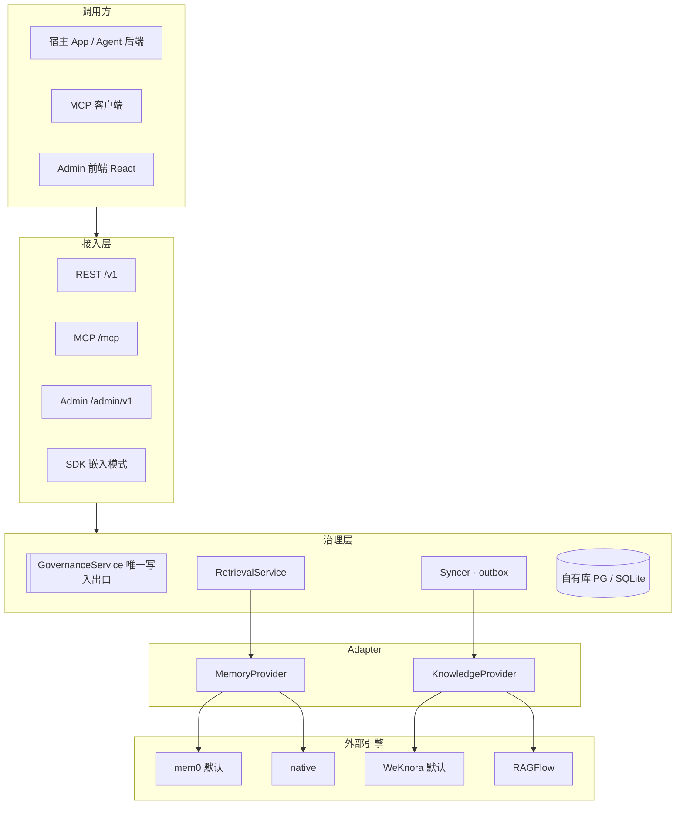
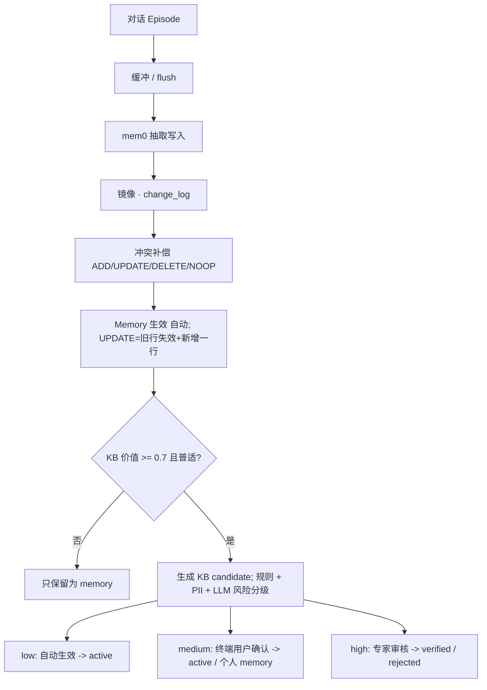

# llm-steward 设计文档：AI 记忆与知识的治理层

Nov 7, 2026 · @Arthur Gao

## 1. 概述

**llm-steward** 是 AI 记忆与知识的治理层：它让 agent 产生的记忆经过筛选、确认和审核，变成可信、可追溯的团队知识。它本身不重新实现 memory 或 RAG 引擎，而是通过 adapter 接入成熟的开源项目——默认 memory 用 **mem0**，默认 KB 用 **WeKnora**，文档复杂时可以换 **RAGFlow**，测试和单机场景用内置的 **native** 实现（SQLite + sqlite-vec）。任何 app 或 agent 都可以通过 REST、Python SDK 或 MCP 接入。仓库包含 `backend/`（FastAPI）和 `frontend/`（Admin）两个目录。

> 命名：steward 取自数据治理里的 data steward（数据管家），也就是负责数据质量、口径和合规的角色。仓库名 `llm-steward`，Python 包 `llm_steward`，CLI `steward`，环境变量前缀 `STEWARD_`。

### 目标

- **治理是核心**：状态机（candidate → active → verified → deprecated）、按风险分级审核、终端用户确认卡片、完整变更历史与出处、Memory → KB 的升级（promote）通道。这些全部由 llm-steward 自己实现，与后端无关。
- **后端可插拔**：通过 `MemoryProvider` 和 `KnowledgeProvider` 两个接口适配不同引擎。治理元数据只存在 llm-steward 自己的库里，外部引擎只负责存储、抽取和检索。更换后端时把生效数据重新同步一遍即可。
- **统一检索**：一次调用同时查 memory 和 KB，在治理层合并、按可信度加权、组装成可以直接放进 prompt 的上下文。返回格式不随后端变化。
- **轻量部署**：llm-steward 与 mem0 共用**一个 PostgreSQL（pgvector）**；WeKnora 需要 ParadeDB（`pg_search`），自带一个 PG 实例和 Redis；native 模式只需要一个 SQLite 文件。
- **多种接入**：REST（OpenAPI）、Python SDK、MCP server、可嵌入的确认卡片组件。

### 非目标（v1 不做）

- 不自研抽取算法、向量检索引擎、文档解析或知识图谱。这些交给 adapter 背后的项目；native 实现只求够用，用于测试和单机场景。
- 不做聊天应用或 agent 框架。llm-steward 只管"记什么、信什么、取什么"。
- 不做 GraphRAG。需要时由 WeKnora 自带的 GraphRAG 或 LightRAG adapter 提供（v2 再考虑）。
- 不做多区域、分布式部署。

### 核心术语

| 术语 | 含义 |
| --- | --- |
| Namespace | 隔离和配置的单位，一般对应一个接入项目。每个 namespace 有独立的 API key、配置，以及选用的 provider |
| Scope | namespace 内部的归属维度：`user_id`、`agent_id`、`session_id`。为空表示该 namespace 下共享 |
| Provider | 后端引擎的 adapter：`MemoryProvider`（mem0 / native）、`KnowledgeProvider`（WeKnora / RAGFlow / native） |
| Memory | 一条原子记忆。内容存在 memory provider 中，llm-steward 保存一份镜像和治理元数据 |
| KB Entry | 一条受治理的原子知识。**llm-steward 是它的真相源**，只有生效的条目才会同步到 KB provider |
| KB Document | 上传的文档。由 KB provider 负责解析和切块，llm-steward 记录其状态和出处 |
| Candidate | 待确认或待审核的写入提议，来自 AI 抽取、promote 或用户的保存建议 |
| External Ref | llm-steward 对象与 provider 内部 id 之间的映射，同时记录同步状态 |
| Retrieval | 一次联合检索，跨 provider 合并后返回排序结果和组装好的上下文 |

## 2. 开源调研与借鉴

没有哪个项目同时做到"Memory + 可治理的 KB + 审核 + SQLite/pgvector 双后端 + Admin"。所以 llm-steward 只做治理层：借鉴各家已经验证过的做法，并直接把其中成熟的项目当作后端使用。

| 项目 | 定位 | 借鉴 | 不采用 |
| --- | --- | --- | --- |
| [mem0](https://github.com/mem0ai/mem0)（Apache-2.0） | 通用 memory 层 | `user_id`/`agent_id`/`run_id` 三维 scope；只存原子事实；语义 + BM25 + 实体并行检索后融合；经典的 ADD/UPDATE/DELETE/NOOP 决策（早期版本）；每条 memory 都有 history | 新版改成"只 ADD"以降低成本。我们保留冲突处理，因为 KB 不能堆积矛盾条目 |
| [Graphiti / Zep](https://github.com/getzep/graphiti)（Apache-2.0） | 时态知识图谱 | **双时间模型**：事实有生效区间，被新事实取代时标记失效而不是删除；**episode 溯源**：每条事实都能追溯到产生它的原始输入 | 需要 Neo4j 等图数据库。v1 用关系表模拟实体关系 |
| Letta（原 MemGPT） | 有状态 agent | **分层 memory**：常驻上下文的 core blocks（如 `human`、`persona`）与按需检索的 archival 存储分开；空闲时后台整理记忆（sleep-time / dreaming） | 是整个 agent 运行时，不是可插拔的服务 |
| [LangMem](https://langchain-ai.github.io/langmem/concepts/conceptual_guide/) | memory SDK | 语义/情景/程序三类记忆；**collection vs profile** 两种形态；**hot path vs background** 两种写入时机；层级 namespace | 与 LangGraph 绑定 |
| [Memobase](https://github.com/memodb-io/memobase)（Apache-2.0） | 用户画像 memory | **可配置的 profile schema**（topic/sub\_topic）；按用户的 **buffer + 批量 flush**（约 1024 token 或空闲 1 小时）；`context` 接口直接返回可以拼进 prompt 的字符串；技术栈是 FastAPI + Postgres | 只管用户画像，没有 KB |
| [Cognee](https://github.com/topoteretes/cognee)（Apache-2.0） | memory + 知识图谱 | remember / recall / improve / forget 四个动词的简洁 API；**improve：把会话知识升级进共享存储**；单个 Postgres 承载全部数据 | 图谱抽取的成本高，v1 不做 |
| [R2R](https://github.com/SciPhi-AI/R2R)（MIT） | RAG 服务 | 多格式文档导入；语义 + 关键词检索后用 **RRF（Reciprocal Rank Fusion）融合**；用 collection 做权限隔离；REST + Python/JS SDK | 没有 memory 写入和治理 |

### 归纳出的 10 条设计原则

1. **只存原子事实，不存整段对话**（mem0）。整段对话另存为 episode，作为出处。
2. **写入时做冲突决策**：ADD / UPDATE / DELETE / NOOP（mem0 早期版本）。这是 KB 不烂掉的关键。
3. **失效而不删除**：用 `valid_from` / `valid_to` 记录生效区间，可以查历史状态（Graphiti）。
4. **每条数据都可溯源**：能对应到 episode、文档或人工操作（Graphiti）。
5. **分两种形态**：profile（每个 key 只有一个当前值，如「城市」）和 collection（可以堆积、按需检索）（LangMem、Memobase）。
6. **两种写入时机**：同步写入（hot path）和后台批量整理（buffer + flush）（LangMem、Memobase）。
7. **常驻与检索分层**：pinned 的少量核心信息每次都带上，其余的按相关性检索（Letta）。
8. **混合检索 + RRF + 可选 rerank**（R2R、mem0、Graphiti）。
9. **提供「直接返回 prompt 上下文」的接口**，调用方一行代码就能用（Memobase）。
10. **动词少而清晰**：remember / recall / promote / forget（Cognee）。MCP server **默认必须带鉴权**——Graphiti 的参考 MCP server 没有鉴权，官方自己也警告不要暴露到不可信网络。

**llm-steward 的差异点**：Memory 与 KB 之间有一个显式的 **promote（升级）** 流程，并内置风险分级审核、用户确认卡片和 Admin——这正是前面讨论的知识治理问题。Letta 的描述基于其公开文档和 MemGPT 论文的通行概念，其新版 Agent SDK 已经改用 git 追踪的 MemFS。

### 大厂的开源和托管方案

| 厂商 | 方案 | 类型 | 现状 | 与 llm-steward 的关系 |
| --- | --- | --- | --- | --- |
| Redis | [agent-memory-server](https://github.com/redis/agent-memory-server)（Apache-2.0） | 开源 memory 服务：会话级 working memory + 长期 memory，提供 REST 和 MCP | 原始版本已移到 `V0/` 作为研究性代码，官方说明不是受支持的生产版本，重心转向 Redis Cloud 托管服务 | **定位最接近**，但绑定 Redis，没有 KB 治理，也不再作为开源产品维护 |
| Microsoft | [Kernel Memory](https://github.com/microsoft/kernel-memory) | .NET 的 RAG/memory 服务 | 已归档，README 说明是研究项目、不提供支持 | 当年最像"通用 KB 服务"，现在已经没人维护 |
| 腾讯 | [WeKnora](https://github.com/Tencent/WeKnora) | 企业级 RAG 知识库：文档解析、混合检索、GraphRAG、Wiki 模式、ReAct agent | 活跃开发中 | 强在文档型 KB；不管 agent memory，也没有 memory→KB 的升级和审核流程；依赖较重（Qdrant/Milvus/ES、Neo4j） |
| 阿里（ModelScope / AgentScope） | [ReMe](https://modelscope.github.io/ReMe)（Apache-2.0，前身是 MemoryScope） | agent memory 框架：个人记忆、任务记忆、工具记忆 | 活跃 | "任务记忆"与我们的 procedural memory 类似；没有 KB 治理和 Admin |
| AWS | Bedrock AgentCore Memory | 托管服务（非开源） | GA | 功能完整但绑定 AWS；Strands Agents SDK 默认用 mem0 作为 memory 提供方 |
| Google | Vertex AI Agent Engine Memory Bank；[ADK MemoryService](https://google.github.io/adk-docs/sessions/memory) | 托管服务 + 开源 SDK 接口 | GA | ADK 只定义了接口，内置实现仅用于原型（关键词匹配）；可以为 ADK 写一个 llm-steward adapter |
| MemTensor（创业公司，非大厂） | [MemOS](https://github.com/MemTensor/MemOS) | "记忆操作系统"，还覆盖 KV cache 和参数记忆 | 活跃 | 偏研究，依赖 Neo4j + Qdrant，部署重 |

### 结论：有没有必要自己做

**单纯的"memory 层"和单纯的"RAG 知识库"都不值得重做**。前者有 mem0（GitHub 约 6.8 万 star）、Letta、Zep/Graphiti、ReMe，后者有 WeKnora、RAGFlow、R2R。如果你只是一个 app 需要记住用户，直接用 mem0 OSS + pgvector，几天就能上线。

**空白在二者之间的那一层**。上面没有一个项目同时具备：

1. Memory 和 KB 在同一个服务里，并有**显式的 promote（memory → KB）流程**；
2. **按风险分级的审核**、终端用户确认卡片、状态机和变更历史；
3. **轻量部署**：从一个 SQLite 文件平滑升级到 pgvector，不需要 Neo4j、Qdrant、Redis；
4. 开箱即用的 Admin。

Redis agent-memory-server 和 Microsoft Kernel Memory 曾经最接近这个定位，但都已经退居研究性代码。这说明大厂更愿意把它做成托管产品，也说明开源的自托管位置确实空着。

**建议：做，但把范围收紧在"治理层"**

- 如果你有 2 个及以上自己的项目要复用，或者审核和溯源是刚需（企业、客服、医疗、金融场景），值得做。
- 不要在抽取算法、知识图谱、文档解析上和大项目拼质量。把它们做成插件接口（第 8 节），默认用简单实现，需要时可以接 mem0 / ReMe 做抽取、接 Docling 做解析。
- 用公开基准（LoCoMo、LongMemEval）跑一次默认抽取和检索，与 mem0 做对照。如果差距很大，就把默认抽取器换成 mem0，只保留治理层。
- 如果只是单个 app、不需要审核：不建议做，直接用 mem0。

### 后端选型结论

**默认组合是 mem0 + WeKnora。** mem0 与 llm-steward 共用一个 PostgreSQL；WeKnora 使用自带的 ParadeDB 实例（见第 3 节）。 RAGFlow 作为第二个 KB adapter，留给文档复杂的场景。数据为 2026 年 11 月的仓库页面。

| 角色 | 项目 | 协议 | 社区与维护 | 选它的理由 | 注意 |
| --- | --- | --- | --- | --- | --- |
| Memory（默认） | [mem0](https://github.com/mem0ai/mem0) OSS | Apache-2.0 | 约 6.8 万 star；AWS Strands Agents 默认的 memory 提供方 | 使用最广；支持 [pgvector](https://docs.mem0.ai/components/vectordbs/dbs/pgvector)；按 user/agent/run 分 scope | 2026 年 4 月起抽取算法改为"只 ADD"，冲突和取代需要治理层自己补 |
| KB（默认） | [WeKnora](https://github.com/Tencent/WeKnora)（腾讯） | MIT | 约 3.7 万 star；v0.9.0 于 2026-10-29 发布，发版频繁 | 支持 PostgreSQL + pgvector；有 SQLite 单文件的 Lite 版；内置 MCP；约 360 个 REST 端点；中文友好 | 仍是 0.x，API 变化快，需要锁定版本并写合约测试 |
| KB（备选） | [RAGFlow](https://github.com/infiniflow/ragflow) | Apache-2.0 | 约 9.4 万 star；1.0.0-rc1 于 2026-09-29 发布 | 文档解析最强（版面、表格、扫描件）；有 HTTP API 和 Python SDK | 依赖重：Elasticsearch / Infinity、MySQL、MinIO 等；建议 4 核 16 GB 起步 |
| 图谱（v2） | [LightRAG](https://github.com/HKUDS/LightRAG) 或 WeKnora 自带 GraphRAG | MIT | 约 4 万 star | 有 REST server，可以只用 PostgreSQL 存储；自称 LLM 调用比 Microsoft GraphRAG 少得多 | 默认没有鉴权，必须放在内网 |
| 测试 / 单机 | native（内置） | — | — | SQLite + sqlite-vec + FTS5，零依赖；合约测试的参照实现 | 只求够用，不追求效果 |
| KB（自有，S9） | [lite-rag](https://github.com/ArthurGao/lite-rag)（owner 自己的 RAG 引擎） | Apache-2.0 | — | 混合检索（BM25 + 向量 + RRF）、可选 rerank；PostgreSQL + pgvector 或 Chroma；每个 kb 的配置有身份校验；有 HTTP 服务和 Docker 镜像 | 个人项目；`STEWARD_KB_PROVIDER=literag`，详见第 8 节 |

**不选 Microsoft GraphRAG**：它是索引库而不是服务，建索引时 LLM 调用量大、成本高，不适合作为通用 KB 的默认后端。**不选 Letta / Zep 作 memory 后端**：它们更像完整的 agent 运行时或图数据库方案，不适合作为可插拔组件。

## 3. 总体架构：治理层 + adapter

llm-steward 是一个 FastAPI 服务，分四层：接入层（REST / MCP / SDK）→ 治理层（服务与自有数据库）→ provider adapter → 外部引擎（mem0、WeKnora、RAGFlow 或 native）。**治理信息只存在 llm-steward 自己的库里**，外部引擎只负责内容的存储、抽取和检索。


mem0 与自有库共用一个 PostgreSQL（独立 schema）；WeKnora 使用自带的 ParadeDB 实例；native 同时实现两个接口。

GovernanceService 是唯一的写入出口；同步器（Syncer）通过任务队列，把生效的数据异步推送给 provider。

### 三条架构规则

1. **只把生效的知识同步出去**：KB 条目在 llm-steward 中变成 `active` 或 `verified` 后，才作为文档推送到 KB provider；被废弃时从 provider 删除。草稿和待审核的内容永远不进外部 KB，所以外部系统不需要理解状态。
2. **联合检索在治理层做**：并行调用 memory 和 KB provider 的检索，用 RRF 合并，再用自己库里的元数据（是否已验证、风险、好评率）加权。不在库里的结果和已失效的结果一律过滤掉。
3. **用 `external_refs` 表关联**：记录 llm-steward 对象与 provider 内部 id 的映射和同步状态。更换 provider 时，把生效数据重新同步一遍即可。

写入顺序始终是：先在自有库的事务里写入对象、`change_log` 和一条 `sync` 任务（outbox 模式），再由 worker 推送到 provider。失败则指数退避重试，Admin 中显示同步状态。

### 部署组合

| profile | 自有库 | Memory provider | KB provider | 适用 |
| --- | --- | --- | --- | --- |
| `native` | SQLite | native | native | 开发、测试、单机、嵌入式 |
| `standard`（默认） | PostgreSQL + pgvector | mem0（进程内 Python 库，使用同一个 PG） | WeKnora（独立容器，自带 ParadeDB 与 Redis） | 大多数生产场景 |
| `docparse` | PostgreSQL + pgvector | mem0 | RAGFlow（独立部署） | 大量复杂 PDF、表格、扫描件 |

自有库与 mem0 在同一个数据库中使用独立 schema（`steward`、`mem0`），互不干扰。WeKnora v0.9.0 的迁移依赖 ParadeDB 的 `pg_search` 扩展（BM25 索引），普通 PostgreSQL + pgvector 无法承载，因此它使用自带的 `paradedb/paradedb` 实例（见 `deploy/weknora/README.md`，2026-11-08 核实）。provider 也可以按 namespace 单独配置。

### 技术选型

| 层 | 选择 | 理由 |
| --- | --- | --- |
| 语言 / 包管理 | Python 3.12、uv | mem0 是 Python 库，可以直接进程内调用 |
| Web | FastAPI + Pydantic v2 | 自动生成 OpenAPI，前端和 SDK 都从它生成 |
| ORM / 迁移 | SQLAlchemy 2.0（async）+ Alembic | 同一套模型支持 PostgreSQL 和 SQLite |
| 自有库 | PostgreSQL 18 + pgvector（本地共用的 PG 容器，CI 用 `pgvector/pgvector:pg18`）；native 模式用 SQLite | 与 mem0 共用一个 PG 实例；WeKnora 自带 ParadeDB |
| Memory | `mem0ai`（锁定版本） | 见第 2 节 |
| KB 客户端 | httpx2（httpx 的后继，Starlette 1.x TestClient 也用它）调用 WeKnora / RAGFlow 的 REST API | 锁定版本，由合约测试保护 |
| LLM / Embedding | OpenAI SDK，走任意 OpenAI 兼容端点（本地开发用 llm-gateway，生产用厂商端点）；按「角色」配置模型（`memory.extract`、`memory.resolve` …），调用点不写模型名 | 治理层自己的 LLM 调用（风险分级、KB 价值评分、起草、冲突判断）与 provider 的配置分开。原定 LiteLLM，P2 改为 OpenAI SDK：mem0 已自带该依赖，依赖树更小（2026-11-08） |
| native 实现 | sqlite-vec（`vec0`）+ FTS5 + jieba + fastembed | 零依赖、离线可跑 |
| 后台任务 | 数据库任务表（outbox）+ asyncio worker | llm-steward 本身不依赖 Redis（WeKnora 自带的 Redis 只供 WeKnora 使用），两种数据库都能用 |
| MCP | 官方 `mcp` Python SDK（streamable HTTP），挂载在 `/mcp` | 与 REST 共用 service 和鉴权 |
| 鉴权 | Namespace API key（哈希存储）+ 短期 user token（浏览器端）；Admin 不做登录（2026-11-10） | 机器调用和终端用户分开；Admin 是内部监控台 |
| 前端 | React + Vite + TypeScript + TanStack Router/Query + shadcn/ui + Tailwind | 用 `@hey-api/openapi-ts` 生成客户端 |
| 可观测 | structlog、Prometheus `/metrics`、可选 OpenTelemetry | 重点监控检索延迟、同步失败率、provider 错误率 |
| 部署 | Docker Compose，三个 profile | 一条命令启动 |

### 配置示例

```bash
STEWARD_DATABASE_URL=postgresql+asyncpg://steward:***@pg:5432/steward   # 或 sqlite+aiosqlite:///./data/steward.db
STEWARD_MEMORY_PROVIDER=mem0          # mem0 | native
STEWARD_KB_PROVIDER=weknora           # weknora | ragflow | native
STEWARD_WEKNORA_URL=http://weknora:8080
STEWARD_WEKNORA_API_KEY=***
STEWARD_LLM_MODEL=anthropic/claude-haiku-5-5
```

## 4. 数据模型

自有库只存治理所需的数据：对象的状态、版本、出处、审核记录、同步状态，以及用于 Admin 展示和检索过滤的内容镜像。向量、切块和全文索引归 provider 管。所有业务表都带 `namespace_id`；主键使用 UUIDv7；JSON 字段在 PG 中用 `JSONB`，在 SQLite 中用 `JSON`。

### 表一览

| 表 | 用途 | 关键字段 |
| --- | --- | --- |
| `namespaces` | 接入项目 | `slug`、`name`、`config`（JSON，含选用的 provider，第 8 节） |
| `api_keys` | 机器调用的凭证 | `namespace_id`、`prefix`、`key_hash`、`scopes`（read / write / review / admin）、`last_used_at`、`revoked_at` |
| `episodes` | 原始输入（对话、导入、手工操作），溯源的依据 | `kind`、`user_id`/`agent_id`/`session_id`、`content`（JSON messages）、`processed_at` |
| `memories` | memory 的镜像 + 治理元数据（内容由 memory provider 产生和检索） | 见下方 DDL |
| `kb_collections` | KB 分组，对应 provider 里的一个知识库 | `name`、`review_policy`、`default_risk` |
| `kb_entries` | 受治理的原子知识，**真相源** | 见下方 DDL |
| `kb_documents` | 上传文档的记录 | `collection_id`、`title`、`filename`、`source_uri`、`mime`、`size_bytes`、`content_hash`、`state`（治理状态，同条目：draft / active / verified / deprecated / rejected）、`status`（解析状态 pending / processing / ready / failed，从 provider 同步）、`error`、`risk_level`、`valid_to`；待上传的字节在 `kb_document_files`（P3d） |
| `candidates` | 待确认或待审核的写入提议 | 见下方 DDL |
| `external_refs` | 与 provider 的 id 映射及同步状态 | 见下方 DDL |
| `change_log` | 所有对象的变更历史 | `object_type`、`object_id`、`op`、`before`、`after`、`actor_type`（ai / end\_user / admin / system / provider）、`actor_id`、`reason` |
| `retrieval_logs` | 每次检索的记录 | `query`、`filters`、`results`（含各 provider 的原始分与最终分）、`latency_ms`（分 provider）、`feedback` |
| `jobs` | 后台任务与 outbox | `type`（sync / ingest / extract / maintenance）、`payload`、`status`、`attempts`、`run_after`、`locked_until`、`error` |
| `native_*` | 仅 native provider 使用：`native_chunks`、`native_vectors`（sqlite-vec / pgvector）、`native_fts`（FTS5 / tsvector） | 与治理表分开，可以整体替换或删除 |

### 核心表 DDL（逻辑结构）

```sql
CREATE TABLE memories (
  id               UUID PRIMARY KEY,
  namespace_id     UUID NOT NULL,
  user_id TEXT, agent_id TEXT, session_id TEXT,  -- NULL = 该维度共享
  memory_type      TEXT NOT NULL,      -- semantic|episodic|procedural|profile|<自定义>
  key              TEXT,               -- 仅 profile，如 'user.city'，与 scope 一起唯一
  content          TEXT NOT NULL,      -- 镜像：provider 里的文本
  data             JSON,               -- 按 namespace schema 校验的结构化字段
  status           TEXT NOT NULL,      -- active|superseded|deleted
  origin           TEXT NOT NULL,      -- extraction|direct|import
  pinned           BOOLEAN DEFAULT FALSE,
  importance       REAL DEFAULT 0.5,
  confidence       REAL DEFAULT 0.8,
  valid_from       TIMESTAMPTZ NOT NULL,
  valid_to         TIMESTAMPTZ,        -- 被取代时写入
  superseded_by    UUID,
  source_episode_id UUID,
  expires_at       TIMESTAMPTZ,
  access_count INT DEFAULT 0, last_accessed_at TIMESTAMPTZ,
  content_hash     TEXT NOT NULL,
  tags JSON, metadata JSON, created_at, updated_at
);

CREATE TABLE kb_entries (
  id               UUID PRIMARY KEY,
  namespace_id     UUID NOT NULL,
  collection_id    UUID NOT NULL,
  title            TEXT NOT NULL,
  content          TEXT NOT NULL,
  status           TEXT NOT NULL,      -- draft|active|verified|deprecated|rejected
  risk_level       TEXT NOT NULL,      -- low|medium|high
  origin           TEXT NOT NULL,      -- manual|import|promoted_memory|user_suggestion|extraction
  author_type      TEXT NOT NULL,      -- ai|human
  source_refs      JSON,               -- [{type:'episode'|'memory'|'url'|'document', id|url}]
  created_by TEXT, verified_by TEXT, verified_at TIMESTAMPTZ,
  review_due_at    TIMESTAMPTZ,
  valid_from, valid_to, superseded_by,
  confidence REAL, hit_count INT, helpful_count INT, unhelpful_count INT,
  version          INT NOT NULL DEFAULT 1,  -- 每次内容变更 +1，同步时比对
  tags JSON, metadata JSON, content_hash TEXT, created_at, updated_at
);

CREATE TABLE candidates (
  id               UUID PRIMARY KEY,
  namespace_id     UUID NOT NULL,
  target_type      TEXT NOT NULL,      -- memory|kb_entry
  op               TEXT NOT NULL,      -- ADD|UPDATE|DELETE
  target_id        UUID,
  draft            JSON NOT NULL,      -- 拟写入内容，用户或审核者可修改
  reason           TEXT,
  risk_level       TEXT NOT NULL,
  origin           TEXT NOT NULL,      -- extraction|promote|user_suggestion|api
  stage            TEXT NOT NULL,      -- awaiting_user|awaiting_review
  status           TEXT NOT NULL,      -- pending|accepted|rejected|expired
  requested_for_user TEXT,
  decided_by TEXT, decided_at TIMESTAMPTZ, decision_note TEXT,
  source_episode_id UUID, expires_at TIMESTAMPTZ, created_at
);

CREATE TABLE external_refs (
  id               UUID PRIMARY KEY,
  namespace_id     UUID NOT NULL,
  object_type      TEXT NOT NULL,      -- memory|kb_entry|kb_document|kb_collection
  object_id        UUID NOT NULL,
  provider         TEXT NOT NULL,      -- mem0|weknora|ragflow|native|<自定义>
  external_id      TEXT,               -- provider 内部 id（待同步时为空）
  sync_status      TEXT NOT NULL,      -- pending|synced|failed|deleting|deleted
  synced_version   INT,                -- 已同步到 provider 的 version
  last_synced_at   TIMESTAMPTZ, last_error TEXT, attempts INT DEFAULT 0,
  UNIQUE (object_type, object_id, provider),
  UNIQUE (provider, namespace_id, external_id)
);
```

### 一致性规则

- **KB 条目**：自有库是真相源。`status` 变为 active / verified 或 `version` 增加时，入队 `sync.upsert`；变为 deprecated / rejected 时，入队 `sync.remove`。检索结果按 `external_id` 反查，`synced_version` 与当前 version 不一致时，以自有库内容为准。
- **Memory**：provider 是内容的生产者。每次 `add` 后把 provider 返回的变更（新增、更新、删除）写回镜像和 `change_log`。每天运行一次对账任务，对比 provider 与镜像，修复漂移。
- **检索安全网**：provider 返回的结果如果在自有库中找不到，或已经失效，一律丢弃并记录告警。这保证了即使同步延迟，已废弃的知识也不会被使用。
- **文档**：整篇文档由 KB provider 解析和切块。llm-steward 只记录文档级的状态和风险，文档的生效与下线也经过治理层。
- **统计不走治理写入路径**（P4e）：`memories.access_count` / `last_accessed_at`、`kb_entries.hit_count` / `helpful_count` / `unhelpful_count` 是统计数据，不是受治理的状态。它们由检索服务直接更新：不写 `change_log`，也不改 `updated_at`（被读到不等于被编辑）。和 Syncer 记录同步状态一样，这是规则 1"所有写入经过 `GovernanceService.apply()`"仅有的例外，不能拿来给受治理的字段开口子。

## 5. 写入流水线与治理

Memory 默认自动写入；KB 的写入一律先生成 candidate，再由风险等级决定是自动生效、等终端用户确认，还是等专家审核。


终端用户确认永远不会产生 verified；MCP 只能提议，不能直接写入 KB。

上半部分是 memory 的自动通道；只有通过 KB 价值判断的事实才会生成 candidate，再按风险进入三条路径之一。

### 写入入口

| 入口 | 用途 | 是否调用 LLM |
| --- | --- | --- |
| `POST /v1/episodes` | 提交对话消息，由系统抽取记忆（主入口） | 是 |
| `POST /v1/memories` | 调用方直接写入一条记忆；`infer=false` 时跳过抽取和冲突判断 | 可选 |
| `POST /v1/kb/documents` | 上传文档，切块后 embedding | 否 |
| `POST /v1/kb/entries` | 直接创建知识条目，按审核策略处理 | 可选（风险分级） |
| `POST /v1/memories/{id}/promote` | 把一条记忆升级为 KB candidate | 是（改写为通用表述） |
| `POST /v1/suggestions` | 宿主 app 主动提议"把这段内容存入 KB" | 是（起草） |

### Episode 处理的 7 个步骤

1. **缓冲**：按 `(namespace, user, session)` 累积。触发 flush 的条件：超过 `buffer_tokens`（默认 1024）、空闲超过 `buffer_idle`（默认 30 分钟）、显式 `flush`，或请求带 `mode=sync`。
2. **Provider 抽取并写入**：调用 `MemoryProvider.add(messages, scope)`。mem0 负责抽取事实并存储，返回变更列表；native provider 用内置的 `extract_facts` prompt 完成同样的工作。
3. **镜像与记录**：把变更写入 `memories` 镜像、`external_refs` 和 `change_log`（`actor_type=provider`），并关联 `source_episode_id`。
4. **冲突补偿**：如果 provider 能抽取（`extract`）但不声明 `resolves_conflicts` 能力（mem0 2.2.1 只会 ADD，就是这样；P2 起以能力判定，2026-11-08），就对每条新记忆在同一 scope 内取相似度 ≥ 0.75 的 top-5（profile 类型按 `key` 查找），由 `ConflictResolver` 判断 UPDATE / DELETE / NOOP。UPDATE 时旧记忆在镜像中标记 `superseded`、写入 `valid_to` 和 `superseded_by`，**保留在 provider 中**（遵循「失效而不删除」，`as_of` 才能查到旧值；常规检索由安全网按状态过滤）；DELETE 同样只标记失效；NOOP 时删除新写入的重复项。（原文为 `provider.delete(old)`，P2 实现时按第 2 节原则 3 修正，2026-11-08）
5. **KB 价值评分与风险分级**：治理层自己的 LLM 调用（每次 flush 批量一次），对新记忆给出五项评分（复用性、增量、时效、普适、可信，各 0–1）和 `risk_level`。
6. **KB 建议**：五项均值 ≥ `kb_suggest_threshold`（默认 0.7）且"普适" ≥ 0.6 时，用 `draft_kb_entry` prompt 改写为通用表述，生成一条 `target_type=kb_entry` 的 candidate。
7. **同步**：candidate 生效为 KB 条目后，入队 `sync.upsert`，由 worker 推送到 KB provider（第 3 节的 outbox）。

`POST /v1/memories` 带 `infer=false` 时跳过第 2 步的抽取，直接把内容原样写入 provider（mem0 支持 `infer=False`）。

### 风险分级

先跑规则，再由 LLM 标注，取两者中较高的等级：

- **规则**（namespace 配置）：按关键词或类别划为 high（价格、政策、法务、医疗、安全）；内置 PII 检测（手机号、身份证、银行卡、邮箱、密钥格式），命中后按配置拦截、脱敏或升为 high。
- **LLM**：在抽取或起草时一并输出 `risk_level` 和理由。

### KB 审核策略（按 collection 配置）

| 风险 | 默认处理 | 生效状态 | 检索权重 |
| --- | --- | --- | --- |
| low | 自动生效 | `active` | 0.9 |
| medium | 先问终端用户（如果有），确认后生效 | `active` | 0.9 |
| high | 进入审核队列，由 reviewer 批准 | `verified` | 1.0 |
| 由 Admin 或 reviewer 创建 | 直接生效 | `verified` | 1.0 |

状态变化：`draft → active → verified`；任何生效状态都可以因被取代、过期或人工操作变为 `deprecated`；candidate 被拒绝后写入 `rejected` 并保留。`review_due_at` 到期时不改变状态，只在 Admin 中标记"待复审"。**终端用户确认永远不会产生 `verified`**：用户确认只说明有用，不说明正确。

### 用户确认卡片（前面讨论的弹窗）

- `POST /v1/episodes` 和 `POST /v1/retrieve` 的响应里带可选字段 `suggestions[]`，内容是 `stage=awaiting_user` 的 candidate（含起草好的标题和内容）。
- 宿主 app 展示卡片。用户确认时调用 `POST /v1/candidates/{id}/accept`，请求体可带修改后的 `draft` 和保存范围 `scope: personal | team`。personal 转为用户的 memory；team 继续走审核策略（medium 直接生效，high 进入审核队列）。
- 用户拒绝时调用 `/reject`。如果带上 `stop_suggestions=true`，就写入一条该用户的 procedural memory："不希望被推荐分享"，之后不再给这个用户自动出卡片；删掉这条记忆就恢复。（原设计是按"X 类问题"屏蔽；抽取的记忆没有可用的类别，2026-11-11 改为按用户整体关，见 §11 P7c。）
- 防打扰：每个会话最多 `max_suggestions_per_session`（默认 2）条；未处理的卡片 7 天后过期。
- 前端提供可嵌入的 React 组件 `<SuggestionCard />`（放在 `frontend/packages/widget`）。

### 后台维护任务（默认每天运行）

- **过期**：`expires_at` 或 `valid_to` 到期的对象标记失效。
- **整合**（借鉴 Letta 的 sleep-time）：合并相似度 ≥ 0.92 的重复记忆；把旧的 episodic memory 归纳为 semantic。
- **反馈驱动**：命中 ≥ 5 次且差评率 ≥ 30% 的 KB 条目标记为待复审（只算上次复审之后的命中和评价）；命中多且好评多的 `active` 条目推荐 reviewer 升级为 `verified`。
- **缺口报告**：统计检索最高分低于阈值的高频问题，在 Admin 中展示"KB 缺什么"。

## 6. 检索（RAG）

一次 `POST /v1/retrieve` 并行查询 memory provider 和 KB provider，在治理层反查自有库、过滤失效内容，用 RRF 合并后按可信度和时效加权，最后在 token 预算内组装成上下文。各 provider 内部如何做混合检索由它们自己决定。

### 请求参数

```json
{
  "query": "我上次那个退款怎么样了",
  "scope": {"user_id": "u_123", "agent_id": "support-bot", "session_id": null},
  "sources": ["memory", "kb"],
  "memory_types": null,
  "collections": ["refund-policy"],
  "filters": {"tags": ["refund"], "metadata": {"region": "cn"}},
  "top_k": 8,
  "include_pinned": true,
  "rerank": false,
  "as_of": null,
  "format": "context",
  "token_budget": 2000
}
```

### 执行步骤

1. **预处理**：可选的 query 改写（默认关闭，有 LLM 延迟）。
2. **并行分发**：同时调用 `MemoryProvider.search(query, scope, top_k=30)` 和 `KnowledgeProvider.search(query, collections, top_k=30)`。每个 provider 有独立超时（默认 800 ms）；超时或报错时返回其余结果，并在响应中标记 `degraded: ["kb"]`。
3. **反查与过滤**：通过 `external_refs` 把结果映射回自有对象。丢弃找不到的、非 active / verified 的、不在 `as_of` 生效区间内的结果。provider 不支持的过滤条件（tag、metadata、scope）在这里做后过滤。scope 规则：memory 取 `user_id = :uid OR user_id IS NULL`，即用户私有记忆加上 namespace 共享记忆。
4. **RRF 融合**（k = 60）：按各 provider 内部的名次合并，避免不同引擎的分数尺度不可比。
5. **可选 rerank**：取 top-30 给 cross-encoder（默认 fastembed 本地模型，可换成 Cohere / Jina / Voyage），用其分数替代 RRF 分数。跨 provider 合并时开启 rerank 效果提升最明显。
6. **业务加权**：按下方公式计算最终分。
7. **去冗余**：MMR（λ = 0.7）。
8. **常驻记忆**：`pinned=true` 的 memory 和 profile 直接从自有库镜像读取，不调用 provider，始终放在最前面。
9. **组装与记录**：生成结果列表和上下文；写入 `retrieval_logs`（含各 provider 的耗时和原始名次）；异步更新 `access_count` 和 `hit_count`。响应返回 `retrieval_id`，用于提交反馈。

### 打分公式

第 4 步的 RRF 融合（P 是参与本次检索的 provider 集合，r 是该条结果在 provider p 返回列表中的名次）：

```latex
\mathrm{rel}(d) = \sum_{p \in P} \frac{1}{60 + r_p(d)}
```

第 6 步的最终分：

```latex
\mathrm{score}(d) = \mathrm{rel}(d) \times w_{\mathrm{trust}}(d) \times \bigl(1 + 0.3 \cdot \mathrm{importance}(d)\bigr) \times 0.5^{\,\mathrm{age}(d) / h_{\mathrm{type}}}
```

- `w_trust`：`verified` = 1.0，`active` = 0.9，`confidence < 0.5` 的 memory 再乘 0.8。
- `h_type`：按 memory 类型配置的半衰期。episodic 默认 30 天；semantic、procedural、profile 和 KB 默认不衰减（无穷大）。
- 权重、系数和半衰期都可以在 namespace 配置中覆盖。

### 上下文格式（`format=context`）

默认使用 Jinja2 模板，可以按 namespace 自定义：

```markdown
## 关于用户
- 偏好简短的中文回答
- 订单 #123 于 2026-10-29 申请退款

## 知识库
- [kb:01J...] 退款审核 3–5 个工作日，原路返回。（已验证）
- [kb:01K...] 跨境订单退款另加手续费。（未验证）
```

每条内容都带引用 id，方便 LLM 引用来源、用户反馈时定位；未验证的内容会显式标注。`format=items` 则只返回结构化的结果列表。

**性能目标**（设计指标，待压测验证）：治理层自身的开销（反查、过滤、融合、组装）p95 < 30 ms；端到端延迟主要取决于最慢的 provider，由超时设置兆底。

## 7. API 设计

对外提供三种接入方式，共用同一套 service 层和鉴权：REST（`/v1`）、Python SDK（`llm-steward-client`）和 MCP（`/mcp`）。Admin 前端使用单独的 `/admin/v1` 路由（P6 与页面一起实现）。

### 鉴权

- **业务调用**：`Authorization: Bearer stw_<prefix>_<secret>`。key 绑定 namespace，数据库只存 `sha256(secret)`。scopes 分 `read`、`write`、`review`、`admin`。
- **终端用户身份**由宿主 app 在请求中传 `scope.user_id`，llm-steward 信任持 key 的服务端。如果要在浏览器里直接调用（例如确认卡片），宿主后端用 `POST /v1/tokens/user` 签发短期的 user token，该 token 只能操作这个 user 自己的 memory 和 candidate。实现（P5a）：HS256 JWT，密钥 `STEWARD_TOKEN_SECRET`（未配置则不签发也不接受）；claims `iss`/`aud`/`sub`=user_id/`ns`/`kid`=签发它的 key/`iat`/`exp`/`jti`；默认 15 分钟、最长 1 小时；每次使用都回查签发它的 key，key 吊销则 token 失效；权限最多是该 key 的 read/write，永远不带 review。只有声明了 `UserToken` 安全方案的路由接受它（OpenAPI 里可见，测试钉住清单）；这些路由把 `user_id` 固定为 token 的用户，按 id 访问别人的或共享的 memory 一律 404。
- **Admin**：不做登录和账号（用户 2026-11-10 决定）：Admin 是内部使用的监控台，可能在本地运行、连接远程 backend。待 P6 定：远程部署时 `/admin/v1` 至少要一个静态 bearer（如 `STEWARD_ADMIN_TOKEN`），否则能连上端口的人就能读到所有 namespace 的记忆。
- **审核者**：带 `review` scope 的 API key（P3a 起的做法，不再是过渡方案）。
- 限流：按 key 做令牌桶。实现（P5b）：每个 key 一个桶，容量为每分钟请求数、按每秒 rpm/60 补充；user token 消耗签发它的 key 的额度；默认 `STEWARD_RATE_LIMIT_PER_MINUTE`（600），命名空间可用 `limits.requests_per_minute` 覆盖（每分钟最多重读一次）；超限返回 429 + `Retry-After`；未通过鉴权的请求不计数。桶在进程内，多进程部署时每个进程各自放行全额（v1 不引入共享存储）。

### REST 端点（`/v1`）

| 分组 | 端点 | 说明 |
| --- | --- | --- |
| Episodes | `POST /episodes` | 提交消息；\`mode=async |
|  | `POST /episodes/flush` | 强制处理某个 scope 的缓冲区 |
| Memories | `POST /memories` · `GET /memories` · `GET/PATCH/DELETE /memories/{id}` | CRUD；列表支持 scope、type、status、tag 过滤和分页 |
|  | `GET /memories/{id}/history` | 变更历史和取代链 |
|  | `POST /memories/{id}/promote` | 升级为 KB candidate |
|  | `GET /profile?user_id=` | 该用户的所有 profile 与 pinned memory，以 key-value 形式返回 |
|  | `DELETE /memories?user_id=` | 删除某用户的全部记忆（满足 GDPR 等合规要求，物理删除）。P5a：只能用 API key；删除该用户的 memory 及其变更历史、episode、问该用户的或由其 episode 生成的待处理 candidate、检索日志；引擎里的副本由 outbox 按引擎 id 删除；已决定的 candidate 和由此形成的团队知识保留（KB 的审计记录） |
| KB | `POST/GET /kb/collections` · `PATCH /kb/collections/{id}` | collection 管理与审核策略 |
|  | `POST /kb/documents`（multipart 或 URL）· `GET /kb/documents/{id}` · `DELETE` | 文档导入与处理状态。URL 导入（P5c2）：表单字段 `url` 代替 `file`（二选一）；请求里只做格式检查，worker 经出站防护去拉取，再走上传的流程；拉取失败的文档标记 `failed`，错误是固定文字 |
|  | `POST/GET /kb/entries` · `GET/PATCH/DELETE /kb/entries/{id}` | 知识条目；PATCH 会生成新版本 |
|  | `POST /kb/entries/{id}/deprecate` · `/verify` | 状态流转（需要 review scope） |
| Retrieval | `POST /retrieve` | 统一检索（第 6 节） |
|  | `POST /retrieve/{id}/feedback` | `{item_id, helpful: bool, note?}` |
| Governance | `POST /suggestions` | 宿主提议保存内容，由 LLM 起草 candidate |
|  | `GET /candidates` | 过滤条件：`stage`、`status`、`user_id` |
|  | `POST /candidates/{id}/accept` · `/reject` | 用户确认或审核，可以带修改后的 `draft` |
| 系统 | `GET /health` · `GET /metrics` · `GET /jobs/{id}` | 健康检查、指标、异步任务状态 |
|  | `POST /tokens/user` | 签发短期 user token |

**Admin 路由（`/admin/v1`）**：namespace 与 API key 管理、配置编辑、统计汇总、审核队列、变更日志、检索日志、检索沙盒、任务重试、provider 健康检查与同步状态、全量重新同步（更换 provider 时使用）。实现（P6a）：一个静态 token `STEWARD_ADMIN_TOKEN`（至少 32 字节；没设置则整个 `/admin/v1` 返回 503），路由级依赖、先于一切校验（未知 namespace 也是 401，不能借此探测），OpenAPI 里是 `AdminToken` 方案；调用方是 `admin`（审核者，change_log 里记为 `admin`）。路由按 `/admin/v1/ns/{slug}/…` 组织：stats、memories（列表、详情、改、删、历史、promote、按用户删除）、users、kb（collections 带计数、entries、版本历史、改、verify、deprecate、documents）、candidates（列表、详情、accept、reject——reject 必须写理由）、retrieve（试验台）、retrieval-logs（`gaps=true` 只看没有结果的）和 add-to-kb（以 `propose_only` 提交，进审核队列）、activity、jobs（retry、cancel）、providers、sync（失败的重排）、settings（GET；PUT 整份 YAML，先校验再写）、keys（建，只在这一次回答里给出；吊销）。写入都走和 `/v1` 相同的 service；Admin 独有的读取在 `services/admin_service.py`。没有：直接写引擎的任何操作、文档切块查看（引擎内部数据）、成员与角色（不做账号）。

### 通用约定

- 错误统一为 RFC 9457 Problem Details：`{type, title, status, detail, code}`。
- 列表使用 cursor 分页：`?cursor=&limit=`。
- 写接口支持 `Idempotency-Key` 请求头，避免重试时重复写入。实现（P5b，语义按 IETF 草案）：key 归属于调用方（命名空间 + API key + token 的用户），保留 24 小时；同 key 同请求重放已存的响应（带 `Idempotent-Replayed: true`），同 key 不同请求 422 `idempotency_key_reused`，第一次还在处理时 409 `idempotency_in_progress`；5xx、408、429 释放 key（可以真正重试），其他 4xx 是这次请求的答案，照样重放。key 须为 1–200 个可见 ASCII 字符，否则 400。鉴权和限流在每个请求里只做一次（结果缓存在请求里，幂等中间件、路由和 MCP 共用），被限流的请求在预留 key 之前就被拒绝；为算哈希缓冲的请求体不超过上传上限 + 1 MB，否则 413。不存储的：`/v1/tokens/user`（存下来就是一张有效的凭证）和 `/v1/retrieve`（响应是记忆内容），这两个路由忽略这个请求头；按用户删除时清掉该命名空间已存的响应（API key 的写入无法对应到具体用户，丢掉一天的重试缓存无害）。这两点来自 e98164f 的提交后安全审查。
- 所有对象都返回 `source_refs`，可以追溯出处。
- **Webhooks**（可选）：`candidate.created`、`kb_entry.verified`、`kb_entry.deprecated`、`document.ready`。使用 HMAC 签名，让宿主 app 实时知道审核结果。实现（P5c）：命名空间配置 `webhooks: [{url, events, secret_env}]`，密钥从 `secret_env` 指定的环境变量读（不入库）。事件在治理写入的同一事务里排进 outbox（`webhook.deliver`），写入回滚就不会发；worker 投递。请求体 `{id, type, created_at, namespace_id, data}`，`data` 只有 id 和状态，不含内容。请求头 `Steward-Event-Id`、`Steward-Event`、`Steward-Signature: t=<秒>,v1=<HMAC-SHA256("<t>." + body) 的十六进制>`；接收方验签、拒绝过旧的时间戳、按事件 id 去重（至少投递一次）。2xx 成功；408、429、5xx、网络错误退避重试；其他状态码（包括 3xx：不跟随重定向）、缺密钥、地址被拒，任务直接失败（`steward jobs failed` 可见）。配置里已移除的 endpoint 不再调用。地址只允许公网 https（见下面的出站防护）。

### Python SDK

```python
from llm_steward_client import Steward

st = Steward(base_url="http://127.0.0.1:8600", api_key="stw_...")

# 写入对话，由 memory provider 抽取记忆
res = st.episodes.add(messages=msgs, user_id="u_123", session_id="s_9")

# 联合检索并拼进 prompt
ctx = st.retrieve("我上次的退款", user_id="u_123", format="context")
system_prompt = BASE_PROMPT + ctx.context

# 展示确认卡片
for s in res.suggestions:
    ...
st.candidates.accept(s.id, user_id="u_123", scope="team", draft=edited)
```

提供同步和异步两套客户端，由 OpenAPI 生成基础代码后再手工封装。另外提供 **嵌入模式**：`Steward.embedded("sqlite+aiosqlite:///./steward.db")`，不启动 HTTP 服务，在调用方进程内运行。这是选择 SQLite 的主要收益之一。

实现（P5e，`sdk/python`，包名 `llm-steward-client`）：
- 导入名是 `llm_steward_client`，不是 `llm_steward`：后者是后端包，同一个环境里会冲突（嵌入模式就要求两者共存）。
- 模型由 `datamodel-code-generator`（锁定版本）从仓库里提交的 `openapi.json` 生成，请求部分手写（每个操作写一次，同步、异步两套客户端共用）。`scripts/generate.py --check` 和后端的一个测试都会在规格变了而 SDK 没重新生成时失败。没有用 `openapi-python-client`：它会生成一整套 attrs 模型和每个接口一个模块，最后都被包装层盖住。
- 写操作自动带 `Idempotency-Key`（重试时不变）；重试 408、429（遵守 `Retry-After`，最多 30 秒）、5xx 和网络错误；401/403 从不重试。凭证按请求加在头上，传入的共享 `httpx` 客户端不会被改。
- 嵌入模式走同一个 ASGI 应用（不是另一套 service 层调用）：启动时迁移数据库、确保有 `default` 命名空间，outbox worker 在进程内运行；没有 API key，调用方就是该命名空间的本地 principal（read/write，`review=True` 才有审核权），不限流。

### MCP server

通过 `/mcp`（streamable HTTP，使用同一个 API key）或 `steward mcp --stdio` 接入。工具列表：

| 工具 | 作用 |
| --- | --- |
| `remember` | 写入一条记忆或一段对话 |
| `recall` | 检索，返回上下文文本 |
| `forget` | 软删除一条记忆 |
| `suggest_kb` | 提议存入 KB（只生成 candidate，不会直接写入） |
| `search_kb` | 只检索 KB，可按 collection 过滤 |
| `get_profile` | 获取用户画像 |

MCP 的 agent **不能直接写入或审批 KB**，只能提议。这是防止 prompt injection 污染共享知识库的底线。

实现（P5d，官方 `mcp==2.3.0`，`MCPServer`）：
- HTTP：`/mcp` 挂在 FastAPI 里（streamable HTTP，无状态、JSON 响应，任何 API 进程都能应答）。调用方在 MCP 应用之前由同一个鉴权步骤解析（API key 或 user token，计入限流，401/429 同 `/v1`），工具从请求里取到这个调用方。SDK 自带的 DNS rebinding 检查（只认 localhost 的 Host）关掉了：每个请求都要 bearer 凭证，重绑 DNS 的网页拿不到。挂载的子应用不会跑自己的 lifespan，由 FastAPI 的 lifespan 进入 `session_manager.run()`。
- stdio：`steward mcp --stdio` 启动时用 `STEWARD_API_KEY` 鉴权（没有本地免鉴权），`--user-id` 把每次调用固定到一个终端用户（和 user token 一样只有 read/write）；outbox worker 同进程运行。
- `remember` 只存 agent 给出的那条事实（不做抽取）；`recall`、`search_kb` 返回上下文文本；`forget` 软删除；`get_profile` 返回 profile 和置顶记忆。
- 只能提议：工具一律以 `Actor(propose_only=True)` 执行（同时去掉审核权）。治理层对这种 actor：提交、修订、上传文档一律变成审核队列里的 candidate（不管风险、集合路由还是 key 的审核权），任何 candidate 都不能由它决定（包括问它自己的卡片）。以后新加的 MCP 工具自动受约束，不靠每个调用点记得传参数。另有测试钉住 `mcp` 包不能出现任何知识写入或决定的操作名。
- 限流：stateless 模式下每个 POST（`initialize`、`tools/list`、每次 `tools/call`）都走一次鉴权并计入限流，一个 agent 第一次调用工具前大约用掉 3 个单位；按每分钟 600 的默认值不构成问题。

## 8. 扩展与自定义

"通用"靠好的默认值，"可定制"分四层：大多数场景改**配置**就够了；换后端用 **provider adapter**；改治理行为用 **prompt 模板**；水平扩展用 **hook 和插件**。

### 第一层：Namespace 配置（YAML / JSON）

可以在 Admin 中编辑，也可以用 `steward ns apply -f ns.yaml` 导入（配置即代码）。写入时按 `llm_steward/namespace_config.py` 的模型校验，未知的键直接拒绝（P5.0）。下面示例里的 `providers`、`llm`、`memory.profile_keys` / `buffer` / `conflict_compensation`、`memory.types[].schema`、`kb.review_due_days` 是设计目标，目前由全局环境变量决定或尚未实现，写进去会被拒绝；P5 新增 `limits.requests_per_minute`、`webhooks[]`、`documents.url_allowlist`。

```yaml
slug: support-bot

providers:
  memory:
    type: mem0                 # mem0 | native | <module:Class>
    config:                    # 原样传给 mem0 的 Memory.from_config
      vector_store: {provider: pgvector, config: {collection_name: support_bot}}
      llm: {provider: anthropic, config: {model: claude-haiku-5-5}}
  kb:
    type: weknora              # weknora | ragflow | native | <module:Class>
    config: {base_url: http://weknora:8080, api_key_env: STEWARD_WEKNORA_API_KEY}
    timeout_ms: 800

llm: {model: anthropic/claude-haiku-5-5, temperature: 0}   # 治理层自己的 LLM 调用

memory:
  types:                       # 内置 semantic/episodic/procedural/profile，可新增
    - name: order_event
      description: 用户的订单相关事件
      half_life_days: 60
      schema:
        type: object
        properties: {order_id: {type: string}, event: {enum: [refund, cancel, complain]}}
  profile_keys: [name, city, language, plan]
  buffer: {tokens: 1024, idle_minutes: 30}
  conflict_compensation: auto  # auto（provider 能 extract 但无 resolves_conflicts 时启用）| always | off
  pii: {action: redact}        # block | redact | allow

kb:
  suggest_threshold: 0.7
  max_suggestions_per_session: 2
  high_risk_keywords: [价格, 退款政策, 法律, 医疗]
  review_due_days: 180

retrieval:
  top_k: 8
  rerank: false
  trust_weights: {verified: 1.0, active: 0.9}
  importance_boost: 0.3
  token_budget: 2000
```

### 第二层：Prompt 模板

所有 LLM 调用都使用命名的 Jinja2 模板，可以按 namespace 覆盖：`extract_facts`、`resolve_conflict`、`classify_risk`、`draft_kb_entry`、`promote_memory`、`consolidate`、`context_render`。所有模板都配套 Pydantic 输出模型，通过结构化输出保证解析稳定。Admin 中提供模板编辑器，并支持用样例输入试运行。

### Provider adapter（核心扩展点）

每个 adapter 实现一个 Python `Protocol`，并通过 `capabilities` 声明自己支持什么。治理层据此自动降级：缺 `update` 就启用冲突补偿，缺 `metadata_filter` 就多取结果后在治理层过滤。

```python
class MemoryProvider(Protocol):
    name: str
    capabilities: frozenset[str]   # {"extract", "update", "delete", "history", "metadata_filter", "graph"}
    async def add(self, messages: list[Message], scope: Scope, *, infer: bool = True,
                  metadata: dict | None = None) -> list[MemoryEvent]: ...   # 返回 ADD/UPDATE/DELETE 事件
    async def search(self, query: str, scope: Scope, *, top_k: int,
                     filters: dict | None = None) -> list[ProviderHit]: ...
    async def get(self, external_id: str) -> MemoryRecord | None: ...
    async def update(self, external_id: str, content: str) -> None: ...
    async def delete(self, external_id: str) -> None: ...
    async def list(self, scope: Scope, *, cursor: str | None = None) -> Page[MemoryRecord]: ...  # 对账用
    async def health(self) -> ProviderHealth: ...

class KnowledgeProvider(Protocol):
    name: str
    capabilities: frozenset[str]   # {"doc_parsing", "entry_upsert", "metadata_filter", "graph", "chunk_view"}
    async def ensure_collection(self, collection: KBCollection) -> str: ...      # 返回 external_id
    async def upsert_entry(self, entry: KBEntry, collection_ext_id: str) -> str: ...  # 一条知识写成一篇小文档
    async def ingest_document(self, doc: KBDocument, file: BinaryIO, collection_ext_id: str) -> str: ...
    async def document_status(self, external_id: str) -> DocStatus: ...
    async def remove(self, external_id: str) -> None: ...
    async def search(self, query: str, collection_ext_ids: list[str], *, top_k: int,
                     filters: dict | None = None) -> list[ProviderHit]: ...
    async def health(self) -> ProviderHealth: ...
```

| adapter | 实现要点 |
| --- | --- |
| `Mem0Provider` | 进程内使用 `mem0.AsyncMemory`；scope 映射为 `user_id`/`agent_id`/`run_id`；把 llm-steward 的 memory id 写进 mem0 metadata，便于反查；按 mem0 返回的事件确定 capabilities |
| `WeKnoraProvider` | REST（httpx2）：collection ↔ 知识库；一条 KB entry 写成一篇文本知识（标题 + 正文 + `steward_id` 元数据）；上传文档走其文档接口；定时轮询解析状态 |
| `LiteRagProvider` | 默认走 lite-rag 的 HTTP API（`literag serve` 或其 Docker 镜像，API key 的 namespaces 覆盖 `steward/*`），也可进程内（extra `literag`，锁定 git commit）。namespace ↔ `steward/<namespace_id>`，collection ↔ kb `c-<collection_id>`，entry ↔ 文档 `doc_id = entry_id`（metadata 带 `steward_id`、`version`、`tags`）；entry 的 external id 为 `<namespace_id>/<collection_id>#<entry_id>`（`remove` 不带 collection）。检索对每个 lite-rag namespace 调一次多 kb 检索（lite-rag S10 的 `search_kbs` / `POST /v1/search`：只嵌入一次、只融合一次、只 rerank 一次），每个 entry 取最高分的 chunk；还没同步过的 collection 由 lite-rag 跳过 |
| `RAGFlowProvider` | REST + Python SDK：collection ↔ dataset；entry ↔ 一篇文档；检索用其 retrieval 接口 |
| `NativeMemoryProvider` / `NativeKnowledgeProvider` | SQLite（或 PG）+ sqlite-vec / pgvector + FTS5 / tsvector + jieba；实现全部 capabilities，作为合约测试的参照 |

**合约测试**：同一套 `tests/contract/` 对每个 adapter 运行（写入 → 检索命中 → 更新 → 删除后不再命中 → 健康检查）。外部引擎在 CI 中用 docker compose 拉起已锁定的版本；升级 mem0 / WeKnora / RAGFlow 前必须先让合约测试通过。

### 其他可替换组件

| 接口 | 默认实现 | 可替换为 |
| --- | --- | --- |
| `ConflictResolver` | LLM 判断 UPDATE / DELETE / NOOP | 纯规则、关闭 |
| `RiskClassifier` | 关键词 + PII + LLM | 企业合规服务 |
| `KBWorthinessScorer` | LLM 五项评分 | 规则、分类模型 |
| `Reranker` | fastembed cross-encoder | Cohere、Jina、Voyage |
| `Hook` | 无 | `before_write`、`after_write`、`before_retrieve`、`after_retrieve`，用于审计、改写、拦截 |

adapter 和组件都通过 entry points（`llm_steward.providers`、`llm_steward.plugins`）或配置中的 `module:Class` 注册。

**边界**：adapter 和插件都不能绕过状态机和 `change_log`。所有写入都经过 `GovernanceService.apply()`；adapter 只由 Syncer 和 RetrievalService 调用，API 层不能直接访问。

## 9. 前端 Admin

Admin 是一个单页应用（SPA），顶部是 namespace 切换器，左侧是导航。所有列表都支持筛选、搜索、分页，点击任一对象打开右侧详情抽屉，里面包含内容、元数据、溯源链接和变更历史。v1 的页面如下：

| 页面 | 内容 | 主要操作 |
| --- | --- | --- |
| **Dashboard** | memory / KB 条目 / 文档数量；按状态分布；待审核数量；近 7 天写入量和检索量；检索 p95 延迟；失败的任务；"KB 缺口"列表 | 点击跳转到对应列表 |
| **Memories** | 表格：content、type、user / agent / session、status、pinned、importance、confidence、来源、更新时间。可按 scope、类型、状态筛选，默认隐藏 superseded | 编辑、删除、置顶、promote 到 KB、查看取代链（时间线） |
| **Users** | 按 `user_id` 聚合：画像（profile key-value）、pinned memory、记忆数量、最近活跃时间 | 查看该用户全部记忆、一键删除（合规） |
| **Knowledge Base** | 左侧是 collection 列表；右侧分"条目"和"文档"两个 tab。条目展示状态徽章（draft / active / verified / deprecated）、风险、来源、命中数、好评率、复审日期 | 新建、编辑（生成新版本）、验证、废弃、上传文档、查看文档切块、重新处理 |
| **Review Queue** | `awaiting_review` 的 candidate：左侧列表，右侧是草稿与已有相似条目的 **diff 对照**、LLM 理由、风险、来源对话 | 通过、编辑后通过、驳回（必须填理由）、批量操作、快捷键（a / e / r） |
| **Retrieval Playground** | 输入 query 和 scope，展示每一阶段的结果（向量、关键词、RRF、rerank、最终分）和组装好的上下文 | 调参数对比；一键"把缺失的答案加入 KB" |
| **Activity Log** | `change_log` 和 `retrieval_logs`，可按对象、操作者类型（ai / end\_user / admin）、时间筛选 | 查看 before / after diff |
| **Jobs** | 后台任务队列，按状态筛选 | 重试、取消 |
| **Settings** | namespace 配置（YAML 编辑器 + 校验）、prompt 模板（可试运行）、API key 管理（创建时只展示一次）、embedding space 切换与重建进度、成员与角色 | — |
| **Providers** | 每个 namespace 当前使用的 memory / KB provider、版本、capabilities、健康状态、延迟与错误率；同步队列（pending / failed 数量）和对账结果 | 重试失败的同步、触发对账、更换 provider 并全量重新同步（带进度） |

**权限**：原设计为 `viewer` 只读、`reviewer` 审核和编辑 KB、`owner` 管理配置、key 和成员；2026-11-10 决定 Admin 不做登录和账号，审核权来自带 `review` scope 的 API key。

**可嵌入组件**：`frontend/packages/widget` 发布为 npm 包 `@llm-steward/widget`，包含 `<SuggestionCard />`（第 5 节的确认卡片）和 `<MemoryPanel />`（让终端用户查看和删除自己的记忆），使用 user token 调用 API。

## 10. 项目结构

仓库名 `llm-steward`，Python 包 `llm_steward`，采用 monorepo。后端分层依赖：`api/`、`mcp/` → `services/` → `providers/`、`pipeline/`、`storage/`。`services/` 不能导入 FastAPI；`providers/` 不能导入 `services/`，且只由 Syncer 和 RetrievalService 调用。

```text
llm-steward/
├── README.md
├── CLAUDE.md                     # 给 Claude Code 的开发约定（分层规则、命令、测试要求）
├── docs/llm-steward-design.md    # 本文档
├── docker-compose.yml            # profiles: native / standard（PG + WeKnora）/ docparse（PG + RAGFlow）
├── deploy/
│   ├── weknora/                  # 锁定版本的 WeKnora compose 片段与初始化脚本
│   └── ragflow/                  # 锁定版本的 RAGFlow compose 片段
├── .env.example
├── backend/
│   ├── pyproject.toml            # uv；可选依赖组 [mem0] [native] [rerank]
│   ├── alembic.ini               # 迁移脚本在包内 src/llm_steward/migrations/，随包发布
│   ├── src/llm_steward/
│   │   ├── main.py               # create_app()：挂载 /v1、/admin/v1、/mcp、前端静态文件
│   │   ├── config.py             # pydantic-settings，环境变量前缀 STEWARD_
│   │   ├── cli.py                # steward serve | worker | migrate | ns apply | resync | mcp --stdio
│   │   ├── api/
│   │   │   ├── deps.py           # 鉴权、namespace 解析、db session
│   │   │   ├── v1/               # episodes, memories, kb, retrieve, candidates, tokens, system
│   │   │   └── admin/            # auth, namespaces, keys, stats, review, logs, jobs, providers, settings
│   │   ├── mcp/server.py
│   │   ├── schemas/              # Pydantic 请求与响应模型
│   │   ├── models/               # SQLAlchemy ORM（第 4 节的治理表）
│   │   ├── services/
│   │   │   ├── governance_service.py   # 状态机、candidate、apply()、change_log、outbox
│   │   │   ├── memory_service.py
│   │   │   ├── kb_service.py
│   │   │   ├── retrieval_service.py    # 并行分发、反查、RRF、加权、组装
│   │   │   ├── sync_service.py         # Syncer：outbox 消费、重试、对账、全量重同步
│   │   │   └── namespace_service.py
│   │   ├── providers/
│   │   │   ├── base.py           # MemoryProvider / KnowledgeProvider Protocol、数据类、capabilities
│   │   │   ├── registry.py       # entry points + module:Class 加载，按 namespace 缓存实例
│   │   │   ├── mem0_provider.py
│   │   │   ├── weknora_provider.py
│   │   │   ├── ragflow.py
│   │   │   └── native/           # memory.py, knowledge.py, vector_sqlite.py, vector_pg.py, fts.py, chunker.py
│   │   ├── pipeline/
│   │   │   ├── buffer.py
│   │   │   ├── conflict.py        # 冲突补偿
│   │   │   ├── worthiness.py      # KB 价值五项评分
│   │   │   ├── risk.py            # 规则 + PII + LLM
│   │   │   └── maintenance.py     # 过期、整合、反馈、缺口报告
│   │   ├── llm/                   # 角色层（roles.py）、OpenAI 兼容客户端（client.py）
│   │   ├── storage/db.py          # engine / session，按 URL 选择方言
│   │   ├── plugins/               # Hook 等其他可替换组件
│   │   ├── prompts/               # *.j2 默认模板
│   │   ├── jobs/                  # 数据库队列 + worker + 定时任务
│   │   └── embedded.py            # Steward.embedded() 进程内模式
│   └── tests/
│       ├── conftest.py            # 参数化：sqlite / pg
│       ├── fakes/                 # FakeLLM、FakeMemoryProvider、FakeKnowledgeProvider（可注入故障和延迟）
│       ├── contract/              # 每个 adapter 都要跑的合约测试
│       ├── unit/  integration/  e2e/
│       └── eval/                  # LoCoMo / LongMemEval（可选）
├── frontend/
│   ├── package.json               # pnpm workspace
│   ├── apps/admin/
│   │   ├── src/client/            # @hey-api/openapi-ts 生成
│   │   ├── src/routes/            # dashboard, memories, users, kb, review, playground, activity, jobs, providers, settings
│   │   ├── src/components/        # shadcn/ui + DetailDrawer, DiffView, StatusBadge, SyncBadge
│   │   └── tests/                 # Playwright
│   └── packages/widget/           # @llm-steward/widget：SuggestionCard, MemoryPanel
└── sdk/python/                    # llm-steward-client（同步 + 异步）
```

生产部署时前端构建产物可以由 FastAPI 直接提供，也可以作为独立的静态站点单独部署（例如 Vercel 项目 `llm-steward-admin`，`VITE_API_BASE_URL` 指向 API；2026-11-09 起演示版即如此）；WeKnora 或 RAGFlow 作为独立容器部署，只在内网暴露给 llm-steward。

## 11. 实施计划（给 Claude Code）

分 8 个阶段实施，每个阶段一个 PR，都有可以自动验证的验收标准。顺序是**先在 native provider 上把治理核心跑通，再接 mem0、WeKnora，最后做前端和 RAGFlow**。单元测试使用 FakeLLM 和 Fake provider，不联网、结果确定；合约测试对真实引擎运行。

### 开发约定（写进 CLAUDE.md）

- 分层：`api` / `mcp` → `services` → `providers` / `pipeline` / `storage`，禁止反向导入（用 import-linter 在 CI 中检查）。
- 所有写操作都经过 `GovernanceService.apply()`，并在同一个事务内写 `change_log` 和 outbox 任务；禁止在请求处理中直接同步调用 KB provider 写接口。
- 外部引擎版本全部锁定（`mem0ai==x.y.z`、WeKnora 与 RAGFlow 的镜像 tag），升级必须先让合约测试通过。
- 测试参数化为 sqlite 和 pg 两种自有库；合约测试用 `pytest -m contract`，在 CI 中拉起真实引擎。
- 命令：`uv run pytest`、`uv run pytest -m contract`、`uv run ruff check`、`uv run mypy src`、`pnpm -C frontend test`、`pnpm -C frontend generate-client`。

### 阶段与验收

1. **P0 项目骨架**
   - [x] monorepo、uv、ruff、mypy、import-linter、pre-commit（pnpm workspace 推迟到 P6，与 Admin 一起建）
   - [x] `config.py`、`storage/db.py`（SQLite / PG）、Alembic
   - [x] docker-compose 的 `native`、`standard`（共用 PG + 锁定版本的 WeKnora）两个 profile；CI（一次运行覆盖 SQLite 与 PG）
   - `docparse`（RAGFlow）profile 推迟到 P7：本机无法启动验证（4C/16GB），不写未验证的配置。→ 2026-11-11 更正：RAGFlow v1.0.0 的镜像有 arm64 版，本机跑得动（约 5.5 GB），P7a 已加上 `docparse`
   - [x] CLAUDE.md
   - 验收：`native` 和 `standard` 都能启动，`GET /health` 返回各组件状态，CI 通过
2. **P1 治理核心（基于 native provider）**
   - [x] 第 4 节的全部治理表和迁移；`providers/base.py` 与 registry；native memory / knowledge provider；Fake provider
   - [x] `GovernanceService`（状态机、`apply()`、`change_log`、outbox）、jobs worker、Syncer 骨架
   - [x] `POST/GET /v1/memories`（`infer=false`）、基础 `POST /v1/retrieve`
   - [x] `tests/contract/` 初版，先对 native 跑通
   - 实现说明（2026-11-08）：
     - API key 鉴权（`stw_<prefix>_<secret>`、scope、吊销）提前到 P1，namespace 与 key 只能用 CLI 创建；user token、限流仍在 P5（Admin JWT 在 2026-11-10 取消）。
     - native 的 `native_*` 表归 provider 所有，首次使用时建表，不进治理迁移，Alembic 的自动生成也会忽略它们；在 PG 上，若治理 schema 不存在就拒绝建表，以免落进 `public`。
     - native embedding 默认用本地 fastembed `paraphrase-multilingual-MiniLM-L12-v2`（384 维），一个库只允许一种 embedding 模型。
     - native 的混合检索中，一条全文命中至少要覆盖查询一半的词才参与 RRF 融合，否则一个通用词（"user"/"用户"）就会压过向量检索的正确结果（真实模型测试发现）。
   - 验收：两种自有库上测试全部通过；native 通过合约测试；namespace 之间完全隔离
3. **P2 Memory：接入 mem0**
   - [x] `Mem0Provider`（`AsyncMemory` + pgvector）、缓冲与 flush、镜像同步、冲突补偿、对账任务
   - [x] `/memories/{id}/history`、profile key、pinned
   - 实现说明（2026-11-08）：
     - mem0 2.2.1 锁定版本，进程内运行，表放在 provider 自己创建的 `mem0` schema；遥测强制关闭，`MEM0_DIR` 移到数据目录（不写 `~/.mem0`）；embedding 用本地 MiniLM。
     - mem0 检索必须带主体 id：共享记忆以 `__shared__` 用户存储，检索分别查本人与共享两次；namespace 写入元数据并在每次检索中过滤。
     - 冲突补偿：provider 能 `extract` 却没有 `resolves_conflicts` 能力时，由 `memory.resolve` 角色判断；模型指向候选之外的记忆时由代码兜底为 ADD。抽取出的记忆在 `change_log` 中记录 `memory.extract:<model>` 作为来源。
     - profile key 是用户级（加 agent）的：一个用户每个 key 只有一个当前值，带 `session_id` 的 profile 写入返回 422。`GET /v1/profile` 与检索前置的 pinned/profile 用同一个查询。
     - 抽取任务重试时从已写入的镜像继续，不会再次调用 `provider.add`；`add` 成功、镜像提交之前进程崩溃时仍可能重复（mem0 没有幂等 key），由对账报告孤儿记录。
     - 阶段收尾 review 中推迟的项（2026-11-08）：抽取任务最终失败（`failed`）后，其 episode 已标记处理，需要人工重放——放到 P5 的 admin「重试失败任务」（P5.0 做成 `steward jobs retry`）；冲突补偿逐条串行、mem0 每次检索查两次（本人 + 共享）、episode token 数每次重算——在有真实负载数据后（P4）再优化。
     - 新操作者类型 `host_app`（API key 写入），与 llm-steward 自己的 `system` 写入区分。
     - 合约测试 `pytest -m contract` 默认不跑，CI 不跑；真实 LLM 只在手动验证时经 llm-gateway 调用。
   - 验收：Mem0Provider 通过合约测试；金标测试——先写入"我住北京"，再写入"我搬到上海了"，得到旧记录 superseded、新记录 active，检索只返回上海，`as_of` 能查到北京
4. **P3 KB 治理：接入 WeKnora**
   - 先做的 lite-rag S9（2026-11-09）：
     - `LiteRagProvider` 已接入，`STEWARD_KB_PROVIDER=literag`，默认 HTTP（`STEWARD_LITERAG_URL`、`STEWARD_LITERAG_API_KEY`），`STEWARD_LITERAG_MODE=inprocess` 则在进程内运行（extra `literag`，lite-rag 用自己的 `LITERAG_*` 配置或 `STEWARD_LITERAG_CONFIG` 指向的 YAML）。
     - KB 合约测试抽成 `tests/contract/test_kb_contract.py` 的一条生命周期：native 在默认测试里跑两种数据库；lite-rag 在 `-m contract` 下以进程内、真实 HTTP app（ASGI，开启 API key）两种方式跑，另有一条经治理层的端到端测试（active 条目能检索到；废弃并同步后，lite-rag 里也删掉了）。
     - 手动端到端（真实 `literag serve` + Ollama `bge-m3` + `steward serve` 带 worker）：active 条目被检索到；废弃后立即检索不到（安全网），worker 约 2 秒内从 lite-rag 删除；停掉 lite-rag 后 `/health` 为 degraded，kb_provider 为 error。
     - 收尾 /simplify 改了：进程内模式每个 namespace 复用一个 lite-rag 引擎，并发上限 4（lite-rag 连接池同为 4，默认线程池与 native embedder、mem0 共用）；`Providers.aclose()` 在容器关闭时释放 provider 持有的资源（进程内 lite-rag 的连接）；格式不对的 collection id 是我们自己的不变量被破坏，报 `ValueError` 而不是 503；dev 依赖改为 `llm-steward[literag]`，只有一处锁定。
     - Codex review（2026-11-09）：
       - 一条成立并已修复：进程内模式把 lite-rag 的原始异常写进日志，而存储错误可能带数据库 URL 和密码。现在写日志前用 `lite_rag.errors.redact` 去掉凭据（lite-rag 把 `redact` 从服务端模块移到了 `errors`），有先红后绿的测试。
       - 不成立的一条：Codex 认为"按 namespace 缓存引擎"是先查后建、没加锁，会有竞态。实际上 `_engine` 在事件循环线程里同步执行，查和建之间没有 `await`，不会被别的协程打断；而且引擎本身不持锁，写入由 store 串行化。
     - ~~留到 P4：lite-rag 一次只查一个 kb~~ 已在 P4a 完成（2026-11-09）：lite-rag S10 加了多 kb 检索，pin 升到 6d52f90。
   - [x] collections、entries、candidates、风险分级（含 PII）、KB 价值评分、promote、suggestions、accept / reject
   - P3a 治理核心（2026-11-09，不含 LLM）：
     - 只有 reviewer 能产生 `verified`（新建或流转）：`admin`，或带 `review` scope 的 API key（用户 2026-11-09 选定；2026-11-10 决定 Admin 不做登录，这就是长期做法）。review 是 `Actor` 的能力（`can_review`），不是身份：这种 key 在 change_log 里仍记为 `host_app`，审计能分清是人还是 key；终端用户、AI、system 都不能 verify。
     - 外部写入走 `SubmitKbEntry`：风险取调用方估计、规则结果和 collection 的 `default_risk`（下限）三者最高；low → `active`，medium → 有终端用户就生成 `awaiting_user` 卡片、否则 `active`，high → `awaiting_review`，reviewer 提交直接 `verified`。collection 的 `review_policy` 只能改 low / medium 的路由，high 永远进审核。
     - 修改走 `ReviseKbEntry`：非 reviewer 改 verified 条目、或新内容是 high，生成 UPDATE candidate 进审核，条目不变。
     - candidate 被接受时在同一事务里落地：ADD 建条目（并把 `target_id` 指向它）、UPDATE 改内容出新版本、DELETE 废弃；终端用户接受卡片：`personal` 存成自己的 memory，`team` 时 medium 生效为 `active`，high 转进审核队列；只有被问的那个用户（或 reviewer）能回答卡片，审核队列只有 reviewer 能处理；candidate 7 天后过期，过期后不能接受。
     - 筛查在 governance 里做：`SubmitKbEntry`、`ReviseKbEntry` 和带编辑的 `DecideCandidate` 都在写事务里读 namespace 策略并跑 `pipeline/risk.py`，所以无论从 API、流水线还是 MCP 进来都经过同样的规则。接受卡片时改过的草稿会重新筛查：新加了个人信息或高风险内容，终端用户接受时就转进审核队列，不会直接生效（安全审查发现，2026-11-09）；决定只能改 `title` 和 `content`。
     - 规则风险（`pipeline/risk.py`）：namespace 配置的 `kb.high_risk_keywords`（不分大小写）和内置 PII 检测（手机号、身份证含校验位、银行卡含 Luhn、邮箱、密钥格式）；`memory.pii.action` 为 `redact`（默认，替换为 `[REDACTED:<类型>]`）、`block`（422）或 `allow`；命中都升为 high，理由写进 candidate 的 `reason`，不重复敏感值本身。
     - REST：`/v1/kb/collections`（建和改需要 review scope）、`/v1/kb/entries`（写入 201 = 已生效，202 = 生成了 candidate）、`/v1/kb/entries/{id}/verify|deprecate`（review scope）、`/v1/candidates` 及 `accept|reject`（带 `user_id` 即以该终端用户身份回答）。
   - P3b LLM 步骤（2026-11-09，测试全用 FakeLLM）：
     - 开关 `STEWARD_KB_LLM`（默认关）。开启时启动就解析 `kb.risk`、`kb.worthiness`、`kb.draft` 三个角色，缺模型或端点直接启动失败；关闭时风险只看规则，不生成建议，promote 和 suggestions 返回 422。LLM 调用都在数据库事务之外。
     - 风险标注：每次改动文字（提交、修改、接受时编辑草稿）都先让 `kb.risk` 标注，只能把风险调高（调用方估计、模型、规则、collection 下限取最高），模型和理由写进 `reason`；风险已是 high 时不再调用。`kb.draft` 起草时一并标注自己写的内容，不再多调一次 `kb.risk`。
     - KB 价值评分（§5 第 5、6 步）：抽取完成后入队 `kb.suggest` 任务（outbox，模型出错单独重试，不拖住记忆抽取）。一次调用给整批新记忆打五项分，阈值在代码里（均值 ≥ `kb.suggest_threshold`，默认 0.7，且普适 ≥ 0.6；分数夹到 0–1，模型给的陌生 id 不采信）；值得的用 `kb.draft` 并发改写成通用表述（最多 4 个同时），以 `ai:kb.draft:<模型>` 身份提交到 namespace 的 `kb.suggest_collection`（默认 `inbox`，首次使用时创建）。每条记忆只评一次：在起草之前就在一个事务里标上 `meta.kb_scored`，任务中途失败重试时不会生成重复卡片（代价是可能丢掉这批建议）。
     - 防打扰：流水线在起草之前按会话预算挑选，每个会话最多 `kb.max_suggestions_per_session`（默认 2）张卡片，超出的不再生成（宿主自己的 suggestions 不受此限，由宿主决定）；`candidates.session_id`（迁移 0005）记录卡片所属会话。`/v1/episodes` 和 `/v1/retrieve` 的响应带 `suggestions[]`（该用户、该会话的待确认卡片）。
     - `POST /v1/memories/{id}/promote`（默认问记忆的主人）和 `POST /v1/suggestions`（宿主提议）都先用 `kb.draft` 起草，再按风险分流。
     - 未处理的 candidate 每天由 worker 统一标为 `expired`（`GovernanceService.expire_candidates`，SYSTEM 身份，有 `(status, expires_at)` 索引）。
   - 安全审查（2026-11-09，P3a 提交后）发现两条，已修复：邮箱正则的本地部分不受限，一长串字母会让匹配退化成平方级、卡住事件循环（50k 字符要几秒），现在限定长度并锚定起点；tags 原先不经筛查，现在和标题、正文一样脱敏并提升风险，单个 tag 最长 100 字符。
   - 安全审查（2026-11-09，P3b 提交后）发现两条，已修复：
     - 模型写的知识（`author_type=ai`：抽取建议、promote、suggestions）从不自动生效：起草的模型同时给自己写的内容标风险，提示注入可以让它说 "low"。路由本该是"自动生效"时，改为问被提问的用户，没有用户就进审核（reviewer 自己提交的也一样，因为没人看过模型写的内容）。这比 §5 原来的"low 自动生效"更严，只针对模型起草的内容；人写的内容不变。
     - 写进历史的自由文本（调用方或模型给的 `reason`、决定时的 `note`）原先不经筛查，模型的理由可能复述原文里的个人信息。现在一律脱敏（`pipeline.risk.redact_pii`，与 namespace 的 PII 策略无关，因为这些只是关于知识的记录，不是要分享的知识）。
   - [x] `WeKnoraProvider`（条目同步、文档导入、解析状态轮询、检索）+ 合约测试
   - P3c WeKnoraProvider 条目部分（2026-11-09，接口均在运行中的 v0.9.0 上核对过）：
     - collection ↔ 知识库 `steward-<collection_id>`（标题放在 description），用 `STEWARD_WEKNORA_EMBEDDING_MODEL_ID` 指定的 embedding 模型；条目 ↔ 一条 manual knowledge，创建时必须 `status: publish`（草稿永远不会被索引），external id 是 WeKnora 的 knowledge id，`custom_metadata` 带 `steward_id`、`version`。
     - Provider Protocol 改动：`upsert_entry(entry, collection_ext_id, existing_id=None)`，Syncer 传入上次同步的 external id，WeKnora 据此原地替换（`PUT /knowledge/manual/{id}`），在 WeKnora 里已被删掉时重新创建；native 和 lite-rag 忽略这个参数。
     - WeKnora 在后台解析、嵌入和删除：upsert 等到 `finalizing` / `completed`（可检索）才返回，remove 等到 `GET` 返回 404。每个操作只有一个总时限（`budget_s`，默认 20 秒，低于 worker 每个 job 的 30 秒上限），轮询从 0.2 秒起翻倍、最多 2 秒。新建的条目解析失败或打 metadata 失败都会先删掉再报错，Syncer 重试不会留下重复；upsert 到时限仍在解析则照常返回（稍后就可检索，重试只会造成重复）；remove 到时限没删完就报错，由 Syncer 重试（404 视为已删除，重试安全），不会提前记成已删除。`ensure_collection` 先按名字查找已有知识库，崩溃重试不会建出第二个。
     - 留到以后：在 Syncer 层加 "pending → confirm" 状态（写入后立即记 pending，由单独的确认任务等引擎就绪），这样任何 adapter 都不会占住 worker；这会改同步状态机，要先走 plan mode。
     - 留到以后：引擎已建好条目、但 Syncer 记下其 id 之前进程崩溃，会留下一份孤立副本（"outdated" 重试路径已修：先记 id 再重排）。修法候选：上面的 pending → confirm（创建前先记意图），或定期对账，删掉引擎里没有 SYNCED 映射的条目。
     - 检索用 `/knowledge-search`（一次查多个知识库），结果是 chunk，按 knowledge 取最高分；没有元数据过滤能力，由治理层过滤。错误只带 HTTP 状态和 WeKnora 的错误码，不带响应正文（可能回显输入）。
     - `deploy/weknora/bootstrap.py`：注册 owner、登记 `bge-m3:567m` 并等它变成 active、建 API key，打印 `STEWARD_WEKNORA_*`（写入 gitignored 的 `backend/.env`）。
     - 合约测试（`-m contract`，真实 WeKnora + 宿主 Ollama）：通用 KB 生命周期通过；P3 验收经整个应用自动化：high 风险条目在 reviewer 批准前 WeKnora 里连知识库都没有，批准后可检索；废弃后 worker 未运行时检索立即消失（WeKnora 仍有它），worker 运行后 WeKnora 也删掉了。文档导入与解析状态轮询在 P3d。
   - P3d 文档（2026-11-09，用户选定：字节暂存在治理库、按 collection 路由、只做 multipart）：
     - `POST /v1/kb/documents`（multipart：`file`、`collection_id`，可选 `title`、`risk_level`，返回 202）、`GET /v1/kb/documents`（`collection_id`、`state` 过滤，游标分页）、`GET /v1/kb/documents/{id}`、`DELETE /v1/kb/documents/{id}`（review scope）。迁移 0006：`kb_documents` 加治理状态 `state` 等列，新表 `kb_document_files`，candidate 目标加 `kb_document`，三种任务 `kb.doc_ingest` / `kb.doc_status` / `kb.doc_remove`。
     - 治理：风险取 max(调用方估计, 标题规则, collection 的 `default_risk`)；reviewer 上传直接 `verified`；high（或路由为 `review`）先成为 draft 并生成 `kb_document` candidate，进统一的审核队列，7 天过期，批准前任何字节都不出治理库；其余直接 `active`（文档没有"问终端用户"这条路，`user` 路由视同生效）。只筛查标题（PII 脱敏、关键词提升风险），正文要等 provider 解析，不筛查。同一 collection 里同一文件（sha256）在 draft / active / verified 时再传返回 409；废弃或驳回的不挡。DELETE：生效的废弃（`valid_to`，排队删除），待审的连同 candidate 一起驳回；离开生效状态时删掉暂存字节。
     - 上传前检查：provider 要有 `doc_parsing`（否则 422）；扩展名在 WeKnora 的文本文档清单里（去掉图片、音频、视频，它们要额外的模型；WeKnora 对不支持的类型回 500，所以我们先挡）；非空；不超过 `STEWARD_KB_MAX_UPLOAD_MB`（默认 20，WeKnora 上限 50，超出 413）。sha256 在线程里算，不占事件循环。
     - Syncer：`kb.doc_ingest` 交出字节后立刻记下引擎 id（仍 pending，避免重试再传一份），若上传途中文档已被删掉就把刚传的撤回；`kb.doc_status` 第一次立即轮询，之后 2 秒起翻倍到 1 分钟，30 分钟还没解析完记为失败；ready 后 ref 记 SYNCED、删掉暂存字节；failed 记 `error`（固定文字，不抄引擎的 error_message，它可能回显原文）、删字节、并把引擎里的副本删掉，要重试就重新上传。解析状态和 `error` 是 Syncer 记录的同步状态，`state` 只由 GovernanceService 改。
     - Provider：`DocumentParser` Protocol（`ingest_document`、`document_status`），只有带 `doc_parsing` 的 provider 实现。WeKnora：`POST /knowledge-bases/{kb}/knowledge/file`（multipart，后台解析，没有 publish 这一步），再 PUT `custom_metadata`；同一知识库同一文件再传是 409 `duplicate_file`，响应里带已有条目，直接用它的 id（只在上传这个调用上接受 409）；`finalizing` / `completed` 为 ready，`failed` / `cancelled` / `deleting` / 404 为 failed。native（参照实现）只解析 txt / md，按段落切块（每块最多 1000 字），块 id `doc:<id>#<n>`，另有一行清单记块数；检索把块映射回文档。lite-rag 暂不支持文档。
     - 检索安全网：KB 命中先按条目反查，没对上的再按文档反查，只返回 active / verified、在有效期内、且解析状态为 ready 的文档；条目返回 `kind: "document"`，`content` 是命中的那一块。每篇文档只取最高分的一块，多块留到 P4（已在 P4c 完成）。
     - 测试：集成测试两种数据库各 14 条，覆盖：生效与检索、审核、驳回、删除（含安全网与 `as_of` 历史查询）、重复、上传检查、轮询、失败、超时、上传途中被删；26 个变异全部被测试杀死。合约测试新增文档生命周期，native 在默认测试里跑，真实 WeKnora 在 `-m contract` 下跑，另有一条经整个应用的验收：高风险文档批准前 WeKnora 里没有知识库，批准后解析完可检索，删除后先从检索消失、worker 运行后从 WeKnora 删除。
     - 留到以后：URL 导入（`POST /kb/documents` 带 URL，有 SSRF 风险）推到 P5，和限流、鉴权一起做（域名白名单、拒绝内网地址）；lite-rag 的文档导入；重新处理（reprocess）；同一文件的并发上传在 409 检查上有竞态（没有唯一索引，因为状态会变），后果是多一份副本，不影响治理。
   - 阶段收尾（2026-11-09，P3 全部改动 `git diff b84576c`）：
     - /simplify（四个角度）改了：
       - 下线知识（废弃条目、删除文档）原来只在 API 的 review scope 上把关，现在治理层自己检查：只有 reviewer 或 SYSTEM（llm-steward 自己的维护）能做，MCP 等其他调用方也受约束；
       - 写进 change_log 的理由统一在 `_log` 里脱敏，不再依赖每个操作自己记得做（原来废弃、删除记忆等操作的理由没有脱敏）；
       - 手机号检测加上 `+86 138 0013 8000`、`138-0013-8000` 这类分组写法（原来只认 11 位连写）；
       - `role:model` 标签只在 `Provenance.tag` 一处生成；
       - retrieve 和 episode 的响应里，取建议卡片和检索、读记忆并发执行；
       - 测试的 `Tenant`、`t` fixture、`REVIEWER` 挪进 conftest，不再从别的测试模块导入。
       以上每项都有先红后绿的测试。
     - Codex review（只读，整个 P3）三条，都成立，都先写失败的测试再修：
       - （high）推送或上传途中对象被下线时，原来在当前任务里直接撤回；撤回失败的话，任务重试会因对象已下线而直接返回，引擎里留下孤立副本（条目、记忆、文档都有，条目和记忆这条路径是 P1 留下的）。现在在同一个加锁事务里记下引擎 id、把 ref 标为 deleting 并排删除任务，删除任务按退避重试直到成功。只有对象行本身被删掉（按用户硬删除记忆）时，才在当前任务里撤回。
       - （medium）解析状态的轮询结果原来在拿到行锁后不再检查文档状态，文档如果刚被删掉，会把删除任务已经标好的 ref 改回 synced。现在拿到锁后先确认文档仍然生效。
       - （medium）`describe_error` 原来把异常原文写进 `jobs.error` 和 `external_refs.last_error`；驱动或库的异常可能带出 SQL 参数、请求内容。现在我们自己的错误（adapter 已保证不带响应正文）照旧记录；其他异常的消息先脱敏，再截断。
     - 跳过、留作后续的：
       - 条目和文档的状态流转、风险路由合并成一套受治理对象的生命周期，以及拆分 `governance_service.py`（约 1250 行）：改动大，两者语义也有差别（文档没有 verified_by、没有"问终端用户"这条路由）。P5 前再评估。
       - `UpdateKbEntry` / `CreateKbEntry` 是只给内部和测试用的操作，`UpdateKbEntry` 会绕过筛查直接改条目文字。P5 接入 MCP 之前要决定：删掉，或者改成必须经过筛查。→ 改成经过筛查（P5.0）。
       - 会改变行为的优化：建议卡片的条数上限、调用风险 LLM 前先做便宜的校验、过期任务批量处理，留到 P4 有真实负载数据之后。
       - 条目同步在任务里等待引擎就绪：已有的 pending → confirm 待办。
     - 最终检查：`uv run pytest` 410 passed（SQLite + PG）；ruff、format、mypy、lint-imports 通过；`-m contract` 12 passed（真实 WeKnora、mem0、lite-rag）。
   - 验收：high 风险条目在批准前**永远不会**出现在 WeKnora 中；终端用户确认**永远不会**产生 verified；条目废弃后即使停掉 worker、不让它从 WeKnora 删除，检索也不会再返回它（安全网测试）
5. **P4 联合检索**
   - [x] 并行分发、超时与 `degraded`、反查过滤、RRF、可信度加权、时间衰减、MMR、pinned、上下文模板、token 预算、可选 rerank
   - [x] `retrieval_logs`、feedback、命中统计
   - P4.0（2026-11-09，P3 收尾提交后的后台安全审查，两条都成立，都先写了失败的测试）：
     - 手机号检测回退：新正则的开头排除了 `+`，`+13812345678` 不再匹配。现在开头只排除数字，前缀允许 `+86` 或单个 `+`。
     - 记忆在推送途中被整行删除（按用户硬删除，规则 6 的例外）时，原来在当前任务里直接撤回，撤回失败就留下副本。现在 `_confirm` 在同一个事务里排 `sync.memory_remove`，payload 带上引擎 id；删除任务直接删这个 id，失败按退避重试。按用户硬删除的接口本身在 P5。
   - P4a（2026-11-09）：lite-rag S10 加了多 kb 检索（`search_kbs`、`POST /v1/search`，每个 kb 都要被 key 覆盖；lite-rag 自己的收尾 /simplify + Codex 无发现，提交 6d52f90）。`LiteRagProvider` 每个 lite-rag namespace 只调一次，查询只嵌入一次，多个 collection 只融合一次、只 rerank 一次；pin 从 df84939 升到 6d52f90，`-m contract` 通过（进程内与 HTTP）。lite-rag 的 BM25 是按 kb 各自统计 IDF 的，跨 kb 合并是近似值（见 lite-rag 设计 §5）。
   - P4b 打分（2026-11-09，测试先行）：
     - 最终分 = RRF × 权重。权重在反查时按 §6 公式算好：
       - 可信度：verified 1.0、active 0.9；置信度 < 0.5 的记忆再 × 0.8。
       - 重要性：记忆用自己的值，KB 内容按 0.5 计；加成系数 0.3。
       - 衰减：半衰期按记忆类型，episodic 默认 30 天，其余记忆和 KB 不衰减。
     - 这些默认值在代码里，命名空间配置可以覆盖：`retrieval.trust_weights`、`retrieval.importance_boost`、`retrieval.top_k`、`retrieval.token_budget`、`memory.types[].half_life_days`。配置每次请求读一次，和查 collection 共用一个会话。
     - 去冗余：MMR（λ = 0.7）在融合后的前 3·top_k 条里挑。相似度是词面的 Jaccard，拉丁文按词、中文按相邻两字，不加载 jieba，检索路径上不跑模型。每选一条只增量更新各候选的最大重叠度：审查时实测旧写法在 n=150、k=50 时约 700 ms，增量写法约 8 ms。
     - token 预算：按 MMR 的顺序挑，放不下的跳过，并且不参与去重，下一条放得下的顶上，直到凑够 top_k；常驻记忆排最前，计入预算但不计入 top_k。`format=context` 时按每条渲染后的文本计算，保证上下文本身不超预算。
     - token 估算全项目只有一份（`ranking.estimate_tokens`，事件缓冲也用它）：中文字符各算 1，其余 ⌈字符数 / 4⌉。
     - 新请求参数：`memory_types`、`filters.tags`（全部匹配）、`filters.metadata`（值完全相等），在安全网之后过滤，KB 文档没有标签和元数据，带这两种过滤时被排除；`include_pinned`、`token_budget`；`top_k` 默认取命名空间配置；`rerank: true` 在 P4d 之前返回 422。带过滤条件时向 provider 多要 3 倍候选，减少过滤后结果不够的情况。
     - 排序在数据库事务之外进行，日志用单独的短事务写。
     - 留到以后：
       - 声明了 `metadata_filter` 的 provider（native、mem0）实际忽略 `filters` 参数，所以过滤条件还没有下推，放在 P4 收尾处理。
       - 命名空间配置改成一个 Pydantic 模型、写入时校验，和 P5 的 `steward ns apply` 一起做；现在配置写错会让检索报 500。→ 已做（P5.0）。
   - P4c 文档多块（2026-11-09）：
     - KB provider 的 `search` 约定改为每个外部 id 一条命中，最多带 3 块（`CHUNKS_PER_ID`）放在 `ProviderHit.passages`，最好的在前（`group_hits`）。provider 只搜 `top_k` 块；多取只在检索层做一次（`CANDIDATES_PER_RESULT`，带过滤时再乘 3）。/simplify 时发现三层倍数叠加过：native 一次要取 216 到 648 块，九成被丢掉，已改掉。
     - 文档结果带 `passages`（API 新字段），`content` 是它们用 `\n…\n` 拼起来的文本。上下文里第一段跟引用 id 和"已验证/未验证"标注在同一行，后面几段缩进在下面。token 预算放不下整篇时先减到前几段，仍放不下再跳过。条目照旧用库里的完整内容，多出的块不用。
     - /simplify 发现安全网的"丢弃了 N 条"告警按原始块数计算，多块文档每次都会误报。改成每个 id 一条命中后已修好，有先红后绿的测试。
   - P4d 可选 rerank（2026-11-09）：
     - 配置 `STEWARD_RERANK_MODEL`（可选依赖组 `rerank`）后，`rerank: true` 用本地 fastembed 交叉编码器给融合后的前 30 条重新打分。推荐模型 `BAAI/bge-reranker-v2-m3-int8`：Apache-2.0、多语言、0.57 GB，lite-rag 也在用。没配置时返回 422；配置了 fastembed 不认识的模型名，启动时就失败，不会下载。
     - `Reranker` 接口约定返回 [0,1] 的相关度。本地模型给的是原始 logit，在适配器里过 sigmoid；以后接本来就输出概率的托管服务也不用改调用方。相关度替换 RRF 分，再乘可信度等权重；排到 30 名以外的保持融合顺序，接在后面。
     - 超时单独设置：`STEWARD_RERANK_TIMEOUT_MS`，默认 3000。依据是 KB 里 lite-rag 的实测，rerank 在笔记本上约 1 秒，用 provider 的 800 ms 会总是超时。超时或出错时保留融合顺序，并标记 `degraded: ["rerank"]`。检索日志记录 `reranked_by`（模型名，没跑成为 null）和 `latency_ms.rerank`。
     - 本地模型（embedding 和 rerank 共用 `LazyModel`）：只在后台加载一次，作为共享任务，请求超时只取消自己的等待，不会取消加载。这是 /simplify 发现的：原来冷启动加载超过预算时，每个请求都会重新开始加载，永远加载不完。加载失败时由下一次调用重试；交叉编码器同一时刻只跑一个，因为它一次就会占满所有核。启动时和 embedding 一样在后台预热。
     - 后台安全审查（a88631f 之后）：并发上限原来用 `asyncio.Semaphore`，调用方超时就会释放名额，而模型线程还在跑，一连串超时的请求就能让多个 ONNX 推理同时运行。现在有上限的模型用自己的线程池（线程数即上限），推理占着线程直到结束；调用方放弃时，还在排队的推理会被一起取消，不会堆积。有先红后绿的测试：修复前同时运行的推理峰值为 5。
   - P4e 日志、反馈、命中统计（2026-11-09）：
     - `retrieval_logs.results` 只放返回的条目。每条记录来源、种类、在来源里的名次、融合分（RRF，加权前）、最终分、是否常驻。被淘汰的候选放进单独的 `left_out` 列，原因 `budget`（放不下）或 `rank`（排在别人后面）。迁移 0007 加了 `left_out` 和 `counted` 两列；0007 之前的日志标为已计数，不回头补算。
     - `POST /v1/retrieve/{id}/feedback`（write scope，`{item_id, helpful, note?}`，返回 204）。日志不在调用方的命名空间里返回 404，`item_id` 不是那次检索返回过的（包括被淘汰的候选）返回 422。每次反馈写一行 `retrieval_feedback`（备注先脱敏，按 `(namespace_id, created_at)` 建索引），条目的有用/无用计数在同一个事务里加一。反馈不多，所以不走队列。`retrieval_logs.feedback` 列自此不再使用。
     - 命中统计由 worker 定时汇总，每 30 秒一次：取最多 500 条还没计数的日志（PG 上用 `SKIP LOCKED`），按对象合并后，每个对象一条 UPDATE，按 id 排序避免两个 worker 互相等锁，然后把这些日志标为已计数，全在一个事务里完成。/simplify 时否掉了最初"每次检索排一个任务"的做法：任务表里完成的任务从不删除，每次读都会加一行；并发更新热门条目还会排队等锁，甚至死锁。
   - P4f 验收（2026-11-09）：
     - 降级（`tests/integration/test_p4_acceptance.py`，默认测试，两种数据库都跑）：KB 或记忆 provider 慢 2 秒、超时设为 800 ms 时，响应在 1.5 秒内返回，`degraded` 正好标出慢的那个来源，另一个来源的结果照常返回。去掉超时或降级标记，这条测试就会失败。
     - recall@8（`tests/eval/`，`-m eval`，需要手动开启）。语料是**合成的**：一家虚构户外用品店的客服，中英混合，28 条知识、2 篇文档、8 条记忆、25 个带标注的查询。查询有改写、有跨语言，也有需要同时召回知识和记忆的。通过 API 加载，provider 用 native，embedding 用真实的本地 MiniLM（多语言）。
       - **基线：0.960**，开 rerank（`BAAI/bge-reranker-v2-m3-int8`）为 **0.980**。SQLite 和 PG 的结果一致。没完全命中的是两条需要知识加记忆的查询，各漏了一项。
       - 门槛 **0.92**（比基线低一个"整条查询都没命中"的量），断言写在评测里，打分改动导致召回下降时就会失败。去掉 KB 那一路做变异检查，评测失败。
   - 阶段收尾（2026-11-09，P4 全部改动 `git diff 23797aa`）：
     - /simplify（四个角度）改了：
       - 检索结果全部用关键字构造，`source` 由 `kind` 推出；三个反查函数共用 `external_refs` 的关联查询；KB 权重改用共享的 `weigh`（去掉了永远是 1.0 的 `rel` 参数）。
       - native 和 mem0 去掉 `METADATA_FILTER`：它们其实忽略 `filters`，这条 P4b 记下的待办就此关闭；能力声明恢复真实，治理层照常做后过滤。过滤条件只让它作用的那一路多取候选。
       - 命名空间可以用 `retrieval.rerank` 默认开启 rerank（§8 的配置项），请求可以覆盖；命名空间要求但没配置 reranker 时标 `degraded: ["rerank"]`，请求里明确要求时仍返回 422。
       - 配置段写成 null 时，风险规则和 KB 建议不再崩。上下文模板只编译一次；MMR 候选池最多 60 条。命中统计只读需要的列，每张表一条批量语句。
       - 迁移 0008 删掉不再使用的 `retrieval_logs.feedback`（0007 已提交，不改）。测试辅助函数 `Tenant.upload`、`AppClient.retrieve` / `get` 统一放进 conftest，评测也复用它们。
       - 每项都有测试，7 个变异全部被抓住。
     - Codex review（只读，整个 P4）：没有 high，3 条 medium、2 条 low。
       - 成立并已修复（都先写了失败的测试）：
         - （medium）检索日志原样保存查询和元数据过滤值，可能带个人信息。现在写入前脱敏。
         - （medium）SQLite 没有行锁，两个 worker 同时汇总时会重复计数：测试里 3 次检索被算成了 6 次，PG 上不会。现在用一条 `UPDATE … RETURNING` 原子地认领日志并标为已计数，两种数据库都成立。
         - （medium，前半成立）每条送进交叉编码器的文本截到 2000 字符，模型本来也只读约 512 个 token。
         - （low）带过滤条件的检索原来会附上不符合条件的常驻记忆，现在常驻记忆也按记忆类型、标签和元数据过滤。
       - 不成立：
         - medium 的后半，"rerank 的排队没有上限"：调用方一超时，还在排队的推理就随之取消，积压不会超过正在进行的请求数。见 1286b23。
         - low，"对已经废弃的条目仍计入反馈"：反馈评价的是当时那次检索展示的内容，计数只是统计，不影响检索，也不泄露数据。条目废弃以后再去改当时的反馈反而不对。
     - 最终检查：`uv run pytest` 504 passed（SQLite + PG）；ruff、format、mypy、lint-imports 通过；`-m contract` 12 passed（真实 WeKnora、mem0、lite-rag）；`-m model` 4 passed；`-m eval` 两种数据库都过门槛（recall@8 0.960，开 rerank 0.980）。
   - 验收：用 Fake provider 注入 2 秒延迟，响应仍在超时预算内返回并标记 degraded；在小型标注集（20–30 条 query）上 recall@8 达标（阈值在建立基线后确定）。**已自动化**：见上面 P4f。
6. **P5 接入与安全**
   - [x] API key、user token、限流、幂等、Problem Details、webhooks（Admin JWT 取消，见第 7 节鉴权）
   - [x] MCP server（HTTP 和 stdio）、Python SDK（含嵌入模式）
   - 验收：在 Claude Code 中接入 MCP，能完成 remember → recall；不带 key 的请求返回 401；user token 无法读取其他用户的数据；MCP 无法直接写入 KB
     - 已自动化：MCP remember → recall 走真实的 streamable HTTP（进程内客户端，`test_mcp.py`）；`/v1` 与 `/mcp` 不带 key 401；user token 的隔离矩阵（`test_user_tokens.py`）；MCP 只能提议（`test_mcp.py`、`test_kb_governance.py`）。
     - 未做：在真实的 Claude Code 里手动接入。这一步要改用户本机的 Claude Code MCP 配置，等用户确认后再做（命令见下）。`steward serve`（native），`steward ns create` + `key create`，然后 `claude mcp add -s local --transport http steward http://127.0.0.1:8600/mcp --header "Authorization: Bearer stw_…"`，在会话里 remember → recall，结束后 `claude mcp remove steward`。
   - P5 收尾（2026-11-11）：
     - /simplify（整个阶段，跨切片）：命名空间配置的读取移到 `namespace_config.read_config`，webhook 的事件和派发移到 `webhook_service`（治理层不再背这两样，1548 → 1420 行）；按用户删除的批量 SQL 移到 `services/erasure.py`；webhook 和 URL 导入共用一个注入的 `Outbound`（测试也只在这一处换网络）；`TryLater` 和 `PermanentFailure` 都在 `job_queue`；幂等中间件复用 `outbound.retryable` 和 `domain_problem`；测试共用 `key`、`user_token`、`settle`、`fake_network`、`bearer`、`provider_has`。
     - 不改：webhook 和文档拉取的"成败阶梯"不合并（两者确有不同：webhook 的回答超长是重试，文档超长是失败）。
     - Codex（只读，`git diff 5ea0174`）两条 medium，都成立、都已修（先写失败的测试）：按用户删除时还在队列里的 `candidate.created` 事件会把该用户 id 和已删的卡片发出去——删除时一并删掉这些待投递的事件，投递时也先确认卡片还在；SDK 重试 multipart 上传时每次重新编码、boundary 变了，服务端按同一个 Idempotency-Key 认为是不同请求而 422——改为编码一次、每次重发同一个请求。
     - 各切片提交后的后台安全审查共发现 6 处，均已修：user token 的自批（d3c520c）、幂等存储了 token 和检索内容（235e0c1）、NAT64 等内嵌 IPv4 的 IPv6（1bc9397）、MCP 参数无上限（297787c）、SDK 路径 id 未校验（c7cba6b），以及上面 Codex 的两条。
     - 最终检查：后端 `uv run pytest` 777 passed（SQLite + PG），ruff、format、mypy、lint-imports 通过；SDK 23 passed，ruff、format、mypy 通过。
   - P5.0 准备（2026-11-10）：
     - 命名空间配置改成 Pydantic 模型（`namespace_config.py`），写入时校验、未知键拒绝；`steward ns apply -f` / `ns show`。库里已存的旧配置读出时不合法，返回 `namespace_config_invalid` 并提示用 `ns apply` 修正，不再在检索深处报 500。
     - `UpdateKbEntry`（仅内部和测试用，REST / MCP 都不构造它，有测试钉住）改为经过筛查：个人信息按策略处理，条目的风险等级随新文字只升不降；生效中的条目改成 high 风险文字必须是 reviewer，否则拒绝（这条路径没有审核队列可等）。两条编辑路径共用同一个筛查函数；直接生效的 `ReviseKbEntry`（reviewer 或自动路由）也把筛查后的风险记到条目上（之前不记）。
     - 失败任务的人工重试做成 CLI：`steward jobs failed [--ns]`、`steward jobs retry <id>… | --all-failed`（重置尝试次数、立即可领取；只动 `failed` 的任务）。抽取任务按 payload 里的 episode 重跑，P2 留下的"episode 已标记处理"问题由此解决。
     - 许可证 Apache-2.0（根目录 `LICENSE`，pyproject `license`）；v1 不做 TS SDK。
   - P5a user token 与按用户隔离（2026-11-10）：
     - `POST /v1/tokens/user`（API key + write）；token 的细节见第 7 节鉴权。`/v1/profile` 的 `user_id` 改为可选（user token 下默认是自己）。
     - 用户 token 可用的路由：memories 的增、查、改、删、历史，profile，retrieve 与反馈，candidates 列表与 accept/reject；其余（episodes、suggestions、KB、collections、promote、tokens、按用户删除）一律 403。
     - 提交后的安全审查（2026-11-10）发现的自批路径，已修：`/v1/suggestions` 原本也开放给 user token，但中风险建议会生成问"同一个用户"的卡片，用户就能自己提议、自己批准进团队 KB；改为只接受 API key。同理，user token 接受卡片时带修改后的 `draft`，只能 `scope: personal`（存成自己的记忆）；改写团队知识返回 403。宿主后端（API key）代用户转交修改不受影响。
     - 按用户删除做成治理操作 `EraseUser`（规则 6 的例外，不写 change_log）。
   - P5b 限流、幂等、任务状态（2026-11-10）：细节见第 7 节。迁移 0009 新增 `idempotency_keys`；worker 每小时清理过期的 key。`GET /v1/jobs/{id}`（read，只看本命名空间，不返回 payload）。`/metrics` 推到 P6，和 Admin 的统计一起做。
   - P5c1 出站防护与 webhooks（2026-11-10）：
     - `outbound.py`：用户给的 URL（webhook、文档 URL）只能访问公网。解析主机名，所有解析结果都必须是 global 地址（拒绝私网、回环、链路本地含云元数据、CGNAT、组播、保留、未指定，以及任何写成 IPv6 的 IPv4）；连接直接发往检查过的那个地址，主机名留给 TLS SNI 和 `Host` 头，防 DNS rebinding；每一跳重定向重新检查，最多 3 跳；只允许 https；不复用连接；响应体有上限。`STEWARD_ALLOW_PRIVATE_URLS=true` 只给本地开发用（放开地址和 http，不放开大小和跳数）。配置好的引擎（WeKnora、lite-rag）不是用户输入，走自己的客户端。
     - 提交后的安全审查（75ec4fa）发现：Python 把 NAT64（`64:ff9b::/96`）和 IPv4-compatible（`::/96`）地址算作 global，不管里面嵌的是哪个 IPv4，经过转换网关就能打到内网。已修：凡是内嵌 IPv4 的 IPv6 段（IPv4-compatible、IPv4-mapped、NAT64 两段、6to4、Teredo）一律拒绝。
     - 迁移 0010 给 `jobs.type` 加 `webhook.deliver`。任务队列新增"永久失败"：重试解决不了的错误直接标记 failed，不再白白退避 8 次。
   - P5c2 按 URL 导入文档（2026-11-10）：
     - 请求只记录：URL 必须是 https（本地开发可放开 http）且有主机；文件名带类型时当场检查类型；不做任何网络访问。文档行带 `source_uri`，排一个 `kb.doc_fetch` 任务（迁移 0011）；无论是否需要审核都先拉取，审核者能看到内容。
     - worker 经 `outbound.py` 拉取（跟随最多 3 次已检查的重定向，大小上限同上传，命名空间 `documents.url_allowlist` 限定主机），然后用治理操作 `AttachDocumentFile` 交回字节：存成和上传一样的文件，文档已生效就排 ingest。审核在拉取之前或之后通过都行：两者都锁文档行，后发生的那个排 ingest。
     - 名字没有类型时按响应的 Content-Type 命名；类型不支持、404 等 4xx、超大、地址被拒、集合里已有相同内容，文档直接 `failed`（`FailDocumentFetch`，固定错误文字，不含 URL 和对方的响应）；5xx、408、429、网络错误退避重试，用到任务自己的最后一次尝试时文档 `failed`、任务也标记 failed（`steward jobs failed` 可见）。webhook 和文档拉取共用 `outbound.retryable` 判断哪些答复值得重试；被拒的原因带结构化的 `reason`，不靠匹配错误文字。
   - P5d MCP server（2026-11-10）：细节见第 7 节"MCP server"。治理层新增 `Actor.propose_only`（规则 5 落在 actor 上，见第 7 节）。验收：进程内 MCP 客户端走 streamable HTTP 完成 remember → recall，其他用户的记忆召回不到；带审核权的 key 用 `suggest_kb` 也只产生 awaiting_review 的 candidate；`/mcp` 不带 key 返回 401。
   - P5d 提交后的安全审查（71c1cb7）：MCP 工具参数原来没有 REST 的长度和范围限制（如 `top_k` 可以传 100000）。已修：限制集中在 `schemas/bounds.py`，REST 的请求模型和 MCP 工具签名共用。
   - P5e Python SDK（2026-11-10）：细节见第 7 节"Python SDK"。CI 新增 `sdk` 任务。后端测试里有 SDK 的端到端测试（README 流程、异步、重试的写入只生效一次、嵌入模式）。
7. **P6 Admin 前端**
   - 提前做的 mock 版（2026-11-09，按 owner 要求，在分支 `feat/admin-frontend` 上，排在 P3–P5 之前）：`frontend/apps/admin` 的全部页面、布局、演示登录、namespace 切换器，数据来自浏览器内的 MSW mock（`src/mocks/`，实现与治理层相同的规则），部署在 Vercel 项目 `llm-steward-admin` 作开源演示。设计方向是 "Standards Track"（`DESIGN.md`）。
   - P6 计划（2026-11-11）：P6.0 把该分支的 `frontend/`、CI 任务、`DESIGN.md` 带进 main（不合并整个分支：它还提交了 `PRODUCT.md`、`.impeccable/`、`docs/superpowers/`，这些在 main 里是另一个会话的工作文件）；P6a 后端 `/admin/v1`，按前端 `src/api/endpoints.ts` 的契约实现，访问用静态 `STEWARD_ADMIN_TOKEN`（不登录、不建账号，没设置就关闭）；P6b 前端去掉演示登录和角色，用 `@hey-api/openapi-ts` 生成的客户端，live 模式带 admin token 连真后端，mock 演示保留；P6c 两条 Playwright 验收流程对真后端（native，fake LLM）。
   - P6.0（2026-11-11）：带进 main 后原样通过 typecheck、lint、73 个单元测试、build、7 个 Playwright 测试。`routeTree.gen.ts` 改为提交（TanStack Router 的建议；不提交的话，全新检出时 typecheck 在 build 之前跑会失败）。
   - [x] 布局、namespace 切换器、生成的客户端（不做登录；远程访问用静态 `STEWARD_ADMIN_TOKEN`）
   - [x] 按顺序实现：Memories → Knowledge Base → Review Queue → Providers → Dashboard → Playground → Users → Activity → Jobs → Settings
   - 验收：Playwright 覆盖"审核一条 high 风险 candidate 并看到它同步到 WeKnora"和"在 Playground 发现缺口并加入 KB"两条主流程
   - P6a 后端 `/admin/v1`（2026-11-11）：见第 7 节"Admin 路由"。测试 `test_admin_api.py`（两种数据库）。迁移 0012 给 `retrieval_logs` 加 `hit_count`（从已有的 results 回填），KB 缺口在 SQL 里筛（`hit_count = 0`），翻页不会变短。新增 `STEWARD_CORS_ORIGINS`（Admin 在本地跑、连远程后端时需要；默认不允许跨域）。`/v1/retrieve` 和试验台共用 `RetrieveIn.to_request`，`/v1` 和 Admin 的审核共用 `decide`。按天计数在 Python 里做：PostgreSQL 的 `date(timestamptz)` 按服务器时区，SQLite 不按，在 SQL 里分组得写方言相关的代码。SDK 的 `openapi.json` 和模型随之重新生成（规格漂移检查按设计报了错）。P4 的超时验收测试在整套测试并发时偶尔超时一次，单独重跑 3/3 通过：时序测试，机器负载敏感，记下以便观察。
   - P6b 前端接真后端（2026-11-11）：去掉演示登录、角色和成员页（不做账号；`useDenied` 一并删掉，权限只在后端）。`VITE_API_MODE=live` 时首页进 Connect 页：填后端地址和 admin token，先调 `/admin/v1/namespaces` 验证，失败不保留；连接只存在这个标签页的 sessionStorage。页面仍只调用 `api`：`mockApi`（MSW，演示）和 `liveApi`（`src/api/live.ts`，`@hey-api/openapi-ts` 0.99.0 从 `sdk/python/openapi.json` 生成的客户端，加适配到页面的视图类型）二选一，live 构建里不含 mock。后端没有的数据不编：KB 条目的同步状态、文档切块数、provider 的 p95/错误率/漂移、列表总数、检索的中间阶段（只有最终排序）、缺口的最高分都是 null，显示 "—" 或 "Not reported by this backend"；后端的 keyset 游标只能向前，分页器在没有总数时显示 First page / Next。候选的筛查原因从 `reason`（`; ` 分隔，`pii: <种类>`）解析，UPDATE 候选的对比对象取目标条目。`EntryOut` 新增 `superseded_by`、`hit_count`、`helpful_count`、`unhelpful_count`。测试：`src/api/live.test.ts`（MSW 在网络边界模拟后端，9 个，7 个变异都能抓到），`Pager.test.tsx`；删掉的测试只测已删除的功能（演示登录、viewer/reviewer 不能操作的 6 个单元测试和 `e2e/roles.spec.ts`）。留到 P6 收尾再看：筛查原因和对象短号（`KB-xxxxxx`）现在由前端从 `reason` 字符串和 id 推出，后端直接给结构化字段会更稳。
   - P6c 验收流程对真后端（2026-11-11）：`backend/tests/e2e/admin_server.py` 起一个真的 llm-steward（native 引擎、全新 SQLite、outbox worker 在跑、FakeEmbedder 和 FakeLLM，不碰真模型），先用另一个 app 实例通过公开 API 种数据（一个 reviewer 写的已验证条目，一个 host app 提交的 high 风险条目在审核队列），之后才监听端口，所以 `/health` 一通数据就在。`pnpm e2e:live`（`playwright.live.config.ts`，后端 8602、live 版 Admin 8612）三条：错误的 admin token 被拒且不保留；审核 high 风险候选 → verified → Providers 页看到 worker 把它推到引擎（Synced）；Playground 提问 → 补答案 → 进审核 → 批准 → 同一个问题能检到（等 worker 同步）。CI 的 frontend 任务也跑它。三条都用变异看到过红（停掉 worker、连接失败不清除、非缺口时不给补答案入口）。验收原文写的是"同步到 WeKnora"，这里同步到的是 native：Admin 和引擎之间只隔着 Syncer，换引擎不改这条流程；对 WeKnora 的同步由 P3c 的合约测试覆盖。
   - P6c 对真 lite-rag（2026-11-11）：`E2E_KB=literag STEWARD_LITERAG_API_KEY=lrk_… pnpm e2e:live` 让启动器用一个正在跑的 lite-rag 服务（lite-rag 7f372a2，`literag serve`，Ollama `bge-m3` 真 embedding，单独的 schema，跑完删掉）当 KB 引擎，三条流程都通过；lite-rag 的访问日志里有 3 次文档写入、3 次 `/v1/search`。`-m contract` 里的 lite-rag 合约测试（进程内、HTTP、跨 namespace 的 key 被拒、经治理层端到端）5 个也都通过。
   - P6c 发现，待定：检索没有相关性下限。向量检索总会返回最近的几条，所以 KB 不空时后端几乎不会记下缺口（`hit_count = 0`），Dashboard 的缺口列表和 `gaps=true` 基本是空的。Playground 因此改为：后端判定的缺口显示 "No confident answer"；有结果时由操作人判断（"Do these answer it?"），同样可以补答案进审核。要不要加 `retrieval.min_score`（低于它的结果丢弃并算缺口）是检索打分的改动，需要 owner 决定，并用 eval 定阈值。
   - P6 收尾 · simplify（2026-11-11，四个角度，整个 stage 的 diff，基准 `d705080`）。修了：检索日志从不记总耗时和 degraded（Dashboard 的 p95、日志的耗时和 degraded 在真后端上一直是空的；先写红测试，现在 `retrieve()` 记 `total` 和失败的数据源）；日志的 `hit_count` 用存储的列；Admin 的 job 重试和 CLI 共用 `job_queue.requeued()`，`_set_job` 不再开第二个 session；`AdminJobOut` 去掉，用 `/v1` 的 `JobOut`；providers 页的引擎探测和 DB 读取并发，两个 DB 读取合成一个 session；`add-to-kb` 不给 collection 时由后端放进 suggestions collection（和 promote 一样），前端不再自己挑；候选详情 `CandidateDetailOut.target` 由后端带上要被取代的条目，前端不再多发一个请求，也不再编一个相似度 1；迁移 0012 的回填改成一条 UPDATE（加了回填测试）；迁移 0013 给 `change_log`、`retrieval_logs` 加 `(namespace_id, created_at)` 索引（Dashboard 的 7 天窗口），并删掉 `admin_users` 表和 `AdminUser`/`AdminRole`（不做账号）；前端：枚举直接用生成的类型（`ObjectType`、`ChangeOp` 保留演示多出的值），`change` 只有一个适配，`at()` 生成路径参数，`NOT_IN_DEMO` 并入 `components/misc`，users 列表不再编总数。没做，记下：结构化的筛查结果（候选表加字段，改治理表，需要先计划）；reject 必须写理由下沉到 `kb.decide`（会改 `/v1` 行为，待 owner 定）；Dashboard 的按天计数和 p95 改成 SQL 聚合（需要方言相关的 SQL，现在有索引、只读 7 天，先不动）；通用 `Page[T]` 和把 `Limit` 移到 `api/deps.py`（会改 OpenAPI 的 schema 名）；去掉 `ApiScope.ADMIN`（已存的 key 可能带着它，要先迁移数据）；`ActivityOut` 不继承 `ChangeOut`（它的字段是枚举，比 `ChangeOut` 的字符串严格）；`collections` 不改用 `KbService.list_collections`（Admin 按名字排序，`/v1` 按 id，合并要多开一个 session）；`session.ts` 去掉 `mode` 哨兵、`entry_history` 改返回 dataclass、只失效更窄的 query key、job 显示所属对象、Playground 显示 `weight`/`rel`、users 分页：都是小改进，留到 P7。
   - P6 收尾 · Codex（2026-11-11，只读，`git diff d705080`）报 3 条。修了 2 条，各先写红测试：(1) 连接页只接受 http/https、不带账号密码/query/fragment 的后端地址（`backendUrl`），admin token 不会发往别的 scheme；(2) users 列表原来静默截在 100 个，现在按（最后活动时间, user id）做 keyset 翻页，`next_cursor` 是不透明字符串。不成立 1 条："Admin 直接 verify 绕过审核"——规则 5 写的是只有 reviewer/admin 能 verify，Admin 就是审核者，§7 的 Admin 路由本来就有 verify；它走 `GovernanceService.apply()`，有状态机和 change_log。P6 关闭。
8. **P7 RAGFlow 与收尾**
   - [x] `RAGFlowProvider` + 合约测试
   - [x] `steward resync`（更换 provider 并全量重新同步）
   - P7 计划（2026-11-11）。RAGFlow v1.0.0 已在本机跑通（arm64 原生镜像，约 5.5 GB），事实见 KB `global/ragflow/README.md`。P7a `RAGFlowProvider`：collection ↔ dataset `steward-<collection_id>`（按精确名字找，崩溃后不重建）；entry ↔ 一个文档 `entry-<entry_id>.txt`，其中一个手动 chunk 存"标题 + 内容"（马上可检），外部 id 为 `<dataset_id>/<document_id>`，更新时 PATCH 那个 chunk，文档没了就重建；document ↔ 上传文件，名字为 `<document_id>-<filename>`（按名字去重，因为 RAGFlow 不按内容去重），然后 `POST /datasets/{id}/chunks` 开始解析，`ingestion_status` 映射为 COMPLETED → ready、FAILED/STOPPED → failed、RUNNING/STOPPING → processing、其余 → pending，查不到（code 102）→ failed；检索走 `/api/v1/retrieval`，`similarity_threshold` 0（由治理层决定，和 native、lite-rag 一致），`keywords_similarity_weight` 0.3（实测默认 0.7 会压低换说法的问题）；每个响应都检查 `code`，报错时不带响应正文。另有：配置 `STEWARD_RAGFLOW_URL`、`STEWARD_RAGFLOW_API_KEY`；`deploy/ragflow`（固定 v1.0.0、端口只绑 127.0.0.1、换掉示例密码、`bootstrap.py` 不点 UI 完成初始化并打印 STEWARD_RAGFLOW_* 配置）；单元测试（脚本化的 API）；`-m contract` 合约测试和经治理层的验收测试。P7b `steward resync`；P7c `@llm-steward/widget`；P7d 后台维护任务；P7e README 与接入指南；LoCoMo 评测要调真模型，owner 没要求，不做。
   - [x] `@llm-steward/widget`
   - [x] 后台维护任务（反馈驱动的复审；其余见下）
   - [x] README 与接入指南（LoCoMo 评测要调真模型，owner 没要求，不做）
   - P7d 维护任务（2026-11-11）。§5 列的四项：(1) 过期——到期的卡片每天过期，早已实现；对象的 `valid_to` 只在退役时写入，没有接口能设一个将来的 `valid_to`，所以没有别的东西会"到期"，不需要新任务。(2) 反馈驱动——新增每天的 `flag knowledge for review`：生效的条目被检索命中 ≥ 5 次、且评价里不满意 ≥ 30%，就由治理层的新操作 `FlagKbEntryForReview`（只有 SYSTEM 或 reviewer 能用，写 change_log，理由里写"X 条评价里 Y 条不满意"，不算新版本，引擎里不变）设上 `review_due_at`；reviewer 出新版本或 verify 时清掉。`EntryOut` 带上 `review_due_at`（Admin 原来显示为未知）；Admin 条目列表加 `review=due|verify`：due 是待复审，verify 是 active、至少 5 条好评、好评 ≥ 80% 的条目（值得 reviewer 升为 verified）；Admin 的 KB 页加了"Review"筛选，演示数据也支持。复审基线：迁移 0014 给 `kb_entries` 加 `reviewed_hits/_helpful/_unhelpful`，reviewer 出新版本或 verify 时记下当时的计数，之后只按增量判断，否则 verify 过的条目第二天会因同一批旧差评再被标记。测试 `tests/integration/test_review_flags.py`（两种数据库 4 个、8 次运行，8 处变异都能抓到：不看比例、重复标记、新版本或 verify 不清标记、verify 不看票数、用累计命中、不扣基线、退役不清标记）和前端三个（live 映射、due 筛选、verify 筛选，各自变异都能抓到）。/simplify 已跑并应用。推迟：阈值（5 / 30% / 5 / 80%）以后做成命名空间配置；`review_due_at` 现在是"已到期"的时间点，不支持预约将来复审；前端 `ReviewFilter` 类型和生成的客户端各有一份。(3) 缺口报告——Admin 的缺口列表（P6a）就是它。(4) 整合（相似度 ≥ 0.92 的记忆合并、旧的 episodic 归纳成 semantic）没做：治理层没有记忆的向量，算相似度要给 MemoryProvider 加一个能力（改 Protocol，要先计划）；mem0 写入时自己会消解重复，没有这个能力的引擎由治理层的冲突补偿处理；归纳要一个新的 LLM 角色。留到 v1 之后。
   - P7e README 与接入指南（2026-11-11）。根目录 `README.md`：是什么、native 两分钟试用、`standard` 部署四步、首次写入与检索、接入方式（REST、Python SDK、MCP、用户 token 与 widget、webhook）、知识如何变可信、运维命令。验收按 README 在全新副本（新 `.env`、新 volumes、`-p` 隔离的 compose 项目）里实走：`standard` 在同一个 shell 里一次跑通，镜像已缓存时 41 秒，KB 条目写入后 4 秒可检索；native 57 秒（含构建）。真正的新机器还要下载几 GB 镜像，这部分没有实测。实走发现并修掉的问题：(1) 镜像从 P5e 起就构建不了——backend 的 dev 组有指向 `../sdk/python` 的路径依赖，`uv sync --locked` 要读它，而构建上下文只有 `backend/`；改 `--frozen`（锁文件仍由开发和 CI 的 `--locked` 检查），CI 加 `image` job 构建镜像并解析三个 profile。(2) 新环境没有治理库：加可选 profile `db`（`pgvector/pgvector:0.8.1-pg17`，未设 `STEWARD_STANDARD_DATABASE_URL` 时默认连它），owner 本机继续用共享 PG。(3) 嵌入模型运行时从 HF 下载，实测有时卡几分钟，期间 native 检索 503、mem0 健康检查超时：改为构建时烘进镜像（`/app/models`，+约 240 MB，模型名由测试钉住与 `Settings` 默认一致），`standard`/`docparse` 的 `/data` 另挂 volume 保存 mem0 的 history 库。(4) WeKnora bootstrap 在模型刚注册时的一次轮询拿到不带 `data` 的响应就崩溃：改为当作未就绪继续等。(5) `set -a; . ./.env` 把空的 key 导出到当前 shell，而 compose 插值时 shell 优先于 `.env`，填好 key 后容器仍拿到空值：README 和两个 deploy README 都改为子 shell。(6) 没有 `.env` 时任何 profile 都解析失败（`include` 的 env_file 不能设为可选）：README 两条路径都先 `cp .env.example .env`。(7) `up -d` 返回时迁移可能还没跑完：改 `up -d --wait`。遗留：`/health` 只探 WeKnora 是否可达，`STEWARD_WEKNORA_EMBEDDING_MODEL_ID` 为空时仍报 ok，而同步任务会一直失败；`format=context` 的小标题是中文（"关于用户"/"知识库"/"已验证"），对英文用户不合适，要做成可配置或随语言变。
   - P7c widget（2026-11-11）：`frontend/packages/widget`，npm 包 `@llm-steward/widget`。`<SuggestionCard />`：确认卡片——保存给团队（先经审核）或只给自己；改过的只能留给自己（和后端的规则一致：团队看到的就是当初问用户的那份）；拒绝时可选"别再给我推荐"。`<MemoryPanel />`：终端用户看自己的记忆、翻页、删除（先在行内确认，不用浏览器弹窗）。只用宿主后端签发的 user token，从不用 API key；客户端从 OpenAPI 生成，每个组件用自己的 client 实例，不会和宿主的同类客户端冲突；React 是 peer dependency，ESM，gzip 约 7 kB；默认无样式，可选 `styles.css`（类名都带 `lsw-` 前缀，没有全局样式）。测试 `src/widget.test.tsx`（msw 在网络边界，8 个；4 处变异都能抓到）；组件和真后端的契约由后端测试保证（user token 的路由白名单和隔离矩阵，以及下面的 suppress 测试），这里没有对真后端跑浏览器测试。顺带补上了设计 §5 承诺却一直没实现的"以后别问"，字段 `stop_suggestions`：用户拒绝卡片时选"别再给我推荐"，在同一个治理事务里写一条该用户的 procedural 记忆（用 profile key `stop_suggestions`，每个用户只有一条生效，并发下也不会重复），之后这个用户的事实在打分之前就被跳过（不再为出不了卡的事实付 LLM 的钱）；这条记忆在 MemoryPanel 里看得到，删掉就恢复。只能按用户整体关，不能按"类"关：设计原文是"X 类问题"，但抽取出来的记忆类型都是 `semantic`，按类型屏蔽实际上就是全关，按 collection 也一样（自动建议都进同一个 collection）；真正按话题屏蔽需要每张卡有一个稳定的话题（LLM 起的话题前后对不上），留到以后。没问用户的卡片（审核队列里的）没有可关的推荐，返回 422，且什么都不改。测试在 `tests/integration/test_kb_suggestions.py`（两种数据库 8 个，3 处变异都能抓到）。simplify 后的其他改动：widget 的客户端按 URL 和 token 的值重建（宿主每次渲染都传一个新的 `{ baseUrl, token }` 对象也不会重复请求、不会丢掉已翻的页，补了测试）；是否显示"别再推荐"不再由浏览器翻 `draft.source_refs` 判断；错误文字合成 `errorText`，表单 id 用 `useId`。没做，记下：规则记忆会被同步到记忆引擎、也会出现在检索结果里（给 agent 的上下文里多一句"用户不想被推荐"），以后可能要按类型排除；"改过的卡片只能留给自己"现在在 `/v1` 路由里检查，用 API key 代表用户（`user_id`）时绕得过去，应移到治理层的 `_decide_candidate`。
   - P7b `steward resync`（2026-11-11）：`services/resync.py`。external ref 按（对象, provider）记录，换引擎后新引擎什么都没有，检索的安全网也就什么都不返回；resync 为当前引擎缺少的每个生效对象打开 ref（pending）并排队平常的同步任务，每个 namespace 一个事务：生效条目（没有 ref、不是 pending、或同步的版本不是当前版本）、生效文档、active 的记忆。新引擎里还没有 ref 的 collection 由 Syncer 自己打开（真引擎验收时发现 Syncer 原来要求这个 ref 由治理层事先打开，于是换引擎后、跑 resync 之前，往已有 collection 写的新条目也会一直失败；先补了红测试再改）。不改任何状态、版本和 change_log，旧引擎的 ref 保留（切回去时只补中间变过的）。没有原文件的文档（见下面 (1) 之前解析过的）没法交给新引擎，resync 把它们列出来请重新上传，不假装搬过去。CLI：`steward resync [--ns slug]… [--no-kb] [--no-memory]`，按 STEWARD_KB_PROVIDER / STEWARD_MEMORY_PROVIDER 判断当前引擎，只连数据库。测试：`tests/integration/test_resync.py`（两种数据库 15 个，6 处变异都能抓到）；P7 第一条验收 `test_switching_a_namespace_from_weknora_to_ragflow`（真 WeKnora → 真 RAGFlow，SQLite 和 PG）通过。没在这里验证：记忆引擎的切换（native ↔ mem0）只有排队这一层的测试。simplify 后："打开 ref + 排队" 合成 `job_queue.queue_sync`（连同 `mark_ref`、`SYNC_JOBS` 从 governance 和 admin 移到 outbox 模块），resync 按一张小表处理三种对象，查原文件只取 id 不读字节，"URL 导入还在抓取" 只有一个定义 `KbDocument.fetch_pending`（这种文档既不排队也不报：抓取完成后会自己交给当前引擎）。改 ref 和排队不经过 `GovernanceService.apply()`：它们不改治理状态，和 admin 的重试同属 outbox 修补，是规则 1 的明确例外。没做，记下：大 namespace 一个事务太长（SQLite 上会挡住写入），需要时按 id 分批提交；记忆那一半可以并进定时的 reconcile，就不用手动跑；启动时检查"有多少生效对象在当前引擎没有 ref"并提醒，不自动推送（误配的 STEWARD_KB_PROVIDER 会把知识推到错的引擎）。两项原待 owner 定，owner 交给我按最好的方式定（2026-11-11）：(1) 文档原文件在文档生效期间保留（原来解析完就删），撤下（deprecate / reject）时照旧删除；解析失败的也保留，换到更擅长复杂文档的引擎（RAGFlow）时可以再试。这样已解析的文档也能换引擎；resync 排队时把文档的解析状态重置为 pending（那是旧引擎的记录，真引擎验收时发现 API 会把"新引擎还没解析"的文档显示成 ready）。改动之前就已删掉原文件的文档仍会被列出，请重新上传。(2) resync 也排队移除：当前引擎里还留着副本（synced 或 failed）的已退役对象——不再生效的条目和文档、被删除的记忆（被取代的记忆和治理层一样留给引擎处理）——标成 deleting 并排队移除，满足规则 3，而不只靠检索的安全网。验收测试也加上了文档：在 WeKnora 解析过的文档，换到 RAGFlow 后从保留的原文件重新上传、解析，检索得到。
   - P7a RAGFlow（2026-11-11）：`providers/ragflow.py` 按上面的计划实现，单元测试 `tests/unit/test_ragflow_provider.py`（脚本化的 v1.0.0 API，28 个；8 处变异都能抓到）。对真引擎的 `-m contract`：`test_ragflow`（生命周期 + 文档真解析）、错误 key 被拒，以及经治理层的两条验收（high 风险条目审核前不进引擎、deprecate 后先被安全网挡住再被 worker 移除；文档审核 → 上传 → 解析 → 可检 → 删除），在 SQLite 和 PG 上共 6 个通过。这两条验收原来只写给 WeKnora，现在按引擎参数化，WeKnora 5 个照样通过。真引擎上发现两处和文档不一致，各自先在测试里改成真实行为：建 dataset 不收 `description`（code 101）；按名字查不存在的文档是 code 102，不是空列表。`deploy/ragflow`：`setup.py` 拉 v1.0.0 的 `docker/` 到被 gitignore 的 `upstream/`，端口只绑 127.0.0.1，只替换仍是上游示例值的密码（重跑不动已有密码，已验证），`bootstrap.py` 不点 UI 完成初始化（新账号、重跑、错密码三种情况都验证过；用它建的 tenant 跑合约测试 6/6）。本机这套 RAGFlow 已从临时目录切到 `deploy/ragflow/upstream`，数据卷保留。根 compose 加了 `docparse`（mem0 + RAGFlow，经 `host.docker.internal:8690`，容器内连通已验证；mem0 需要真模型的 key，所以整个容器没在这里起）。顺带修了 `standard`：容器原来拿不到 `STEWARD_WEKNORA_API_KEY` 和模型 id，所有 WeKnora 调用都会被拒；两个 profile 现在都从根 `.env` 读引擎的 key。去掉了只为 RAGFlow 占位的 `Pending*Provider`。 simplify（四个角度）后：查文档合成一个 `_docs`（按 id 或名字，code 102 = 没有）；新文档上传后直接加它的 chunk；collection 的命名 `collection_name` 和写操作预算 `WRITE_BUDGET_S` 放进 `providers/base.py`，WeKnora 也用；新增 `STEWARD_RAGFLOW_PARSER_ID`（新 dataset 用的内置解析器，默认 `general`，RAGFlow 的长处在 paper、table、laws 这些专门的解析器）；单元测试的脚本化 API `Router` 移到 `tests/fakes/http.py`，WeKnora 和 RAGFlow 共用；compose 的 `standard` 和 `docparse` 共用 PG + mem0 那一段，只有引擎那几行各自写。没做，记下：更新条目时先列 chunk、失败再查文档能省一次请求，但列一个不存在文档的 chunk 返回的是 HTTP 500，和真的服务器错误分不开，先不动；"不带 `existing_id` 重试也返回同一个 id" 现在只有 RAGFlow 做到（按名字找回），WeKnora 做不到，写进 Protocol 前要先改 WeKnora 或做 Syncer 层的 pending → confirm（会改同步状态机）；三个 adapter 的 HTTP 外壳相似，合并成共用模块价值不大，各自保留；`keywords_similarity_weight` 0.3 只凭一次实测，之后用 `-m eval` 的 recall@8 在 RAGFlow 上跑一次再定；每个 collection 用不同解析器要改 Protocol，留到以后。
   - 验收：把一个 namespace 从 WeKnora 切换到 RAGFlow 后，全部生效条目可检索，治理状态和历史不变；全新环境按 README 在 15 分钟内完成 `standard` 部署与第一次写入和检索

### 给 Claude Code 的第一条指令（参考）

```text
阅读 docs/llm-steward-design.md，尤其是第 3、4、8、10、11 节。按第 11 节实施 P0：
建立第 10 节的目录结构，配置 uv / ruff / mypy / import-linter / pytest，
实现按 STEWARD_DATABASE_URL 切换 SQLite 与 PostgreSQL 的 storage/db.py 和 Alembic，
写 docker-compose 的 native / standard / docparse 三个 profile（WeKnora 与 RAGFlow 锁定镜像版本）、
CI 矩阵以及 CLAUDE.md。完成后运行测试，逐条对照 P0 的验收标准报告结果。不要开始 P1。
```

### 待确认的问题

- [x] 默认 LLM 和 embedding 是否允许联网调用？还是默认本地（fastembed / Ollama）？→ embedding 默认本地：llm-steward / mem0 用 fastembed MiniLM，WeKnora 用宿主机上的 Ollama（2026-11-08 确认）；LLM 在本地开发经 llm-gateway，生产按环境变量指向供应商
- [x] mem0 是进程内调用（本文默认），还是部署 mem0 的自托管 server 由 REST 调用？→ 进程内（2026-11-08 确认）
- [x] 开源协议：建议 Apache-2.0（与 mem0、RAGFlow 一致，与 WeKnora 的 MIT 兼容）。→ Apache-2.0（2026-11-10 确认，仓库根目录 `LICENSE`）
- [x] v1 是否需要 TypeScript SDK？→ 不需要（2026-11-10 确认）：前端和 widget 用 `@hey-api/openapi-ts` 从 OpenAPI 生成的客户端

### 参考来源

- 后端：[mem0](https://github.com/mem0ai/mem0) · [mem0 pgvector 配置](https://docs.mem0.ai/components/vectordbs/dbs/pgvector) · [Tencent WeKnora](https://github.com/Tencent/WeKnora) · [RAGFlow](https://github.com/infiniflow/ragflow) · [LightRAG](https://github.com/HKUDS/LightRAG)
- 调研：[Graphiti](https://github.com/getzep/graphiti) · [Letta / MemGPT 文档](https://docs.letta.com/concepts/memgpt) · [LangMem 概念指南](https://langchain-ai.github.io/langmem/concepts/conceptual_guide/) · [Memobase](https://github.com/memodb-io/memobase) · [Cognee](https://github.com/topoteretes/cognee) · [R2R](https://github.com/SciPhi-AI/R2R)
- 大厂方案：[Redis agent-memory-server](https://github.com/redis/agent-memory-server) · [Microsoft Kernel Memory](https://github.com/microsoft/kernel-memory) · [Alibaba ReMe](https://modelscope.github.io/ReMe) · [MemOS](https://github.com/MemTensor/MemOS) · [Google ADK Memory](https://google.github.io/adk-docs/sessions/memory)
